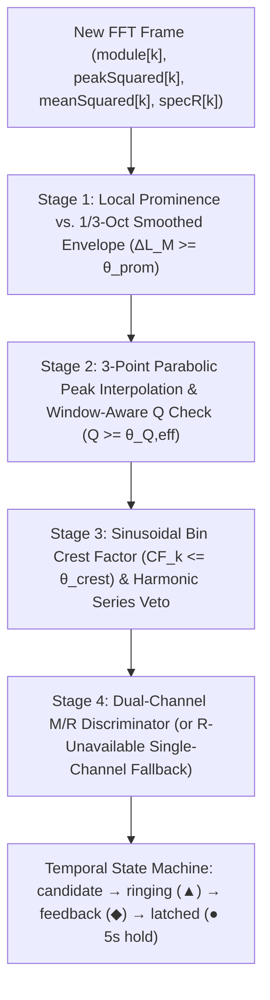

# 07. Real-Time Acoustic Feedback & Ringing Detection Design

> **Status**: Proposed Design Specification  
> **Related Modules**: `src/dsp/feedback-detector.ts` (new), `src/dsp/analyzer-pipeline.ts`, `src/dsp/transfer-function.ts`, `src/dsp/synthetic-rig.ts`, `src/charts/canvas-chart-painter.ts`, `src/ui/inspectors/live-measurement-inspector.ts`

---

## 1. Problem Statement & Acoustic Goals

During soundcheck ("ringing out" stage monitors or FOH) and during a live performance, acoustic feedback occurs when loop gain at a frequency $f_0$ approaches or exceeds $0\text{ dB}$ ($1.0\times$) with $0^\circ \pmod{360^\circ}$ phase shift:
- **Pre-Feedback Ringing ($G_{\text{loop}} \approx -6\text{ to }-1\text{ dB}$)**: High-$Q$ regenerative resonance that colors vocals with a metallic "ring" or overhang after transients.
- **Runaway Feedback / Howling ($G_{\text{loop}} \ge 0\text{ dB}$)**: Sustained or growing narrowband sinusoid that requires immediate fader or EQ intervention.

### 1.1 Why Traditional Single-Channel RTA Peak Finders Fail During a Show
Simple RTA peak detectors flag any frequency bin that rises $X\text{ dB}$ above the average spectrum. During a concert, a lead synth, distorted guitar harmonic, flute, or brass instrument holding a note produces a narrowband spectral peak, causing constant false alarms.

Because `WebSoundMeter` is a **dual-channel ($M / R$) multi-slot analyzer** that already computes **per-bin Peak Hold (`peakSquared`) and Mean Squared (`meanSquared`)**, its feedback detector combines **five physical discriminators**—including a Reference-vs-Measurement ($M/R$) program tone rejector and a Harmonic Series Veto for single-channel fallback—while running simultaneously across up to `8` live measurement slots (`FOH`, `Vocal Wedge L`, `Drum Fill`, etc.).

---

## 2. Multi-Stage Feedback Detection Algorithm (`src/dsp/feedback-detector.ts`)



### 2.1 Stage 1: Local Spectral Prominence ($\Delta L_M$)
To make detection independent of overall program EQ tilt (e.g., heavy subwoofer bass vs. quieter high frequencies), the detector computes a 1/3-octave smoothed background envelope $B_M[k]$ from the narrowband RTA spectrum `module[k]` using the existing $O(1)$ prefix-sum smoother (`smoothMagnitudeOctave(module, bgModule, 3)` in `src/dsp/smoothing.ts`).

A bin $k$ (within $60\text{ Hz} \le f_k \le 16000\text{ Hz}$) is a local maximum and a candidate peak if:
1. $\text{module}[k] > \text{module}[k - 1]$ and $\text{module}[k] \ge \text{module}[k + 1]$
2. Its absolute level exceeds the noise floor gate: $20\log_{10}(\text{module}[k]) \ge L_{\text{gate}}$ (default $-55\text{ dBFS}$)
3. Its **prominence** above the local 1/3-octave neighborhood exceeds $\theta_{\text{prom}}$:
   $$\Delta L_M(k) = 20\log_{10}\!\left(\frac{\text{module}[k]}{B_M[k] + \epsilon}\right) \ge \theta_{\text{prom}}$$

### 2.2 Stage 2: Sub-Bin Parabolic Interpolation & Window-Aware $Q$ Estimation
Using log-magnitudes $\alpha = \ln(\text{module}[k-1])$, $\beta = \ln(\text{module}[k])$, $\gamma = \ln(\text{module}[k+1])$:
- **Sub-bin fractional offset**:
  $$\delta = \frac{1}{2} \frac{\alpha - \gamma}{\alpha - 2\beta + \gamma} \in [-0.5, 0.5], \quad f_0 = (k + \delta)\,\Delta f$$
- **$-3\text{ dB}$ Bandwidth & $Q$ Factor**:
  Walks outward left ($k_L$) and right ($k_R$) from bin $k$ with linear interpolation to find the frequencies $f_L, f_R$ where magnitude drops to $\frac{1}{\sqrt{2}}$ ($-3.01\text{ dB}$) of the peak amplitude:
  $$\Delta f_{-3\text{dB}} = \max(f_R - f_L, \, 0.75\,\Delta f), \quad Q_{\text{est}} = \frac{f_0}{\Delta f_{-3\text{dB}}}$$
- **FFT Window Main-Lobe Compensation at Low Frequencies**:
  At `fftSize = 4096` and $F_s = 48\text{ kHz}$ ($\Delta f = 11.72\text{ Hz}$), the Hann window's own $-3\text{ dB}$ main-lobe width is $1.44\,\Delta f \approx 16.9\text{ Hz}$. Consequently, a pure sinusoid at $150\text{ Hz}$ has a maximum measurable $Q_{\max}(150\text{ Hz}) \approx \frac{150}{16.9} = 8.9$. To prevent low-frequency feedback ($60\text{–}250\text{ Hz}$) from being falsely rejected by the FFT bin width, the effective $Q$ threshold scales with the window's resolving limit at $f_0$:
  $$\theta_{Q,\text{eff}}(f_0) = \min\!\left(\theta_Q, \; \max\!\left(4.0, \; 0.55 \cdot \frac{f_0}{1.44\,\Delta f}\right)\right)$$
  Candidates with $Q_{\text{est}} < \theta_{Q,\text{eff}}(f_0)$ (broad vocal formants or instrument body resonances) are rejected.

### 2.3 Stage 3: Sinusoidal Crest Factor Check ($CF_k$) & Harmonic Series Veto
1. **Rolling Bin Crest Factor ($CF_{\text{frame}}$)**:
   For a pure steady sinusoid (acoustic feedback howl), the bin envelope has nearly constant amplitude across frames (temporal variance $\approx 0$, crest factor $\approx 3.0\text{ dB}$), whereas transient musical content exhibits higher frame-to-frame amplitude modulation:
   $$CF_{\text{frame}}(k) = 10\log_{10}\!\left(\frac{\max_{t \in W} |M_t(k)|^2}{\frac{1}{|W|}\sum_{t \in W} |M_t(k)|^2 + \epsilon}\right)$$
   When $CF_{\text{frame}}(k) \le 4.5\text{ dB}$ over a rolling 6-frame window (`~240 ms`), the peak is confirmed as a steady tone.
2. **Harmonic Series Veto (Overtone / Fundamental Check)**:
   True acoustic feedback oscillates at a single dominant loop frequency $f_0$ (a nearly pure sinusoid unless clipping), whereas sustained musical instruments (bowed violin, organ, flute, synth lead) exhibit a rich harmonic series ($f_0, 2f_0, 3f_0$):
   - Look up the $2\times$ and $3\times$ overtone bins ($k_2 = \text{round}(2 f_0 / \Delta f)$, $k_3 = \text{round}(3 f_0 / \Delta f)$) and the $\frac{1}{2}\times$ subharmonic bin ($k_{1/2} = \text{round}(0.5 f_0 / \Delta f)$).
   - A candidate is flagged `hasHarmonicStructure = true` if either:
     - Both $2f_0$ and $3f_0$ have local prominence $\Delta L_M \ge 6.0\text{ dB}$, **or**
     - The subharmonic $f_0 / 2$ has local prominence $\Delta L_M(k_{1/2}) \ge \Delta L_M(k) - 3.0\text{ dB}$ (meaning $f_0$ is the 2nd harmonic of a musical note at $f_0/2$).
   - When `hasHarmonicStructure` is true and $\Delta L_M(k) < 20.0\text{ dB}$, the peak is suppressed in single-channel mode (or requires explicit Stage 4 $M/R$ confirmation when $R$ is active).

### 2.4 Stage 4: Dual-Channel $M / R$ Discriminator & Single-Channel Fallback
1. **Dual-Channel Mode ($R$ Active, $R_{\text{rms}} > -55\text{ dBFS}$)**:
   - Compute the Reference channel's local prominence at bin $k$:
     $$\Delta L_R(k) = 20\log_{10}\!\left(\frac{|R(k)|}{B_R[k] + \epsilon}\right)$$
   - **Program Tone Rejection**: If $\Delta L_R(k) \ge \Delta L_M(k) - 5.0\text{ dB}$, the tonal peak is already present in the console mix $R$ (e.g., a synthesizer lead or intentional guitar sustain). It is classified as `'program-tone'` and **suppressed**.
   - **Acoustic Feedback Confirmation**: If $\Delta L_M(k) - \Delta L_R(k) \ge 8.0\text{ dB}$, the resonance originates in the acoustic loop between loudspeaker and microphone and is classified as `'acoustic-feedback'`.
2. **Single-Channel Fallback Mode ($R$ Unassigned or $R_{\text{rms}} \le -55\text{ dBFS}$)**:
   - When the engineer is using only a measurement microphone with no console reference feed, Stage 4 automatically engages conservative single-channel guards to prevent false positives from sustained musical notes:
     - **Harmonic Veto Enforced**: Candidates with `hasHarmonicStructure === true` (and prominence $< 20\text{ dB}$) are rejected.
     - **Extended Onset Persistence ($1.5\times$)**: Required `onsetFrames` is multiplied by $1.5\times$ (`4 → 6` frames / `240 ms` for `foh-normal`; `2 → 3` frames / `120 ms` for `monitor-sensitive`).
     - **Level Growth or High Prominence Gate for Critical Alert**: Promotion from `'ringing'` (`▲`) to `'feedback'` (`◆`) in single-channel mode requires either positive level growth ($\ge +1.5\text{ dB}$ over the onset window) or prominence $\ge \theta_{\text{prom,feedback}} + 2.0\text{ dB}$.

---

## 3. Per-Slot Threshold Profiles, Bounds & State Machine

Each Live Measurement slot runs its own `FeedbackDetector` instance with an independent sensitivity profile:

| Profile | Target Use Case | Prominence ($\theta_{\text{prom}}$) | Target Min $Q$ ($\theta_Q$) | Onset Persistence ($R$ Active / $R$ Off) | Ref Tone & Harmonic Rejection |
| :--- | :--- | :---: | :---: | :---: | :---: |
| **`off`** | Disabled for this slot | — | — | — | — |
| **`foh-normal`** (Default in Show Mode) | FOH measurement mic during a live concert | `11.0 dB` (`ringing`) / `14.5 dB` (`feedback`) | `12` | `160 ms` (`4f`) / `240 ms` (`6f`) | Enabled |
| **`monitor-sensitive`** | Stage monitor / wedge ringing-out & vocal mic watch | `8.5 dB` (`ringing`) / `12.0 dB` (`feedback`) | `8` | `80 ms` (`2f`) / `120 ms` (`3f`) | Enabled |
| **`custom`** | User-configured thresholds | `6..24 dB` | `5..40` | `40..500 ms` | Configurable |

### 3.1 Hybrid Frequency Tracking Tolerance & Temporal Lifecycle
To avoid splitting a low-frequency track due to sub-bin jitter while preventing two high-frequency rings from merging, active tracks are matched across frames using a **bounded hybrid frequency window**:
$$\Delta f_{\text{match}}(f_0) = \max\!\left(1.5\,\Delta f, \; \min\!\left(f_0 \cdot (2^{1/24} - 1), \; 120\text{ Hz}\right)\right)$$
- At $100\text{ Hz}$ (`fftSize = 4096`, $\Delta f = 11.7\text{ Hz}$): $\Delta f_{\text{match}} = 1.5\,\Delta f = \pm 17.6\text{ Hz}$ (prevents sub-bin jitter from spawning duplicate tracks).
- At $1\text{ kHz}$: $\Delta f_{\text{match}} = \pm 29.3\text{ Hz}$ ($\pm\frac{1}{24}\text{ octave}$).
- At $10\text{ kHz}$: $\Delta f_{\text{match}}$ is capped at $\pm 120\text{ Hz}$ so distinct high-frequency rings remain separate.

Each track progresses through four states:
1. **`candidate`**: Newly detected peak ($< \text{onsetFrames}$); tracked internally, not yet shown in UI.
2. **`ringing` (`▲` Amber Warning)**: Exceeds ringing prominence & $\theta_{Q,\text{eff}}$ for $\ge \text{onsetFrames}$.
3. **`feedback` (`◆` Red Critical)**: Exceeds feedback prominence + low sinusoidal crest factor (or positive level growth $\ge +4\text{ dB/s}$).
4. **`latched` (`●` 5.0-Second Visual Hold)**: When the engineer pulls down the fader or cuts the EQ band and the peak drops below threshold, the track enters `'latched'` state for `latchDurationMs = 5000`. The callout flag remains visible on the RTA/Magnitude chart (with a decaying opacity bar) so the engineer can read the exact frequency after reacting on the console, and the event is recorded in the **Feedback Ring Log**.

### 3.2 Operational Caps & Worker CPU Budget
- **Per-Slot Track Cap (`MAX_ACTIVE_TRACKS_PER_SLOT = 6`)**: Each slot retains at most `6` simultaneous active/latched tracks, ordered by severity (`feedback` > `ringing` > `latched`) and `prominenceDb`.
- **Chart Callout Cap (`MAX_VISIBLE_CALLOUT_FLAGS = 8`)**: Across all visible slots on a chart, at most `8` callout badges are rendered simultaneously to prevent visual clutter during pathological multi-frequency howl.
- **Ring Log History Cap (`MAX_RING_LOG_ENTRIES = 50`)**: The sidebar **Feedback Ring Log** retains the 50 most recent distinct ring events (deduplicating re-triggers of the same slot + ISO band within 10 seconds by updating peak prominence and timestamp).
- **Worker CPU Performance Budget (`< 1.5 ms` per 40 ms tick)**:
  - `FeedbackDetector` pre-allocates its `Float32Array` background envelope buffer (`bgModule`, `bgRef`) per FFT size—zero heap allocations in the hot loop.
  - Stage 1 is a single linear pass over bins $k \in [k_{60\text{Hz}}, k_{16\text{kHz}}]$; Stages 2–4 run only on local maxima that pass $\theta_{\text{prom}}$ (typically `0–8` candidates per slot). Total execution time across `4` active slots at `fftSize = 8192` is budgeted at **`< 1.5 ms`** per `40 ms` worker cycle.

---

## 4. Acoustic Utility Mappers: ISO 31-Band GEQ & Musical Pitch

Every detected feedback event automatically resolves two actionable reference values for live sound engineers:

1. **Nearest 31-Band ISO 1/3-Octave Graphic EQ Center Frequency**:
   - Standard ISO 266 center frequencies:
     `20, 25, 31.5, 40, 50, 63, 80, 100, 125, 160, 200, 250, 315, 400, 500, 630, 800, 1000, 1250, 1600, 2000, 2500, 3150, 4000, 5000, 6300, 8000, 10000, 12500, 16000, 20000` Hz.
   - Mapped via minimum $|\log_2(f_0 / f_{\text{ISO}})|$ so a console operator using a 31-band GEQ immediately sees which fader to reach for (e.g., `2,482 Hz → ISO 2.5 kHz`).
2. **Musical Pitch & Cents Deviation (`A4 = 440 Hz`)**:
   - $\text{midi} = \text{round}(69 + 12\log_2(f_0 / 440))$
   - Helps distinguish a musical key center (e.g., bass guitar holding `E1 = 41.2 Hz` or `A2 = 110.0 Hz`) from an off-pitch acoustic cavity resonance.

### 4.1 TypeScript Data Model (`src/dsp/feedback-detector.ts`)

```ts
export type FeedbackSensitivityMode =
  | 'off'
  | 'foh-normal'
  | 'monitor-sensitive'
  | 'custom';

export type FeedbackTrackState = 'ringing' | 'feedback' | 'latched';

export interface DetectedFeedbackTrack {
  readonly id: string;
  readonly slotId: string;
  readonly slotName: string;
  readonly slotColor: string;
  readonly state: FeedbackTrackState;
  readonly frequencyHz: number;
  readonly isoBandHz: number;
  readonly isoBandLabel: string;     // e.g. "2.5 kHz"
  readonly musicalNote: string;      // e.g. "D#7 (-8c)"
  readonly prominenceDb: number;     // Peak height above 1/3-oct neighborhood
  readonly peakLevelDb: number;      // Absolute dBFS / dB SPL
  readonly estimatedQ: number;       // Estimated resonator Q (e.g. 18.5)
  readonly durationMs: number;       // How long the ring persisted
  readonly firstDetectedAt: string;  // Wall-clock HH:MM:SS
  readonly latchRemainingRatio: number; // 1.0 while active, decays 1.0 -> 0.0 over 5s latch
}
```

---

## 5. UI, Accessibility & Virtual EQ Integration

### 5.1 RTA & Magnitude Chart Callout Flags (`src/charts/canvas-chart-painter.ts`)
When `rta` or `magnitude` plots are rendered, `drawFeedbackCalloutFlags()` draws markers for up to `MAX_VISIBLE_CALLOUT_FLAGS = 8` active and latched tracks across visible Live Measurement sources:
- **Accessible Shape + Color Severity Coding**:
  - `◆` **Critical Feedback (`feedback`)**: Solid `#ef4444` vertical line (`1.5px`) + diamond icon prefix.
  - `▲` **Pre-Feedback Ringing (`ringing`)**: Dashed `#f59e0b` vertical line (`[5, 3]`) + triangle icon prefix.
  - `●` **Latched Hold (`latched`)**: Dotted slate vertical line (`[2, 3]`) + decaying opacity bar + circle icon prefix.
- **Top Callout Badge**: Collision-avoiding pill at the top of the plot area showing:
  - Line 1: **`◆ 2.48 kHz (ISO 2.5k)`** + source color dot + short slot name (`Wedge L`)
  - Line 2: **`+15.8 dB • Q≈19 • D#7`**

### 5.2 Feedback Ring Log & Severity-Scaled `[Notch EQ]` Action
In the **Live Show Sidebar** (and as a collapsible section in the **Live Measurement Inspector**), the **Feedback Ring Log** lists recent detected rings across all active slots:
- Each row displays: `Severity Icon (◆/▲/●)` | `Frequency (Hz)` | `ISO 1/3-Oct Band` | `Musical Note` | `Prominence & Q` | `Mic Name` | **`[Notch EQ]`** (minimum `36–44 px` touch target).
- **Clicking `[Notch EQ]` on a ring**:
  1. Finds the active `EqualizerSourceConfig` targeting that measurement slot (or creates a new `Virtual EQ` targeting that slot if none exists).
  2. **First Click (Initial Conservative Cut)**: Selects an unused peaking band (or a band already within $\pm 2\%$ of `track.frequencyHz`) and sets:
     - `type: 'peaking'`
     - `frequency: Math.round(track.frequencyHz)`
     - `q: Math.min(24, Math.max(8, Math.round(track.estimatedQ)))`
     - **Severity-Scaled Gain**:
       - For `'ringing'` (`▲`): `gainDb = Math.max(-9, Math.min(-3, -Math.round(track.prominenceDb * 0.5)))` (gentle `-3` to `-9 dB` cut to tame ringing without hollowing out the PA).
       - For `'feedback'` (`◆`): `gainDb = Math.max(-15, Math.min(-6, -Math.round(track.prominenceDb * 0.75)))` (deeper `-6` to `-15 dB` surgical notch to stop runaway howl).
     - `enabled: true`
  3. **Repeated Click (Deepen Notch by `-3 dB`)**: If a band on that slot's Virtual EQ is already active within $\pm 2\%$ of `track.frequencyHz`, clicking `[Notch EQ]` again deepens that band's cut by an additional `-3.0 dB` (clamped at `-18.0 dB`).
  4. Immediately updates the Virtual EQ curve on the Magnitude chart so the engineer can see the exact notch filter shape and copy the parameters (`Hz`, `Q`, `dB`) to their console channel/bus PEQ.

---

## 6. Deterministic Testing via `SyntheticAcousticRig` (`src/dsp/synthetic-rig.ts`)

To make `FeedbackDetector` 100% deterministically testable in Vitest unit/integration tests and Playwright E2E tests without physical microphones or loudspeakers:
- Extend `SimulatorRigConfig` in `src/dsp/synthetic-rig.ts` with an optional `simulatedFeedbackRings?: Array<{ frequencyHz: number; q: number; gainDb: number; injectIntoReference?: boolean; includeHarmonics?: boolean }>`:
  - **`injectIntoReference: false` (Acoustic Feedback)**: A high-$Q$ biquad resonator (`q = 25`, `gainDb = +18 dB`) or phase-locked sinusoid is applied **only** in the simulated acoustic path ($M$), modeling true acoustic feedback and triggering `FeedbackDetector` (`'acoustic-feedback'`).
  - **`injectIntoReference: true` (Program Lead Tone in $R$ and $M$)**: The tone is injected into the generator/reference feed ($R$) before the split to $M$, verifying that Stage 4 ($M/R$ discriminator) suppresses false alarms.
  - **`includeHarmonics: true` (Single-Channel Musical Instrument Fallback)**: Injects $f_0$, $2f_0$, and $3f_0$ with Reference channel disabled ($R = 0$), verifying that the Stage 3 Harmonic Series Veto rejects musical instruments even when no Reference channel is connected.
