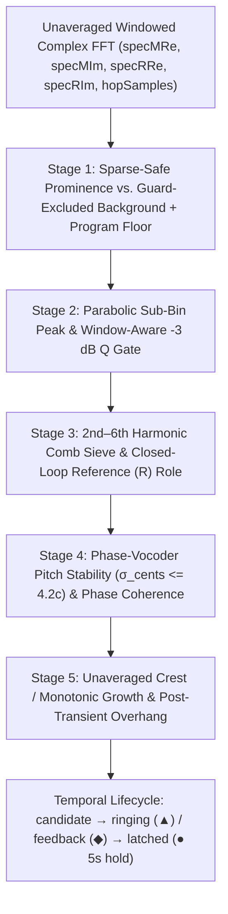

# 06. Real-Time Acoustic Feedback, Ringing & Multi-Channel Culprit Attribution Design

> **Related Modules**: `src/dsp/feedback-phase-tracker.ts`, `src/dsp/feedback-discriminators.ts`, `src/dsp/feedback-detector.ts`, `src/dsp/mixer-watch-scanner.ts`, `src/dsp/feedback-culprit-resolver.ts`, `src/sources/mixer-patch-storage.ts`, `src/ui/mixer-watch-modal.ts`

---

## 1. Problem Statement & Acoustic Goals

Acoustic feedback occurs when closed-loop gain around an open microphone, mixer, and loudspeaker approaches or exceeds $0\text{ dB}$ ($1.0\times$) with $0^\circ \pmod{360^\circ}$ phase shift:
- **Pre-Feedback Ringing ($G_{\text{loop}} \approx -6\text{ to }-1\text{ dB}$)**: High-`Q` regenerative resonance creating a metallic overhang that persists after vocal syllables or stage transients drop.
- **Runaway Feedback / Howling ($G_{\text{loop}} \ge 0\text{ dB}$)**: Phase-locked, steady or exponentially growing narrowband oscillation requiring immediate fader or EQ action.

### 1.1 Two Operational Workflows
`WebSoundMeter` supports two complementary workflows across both **`🛠 Tuning`** and **`🎚 Show`** modes:
1. **Single-Mic Mode (FOH or Stage Measurement Mic Only):** Zero console patching required. Separates true Barkhausen loop oscillation from live vocals, speech, synths, and guitars using unaveraged complex FFT spectra, phase-vocoder pitch stability, sparse-safe prominence, a 2nd–6th harmonic comb sieve, and post-transient overhang tracking.
2. **Multi-Channel Mixer Input Watch (Up to 32 USB Channels, Same or Separate Device):** Scans individual console USB direct outs (on either the primary audio interface or a dedicated secondary USB console interface running on its own hardware clock), deduplicates acoustic bleed across open stage mics, and pinpoints the **#1 Culprit Input** (`Stage Vox 2 · Ch 2 (86%)`) with per-culprit **`Notch — <Channel>`** Virtual EQ strip cheat-sheets.

---

## 2. Single-Channel Phase-Coherent Feedback Pipeline

### 2.1 Unaveraged STFT Tap (Decoupled from Chart FIFO Averaging)
`MeasurementPipeline` feeds `FeedbackDetector` directly from each frame's raw windowed complex spectrum (`specMRe`, `specMIm`) and exact `hopSamples` count rather than the `16`-frame FIFO-averaged `tf.module`. Short vocal syllables never linger in a display FIFO to fake persistence, and frame-to-frame amplitude variance reflects true instantaneous envelope dynamics.

### 2.2 Sparse-Safe Local Prominence (`computeGuardExcludedBackground`)
 around bin $k$, the detector excludes the main lobe (`k ± guardRadius`) over a $\pm\frac{1}{4}$-octave neighborhood and floors that background against **guard-excluded broadband program RMS (`80 Hz – 8 kHz`)** (`0.42 × otherProgramRms`):
- During quiet speech or solo instruments where empty bins between harmonics drop to room silence, the broadband program floor prevents upper vocal formants from receiving artificial `+25 dB` prominence.
- During a pure feedback howl in a silent room, subtracting the peak's own guard power leaves `otherProgramRms` at the noise floor, preserving `+30 dB+` prominence.

### 2.3 Full Harmonic Comb Sieve (`detectHarmonicStructure`)
Tests whether candidate $f_0$ belongs to a musical harmonic series:
1. **Overtone Check (`2f0, 3f0, 4f0`):** Vetoes fundamentals with either $\ge 2$ active overtones ($\ge 5.5\text{ dB}$ prominence within `-16 dB` of the peak) or a strong $2\text{nd}$ harmonic alone (flutes, whistles, vowels), while ignoring weak `-24 dB` clipping harmonics on runaway feedback.
2. **Subharmonic Grid Check ($f_0 / n$ for $n \in \{2, 3, 4, 5, 6\}$):** Catches 3rd–6th vocal formant harmonics (e.g., `1,100 Hz` 5th harmonic of a `220 Hz` sung vowel) whenever $f_0 / n$ and at least one sibling partial $m \cdot (f_0 / n)$ sit on the harmonic grid.

### 2.4 Phase-Vocoder Frequency Stability (`SpectrumPhaseHistory`)
Using the parabolic sub-bin estimate $\delta_{\text{parab}}$ to predict expected phase advance across arbitrary `hopSamples` $\Delta n$:
$$\varepsilon_\phi = \operatorname{wrap}_{[-\pi, \pi]}\!\left(\phi_t[k] - \phi_{t-1}[k] - \frac{2\pi (k + \delta_{\text{parab}})\Delta n}{N}\right), \quad f_{\text{inst}} = \left(k + \delta_{\text{parab}} + \operatorname{clamp}\!\left(\frac{N \varepsilon_\phi}{2\pi \Delta n}\right)\right)\Delta f$$
- **Phase Coherence** ($\overline{\cos \varepsilon_\phi} \ge 0.72$ in `foh-normal`) rejects sibilants, cymbals, and narrowband noise.
- **Rolling Pitch Jitter** ($\sigma_{\text{cents}} \le 4.2\text{ cents}$ in `foh-normal`, $\le 6.5\text{ cents}$ in `monitor-sensitive`) rejects human vocal vibrato (`±20–40 cents`) and guitar bends while locking onto standing-wave feedback loops.

### 2.5 Closed-Loop Reference (`R`) Roles (`FeedbackReferenceMode`)
Because PA feedback travels in a **closed loop** through the console (`Stage Mic → Console Mix R → PA → Room Mic M`), real PA howl appears in **both** `M` and `R`:
- **`'closed-loop-mix'` (Default):** Never suppresses a feedback alert because `R` contains it. Instead tags rings as **`'in-mix'`** (present in both `M` and `R` → main PA loop) vs. **`'stage-only'`** (present in `M` while `R` is clean → stage monitor wedge loop).
- **`'playback-veto'`:** Suppresses peaks present in `R` when `R` is fed strictly from non-acoustic playback stems, synths, or backing tracks.
- **`'ignore'`:** Ignores `R` completely in single-mic feedback detection.

---

## 3. Multi-Channel Mixer Input Watch & Culprit Attribution

### 3.1 Dual-Device Capture & Named Patch Presets
- **Primary or Separate USB Mixer Interface:** `AudioEngine` can tap up to `40` channels from the primary `HardwareAudioRouter` (`deviceMode = 'follow-main'`) **or** open an independent input-only `secondaryMixerRouter` (`33` taps at native `mixerSampleRate`, `deviceMode = 'separate-device'`). All console inputs + Mix Bus share the console's own crystal clock, while `FeedbackCulpritResolver` merges FOH mic rings and console rings in calibrated `Hz` (`±1/24 oct`).
- **Named Patch Profiles (`src/sources/mixer-patch-storage.ts`):** Stored in `'web-sound-meter:mixer-patches:v1'`, pairing manual preset switching (`Save Preset`, `Update`, `Delete`) with automatic hardware affinity keyed by both `deviceId` and normalized `deviceLabel`.

### 3.2 `MixerInputWatchScanner` & Pre-Fader Muted-Mic Guard
- Pairs up to `32` enabled mixer channels through `Radix2FFT.transformDualReal(4096, 'hann')` (`<= 16` FFTs per `40 ms` tick, zero heap allocations).
- **Causal Electrical Coupling (`busCouplingScore`):** In `pre-fader` mode with an active Mix Bus, evaluates normalized time-domain cross-correlation across causal internal mixer lags (`0..1.5 ms`) during non-tonal broadband frames (freezing updates whenever a narrowband candidate tone is present). Open routed mics converge toward `1.0`, whereas muted spare mics picking up loudspeaker bleed (`>= 4–6 ms` air delay) decay toward `0.02` and are down-weighted during culprit ranking.

### 3.3 Cross-Channel Merge & Per-Culprit `[Notch EQ]`
- `resolveFeedbackEvents()` clusters simultaneous same-frequency detections across all watched inputs, ranks weights via Post-Fader in-phase bus projection ($\operatorname{Re}(\langle R^* Y_i\rangle)/\langle|R|^2\rangle$) or Pre-Fader `prominence × amplitude × onsetBonus × busCouplingScore`, enriches matching Measurement Slot tracks in-place, and emits deduplicated `mixerOnlyTracks` for early stage rings.
- Clicking **`[Notch EQ]`** on a culprit-attributed alert creates or deepens an isolated Virtual EQ source (`Notch — Stage Vox 2 (Ch 2)`, keyed by `EqualizerSourceConfig.culpritKey`) so each console channel accumulates its own copyable `Hz / Q / dB` strip cuts.
