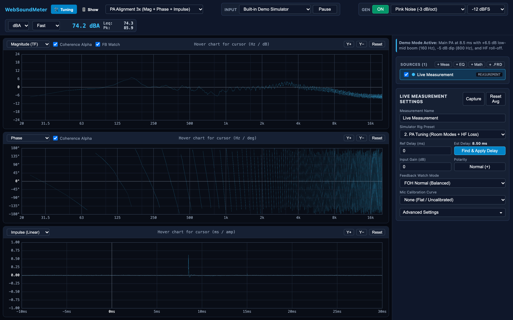
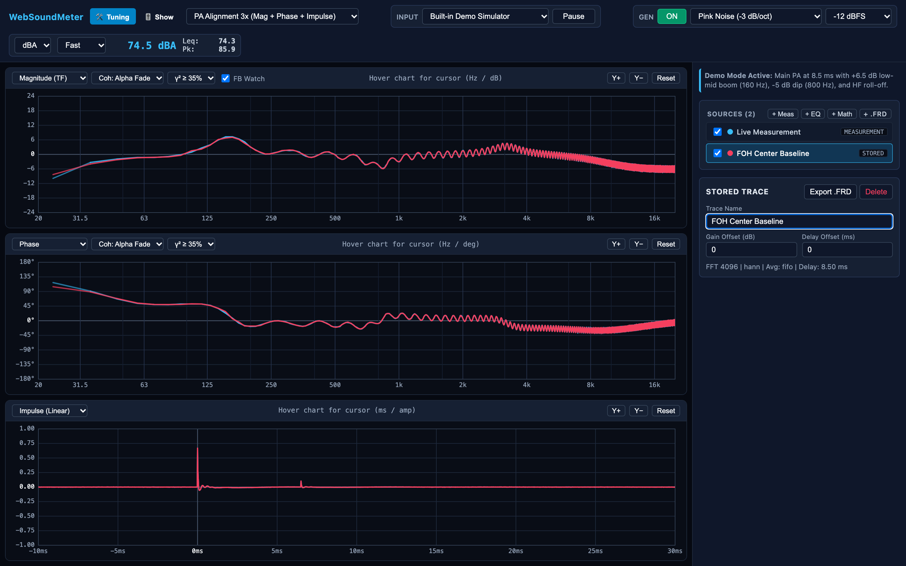
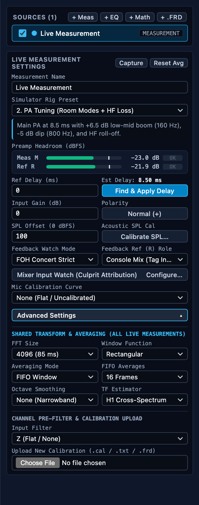
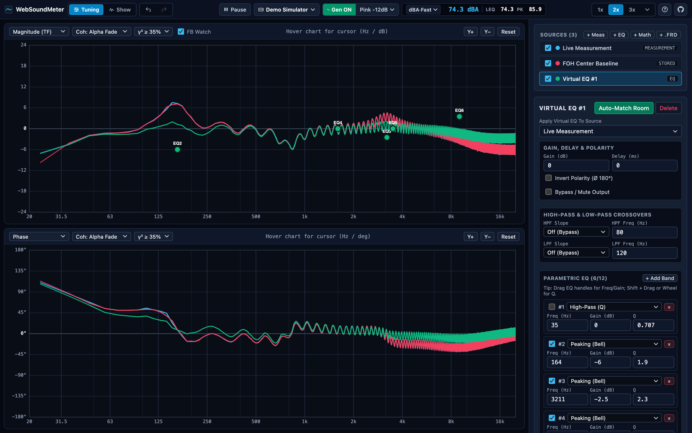
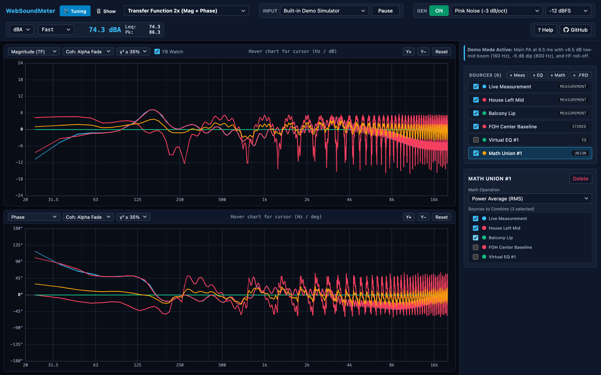

# WebSoundMeter — UI & Measurement Reference

**WebSoundMeter** is a browser-native multi-channel dual-FFT acoustic analyzer, virtual crossover/EQ modeler, and concert SPL compliance & feedback monitor. It runs offline as an installable Progressive Web App (PWA) or locally via `npm run dev:wsm` (`http://localhost:5173`).

> **Looking for step-by-step field workflows?** See the **[FOH Tutorial Series (`docs/tutorials/`)](../../../docs/tutorials/README.md)** for physical cabling diagrams, preamp gain staging, PA time alignment, Predict-to-Measure verification, Show SPL compliance, and troubleshooting.

---

## 1. Workspace Modes & Persistence

The segmented switch at the top left toggles between two operational modes:

| Mode | Purpose | Active Panels & Safety Rules |
| :--- | :--- | :--- |
| **`Tuning`** | Pre-show PA alignment, spatial averaging, and offline EQ/crossover design | Displays all source types (**Live Measurements**, **Stored Traces**, **Virtual EQ**, **Math Union**), **Signal Generator**, and per-source property inspectors. |
| **`Show`** | Concert sound-level compliance and narrowband feedback monitoring | Hides `Stored` and `Math Union` traces from charts (preserving their saved visibility flags for Tuning mode), switches the right dock to **Live Mics & SPL Watch**, **Feedback Ring Log**, and **Show Limits & Log**, and **forcibly mutes and hides the Signal Generator** whenever a hardware audio interface is active. |

### URL State, Autosave & Offline Desktop PWA
- **URL Sharing & History:** Mode, layout preset, active chart plot types, simulator preset, SPL weighting/time constants, and selected source sync to URL query parameters (`?mode=...&layout=...&plots=...`) with full Browser Back/Forward support.
- **Session Recovery:** Routing, live measurement slots, generator configuration, and SPL alert thresholds autosave to `localStorage`. Captured/imported traces, Virtual EQs, Math Unions, calibration curves, and rolling `1 Hz` SPL compliance checkpoints persist in `IndexedDB`.
- **Window Controls Overlay (Installed PWA):** When installed as a standalone desktop PWA, the locked `40 px` studio bar merges directly into the native OS window titlebar (`window-controls-overlay`) with draggable grip regions and container-aware compaction.
- **Hardware Reload Safety:** Reloading the page while **Hardware** input mode is active starts **Paused** (`Resume` button shown) so the browser receives a clean user gesture before opening `AudioContext` and microphone streams.

---

## 2. Top Control Bar Reference

### Chart Layout Presets (`1x` / `2x` / `3x` + `▾`)
Each mode maintains its own active chart stack (`1` to `3` panels), selectable via 1-click `1x`/`2x`/`3x` buttons or the `▾` preset popover:
- **Tuning Layouts:** `PA Alignment 3x (Mag + Phase + Impulse)`, `Transfer Function 2x (Mag + Phase)`, `Live Mixing 2x (RTA + Magnitude)`, `Single Chart 1x`.
- **Show Layouts:** `Live Show 2x (RTA + SPL History)`, `Live Show 3x (RTA + Mag + SPL History)`, `Single Chart 1x`.

### Input, Reference & Hardware Channel Limit (`Audio Input & Reference ▾`)
- **Input Selector:** Clicking the audio interface pill opens the **Audio Input & Reference** popover to switch between **`Built-in Demo Simulator`** and any detected multi-channel **`Hardware`** audio interface (`getUserMedia` with echo cancellation, noise suppression, and auto-gain disabled at the device's native sample rate).
- **Hardware Generator Auto-Mute:** Switching from `Built-in Demo Simulator` to any physical hardware device automatically sets **`Gen`** to **`OFF`** so pink noise never fires unexpectedly into an unmuted PA.
- **Global Reference Channel (`Ref`):** Shown in Hardware mode. Selects **`Internal Signal Generator`** (internal digital reference) or any physical input **`In Ch 1..N`** (physical analog/digital loopback or console mix feed) as the dual-FFT reference for transfer-function magnitude, phase, coherence, impulse deconvolution, and delay estimation.
- **Concurrent Tap Capacity:** The real-time `AudioWorklet` ring buffer taps up to **`8` distinct physical hardware input channels** simultaneously—supporting up to **`7` live measurement microphones + `1` physical reference loopback channel** (or `8` microphones when `Ref` is set to `Internal Signal Generator`).
- **`Pause` / `Resume` (`Space`):** Freezes live capture, spectrum integration, and hardware generator output simultaneously.

### Signal Generator (`Gen` Split-Pill)
- **`Gen` / `Gen ON` Toggle:** 1-click button enables or mutes the internal test signal; the adjacent `▾` chevron opens waveform, level, and output routing controls.
- **Signal Types:**
  - `Pink Noise (-3 dB/oct)` — Equal energy per octave for broadband transfer function and RTA work.
  - `White Noise (Flat)` — Equal energy per Hz.
  - `Brown Noise (-6 dB/oct)` — Low-frequency weighted spectrum.
  - `Burst Pink (Crest/Sub)` — Periodic pulsed pink noise.
  - `Sine Wave (1 kHz)` — Fixed `1,000 Hz` reference tone for level checks.
  - `Log Chirp Sweep` — `2`-second logarithmic `20 Hz – 20 kHz` sweep.
- **Output Level:** `0 dBFS (Hot)`, `-3`, `-6`, `-12` (default), `-18`, or `-24 dBFS`.
- **Hardware Output Routing (`Out`):** Routes generator audio to **`Out Ch 1+2`**, an individual physical output **`Out Ch 1..N`**, or **`Mute Out`**.

### Broadband SPL Meter (`IEC 61672`) & Acoustic Calibration
- **Weighting Curve:** **`dBA`**, **`dBC`**, or **`dBZ`** (flat unweighted).
- **Integration Time:** **`Fast`** (`125 ms`), **`Slow`** (`1,000 ms`), **`Impulse`** (`35 ms` rise / `1,500 ms` fall), or **`Leq`** (continuous energy-equivalent level since last reset).
- **Per-Mic `Input Gain` vs. `SPL Offset / Calibrate…`:**
  - **`Input Gain (dB)` (`gainDb`, default `0 dB`):** Digital channel trim applied before the FFT—shifts **both** Transfer Function / RTA `dBFS` traces and SPL readouts (useful when level-matching `M` to `R` on a Transfer Function plot).
  - **`SPL Offset` (`0 dBFS = X dB SPL`, default `100 dB`) & `Cal…` / `Calibrate SPL…`:** Acoustic calibration offset applied strictly to SPL / Leq / Peak meters and Show History without moving `0 dB` on Transfer Function or RTA `dBFS` traces. Click **`Cal…`** (in Show mode mic cards) or **`Calibrate SPL…`** (in Tuning's Live Measurement inspector) to match a `94 dB` / `114 dB` pistonphone calibrator or side-by-side reference SPL meter in one click.
- **Readouts:**
  - In **Tuning** mode: main weighted SPL plus **`Leq`** and **`Pk`** (true peak).
  - In **Show** mode: main SPL plus **`LAeq1m`**, **`LAeq15m / Limit`**, **`LC−LA`** (`1`-minute C-minus-A low-end balance), **`Pk`**, and a colorblind-safe compliance badge (**`● OK`**, **`▲ WARN`**, or **`◆ LIMIT`**).

---

## 3. Chart Panels & Plot Types

Every chart panel header stays locked to a single `32 px` row; hovering inside any plot displays exact domain coordinates (`Hz`, period `ms`, wavelength `m`, `dB`, phase `°`, coherence `%`) inside a floating canvas HUD pill. All panels include **`Y+`**, **`Y−`**, and **`Reset`** vertical zoom controls.

| Plot Type | Domain & Scale | Header Controls & Behavior |
| :--- | :--- | :--- |
| **`Magnitude (TF)`** | `20 Hz – 20 kHz` (log), `dB` | Relative transfer-function gain (`\|H(f)\|`). Supports coherence blanking (`Coh: Alpha Fade`, `Coh: Hard Cutoff`, `Coh: Off`), threshold (`γ² ≥ 20%..95%`), **`FB Watch`** callouts, and interactive **Virtual EQ** handles. |
| **`Phase`** | `20 Hz – 20 kHz` (log), `-180° .. +180°` | Wrapped transfer-function phase with clean wrap-break suppression and coherence blanking (`Alpha Fade` / `Hard Cutoff` / `Off`). |
| **`Group Delay`** | `20 Hz – 20 kHz` (log), `ms` | Rate of phase change ($-\frac{1}{2\pi}\frac{d\phi}{df}$) with coherence blanking. |
| **`Coherence`** | `20 Hz – 20 kHz` (log), `0% .. 100%` | Magnitude-squared coherence `γ²(f)` measuring causal linearity between Reference and Measurement. |
| **`Impulse (Linear)`** | `-10 ms .. +30 ms`, normalized amplitude | Regularized inverse-FFT impulse response showing arrival timing and polarity (`+` upward vs. `-` downward spike). |
| **`Impulse (ETC dB)`** | `-10 ms .. +30 ms`, `-60 .. 0 dB` | Logarithmic Energy-Time Curve ($20 \log_{10} \lvert h(t) \rvert$) revealing early boundary reflections `-10` to `-40 dB` below the direct arrival. |
| **`Step Response`** | `-10 ms .. +30 ms`, cumulative amplitude | Running integral of the impulse response showing low-frequency decay and driver polarity transitions. |
| **`Spectrum (RTA)`** | `20 Hz – 20 kHz` (log), `dBFS` | Live spectrum selectable between **`1/3 Oct Bars`**, **`1/6 Oct Bars`**, **`1/12 Oct Bars`**, or **`Narrowband Line`**, with **`Peak Hold`** and **`FB Watch`** toggles. |
| **`SPL / Leq History`** | `-1m .. 0s` up to `-4h .. 0s`, `dB` | Rolling level timeline across **`1 min`**, **`5 min`** (`4 Hz` resolution), **`15 min`**, **`60 min`**, or **`4 hours`** (`1 Hz` resolution), with trace modes (`Compliance (LAeq15m + LAeq1m + Pk)`, `dBA (Fast + LAeq1m)`, `dBA vs dBC (Leq1m)`, `Multi-Mic (LAeq1m per Mic)`) and **`Limits`** guide toggle. |

---

## 4. Sources & Inspectors (`🛠 Tuning` Mode)

The **Sources (N)** card lists all active sources with visibility checkboxes, color dots, type badges (`MEASUREMENT`, `STORED`, `EQ`, `UNION`), and creation buttons (**`+ Meas`**, **`+ EQ`**, **`+ Math`**, **`+ .FRD`**).

### Live Measurement Inspector

- **`Capture` (`C`) / `Reset Avg` (`R`) / `Delete`:** Snapshots the current live curve into a persistent **Stored Trace**, clears FFT/meter accumulators, or deletes secondary measurement slots.
- **Measurement Name & Routing:** Editable label plus **`Simulator Rig Preset`** (`6` built-in acoustic models in Demo mode) or **`Meas Channel (M)`** (`Ch 1..N` in Hardware mode).
- **Preamp Headroom (`dBFS`):** Live pre-gain RMS/Peak bars and **`OK` / `CLIP`** (`≥ -0.5 dBFS`) indicators for both **`Meas M`** and **`Ref R`**, independent of software `Input Gain (dB)`.
- **Delay Alignment (`Ref Delay (ms)` & `Find & Apply Delay`):** Displays deconvolved **`Est Delay`** in `ms` (with **`(−POL)`** badge when acoustic polarity is inverted). Clicking **`Find & Apply Delay`** (`D`) locks `Ref Delay` to unwrap phase and center the impulse peak at `0.0 ms`.
- **`Input Gain (dB)` & `Polarity`:** Applies software trim and polarity flip (`Normal (+)` / `Inverted (−180°)`). Note: adjusting `Input Gain (dB)` shifts **both** broadband SPL readouts and transfer-function Magnitude (`dB`), so set SPL calibration gain before capturing baseline TF traces.
- **`Feedback Watch Mode`:** `FOH Normal (Balanced)`, `Monitor / Wedge Sensitive`, `Custom Thresholds`, or `Off`.
- **`Mic Calibration Curve`:** Selects a saved `.cal` / `.txt` / `.frd` capsule correction curve. Calibration curves correct frequency-domain **Transfer Function** and **RTA** traces; broadband `IEC 61672` SPL meters measure raw time-domain pressure directly from `Input Gain` calibration.

#### Advanced Measurement Settings

Transform and smoothing settings are synchronized across all live slots so multi-mic `Math Union` combinations always share aligned frequency bins:

| Control | Options | Practical Guidance |
| :--- | :--- | :--- |
| **`Reference Override`** | `Follow Global Ref`, `Internal Generator Loopback`, `In Ch 1..N` | Overrides the topbar Global Reference for a specific slot (e.g., comparing sub processor drive vs. main matrix). |
| **`Input Filter`** | `None (Flat / Z)`, `A-Weighting`, `C-Weighting`, `1 kHz Notch` | Pre-filters FFT capture (`1 kHz Notch` aids THD+N residual inspection; never double-weights broadband SPL). |
| **`FFT Size`** | `1024`, `2048`, `4096` (default), `8192`, `16384`, `32768` | Larger FFTs give finer low-frequency bin spacing ($\Delta f = f_s / N$) at the cost of longer time windows (`4096 @ 48 kHz` $\approx 85\text{ ms}$, `11.7 Hz` bins). |
| **`Window Function`** | `Hann` (default), `Blackman-Harris`, `Flattop`, `Hamming`, `Rectangular` | `Hann` balances sidelobe leakage and frequency resolution; `Flattop` maximizes single-tone amplitude accuracy; `Blackman-Harris` minimizes spectral leakage. |
| **`Averaging Mode`** | `FIFO Window` (`4..64` frames), `LPF / Exponential` (`0.2..5 Hz`), `Off` | `FIFO` averages a fixed sliding window of recent frames; `LPF` applies smooth exponential decay. |
| **`Octave Smoothing`** | `None`, `1/48`, `1/24`, `1/12` (default), `1/6`, `1/3`, `1 Octave` | Smooths visual comb ripple across fractional octaves in both Magnitude and complex Phase. |
| **`TF Estimator`** | `H1 Cross-Spectrum` (default), `\|M\| / \|R\| Ratio` | `H1` ($G_{RM}/G_{RR}$) rejects uncorrelated crowd/room noise on the mic; `Ratio` divides magnitudes directly. |
| **`Upload Calibration`** | `.cal`, `.txt`, `.frd` | Parses 2- or 3-column calibration files and stores them in `IndexedDB` for reuse across sessions. |

### Stored Trace Inspector
- Displays capture timestamp and notes, editable **`Trace Name`**, **`Gain Offset (dB)`**, and **`Delay Offset (ms)`**, plus **`Export .FRD`** and **`Delete`**.
- Importing an external `.FRD` file (`+ .FRD`) whose `200 Hz – 2 kHz` passband mean exceeds `35 dB` (such as an absolute `~105 dB SPL` prediction from `WebSpeakerSim`) automatically subtracts that passband mean so the target curve overlays cleanly at `0 dB` relative gain.
- *(Note: Stored Traces intentionally omit a direct Polarity toggle; attach a **Virtual EQ** source to preview polarity inversion `Ø` or crossover filters on a stored trace.)*

### Virtual Equalizer Inspector (`+ EQ`)

- **`Apply Virtual EQ To Source`:** Targets any live measurement or stored trace, or `None (Show Filter Curve Only)`.
- **`Auto-Match Room`:** Analyzes the target trace's `1/3`-octave coherence-weighted response relative to the `250 Hz – 3 kHz` vocal band, synthesizing subtractive peaking cuts for broad resonances (`45 Hz – 7.5 kHz`) plus gentle high-shelf compensation while ignoring narrow acoustic comb dips.
- **Output Trim, Delay & Polarity:** Gain (`dB`), Electronic Delay (`ms`, negative or positive), Polarity (`Ø`), and Bypass/Mute.
- **High-Pass & Low-Pass Crossovers:** `Butterworth` (`12`, `18`, `24`, `48 dB/oct`) and `Linkwitz-Riley` (`12`, `24`, `48 dB/oct`) topologies.
- **Parametric EQ (`1` to `12` bands):** `Peaking`, `Low Shelf`, `High Shelf`, `Notch`, and `All-Pass` sections evaluated at `192 kHz` reference sample rate (zero Nyquist cramping near `20 kHz`).
- **On-Chart Handle Gestures:** Drag any numbered **`EQ1..EQn`** handle horizontally for **Frequency**, vertically for **Gain (`dB`)**, or hold **`Shift` while dragging vertically or scrolling the mouse wheel** to narrow or widen **`Q`** (`0.25` to `36`).

### Math / Union Inspector (`+ Math`)

| Math Operation | Input Selection UI | Acoustic Use Case |
| :--- | :--- | :--- |
| **`Vector Average`** | Multi-source checkboxes (`2..N`) | Complex phase-aware average for closely spaced mics or coherent low-frequency zones. |
| **`Power Average (RMS)`** | Multi-source checkboxes (`2..N`) | Phase-blind energy average ($10\log_{10}(\frac{1}{N}\sum 10^{L_i/10})$) across wide audience seating for room EQ. |
| **`Vector Sum (A + B)`** | Multi-source checkboxes (`2..N`) | Predicts combined acoustic summation of separately measured Sub + Top + Fill passes. |
| **`Minimum Envelope`** / **`Maximum Envelope`** | Multi-source checkboxes (`2..N`) | Per-bin minimum or maximum magnitude envelope across multiple seat captures. |
| **`Vector Subtract (A - B)`** | `Source A` & `Source B` dropdowns | Complex phasor difference (`A − B`). |
| **`dB Difference (A / B)`** | `Source A` & `Source B` dropdowns | Magnitude ratio in dB ($L_A - L_B$) and phase difference ($\phi_A - \phi_B$) for Predict-to-Measure verification. |
| **`Apply Filter (A × B)`** | `Source A` & `Source B` dropdowns | Multiplies transfer functions ($A \cdot B$, summing dB and phase). |

---

## 5. Show Mode Compliance & Feedback Reference (`🎚 Show`)

### Live Mics & SPL Watch Card
- **`+ Mic`:** Adds concurrent show monitoring microphones (`LAeq15` and `LAF` badges shown per row), with per-slot hardware channel/reference routing and **`FB Watch`** mode (`FOH Normal`, `Monitor / Wedge Sensitive`, `Custom`, `Off`).

### Feedback Ring Log & Callout Flags
- **RTA Callout Flags:** Active rings display center frequency and nearest **ISO 31-band GEQ** center (e.g., `◆ 2.48 kHz (ISO 2.5 kHz)` on line 1; prominence `+dB`, estimated `Q`, musical pitch `D#7`, and mic name on line 2).
- **Feedback Ring Log Card:** Lists latched and active rings with severity badges (`◆` critical runaway feedback, `▲` persistent ring, `●` held history), exact musical pitch + cents offset (`D#7 (-6c)`), and **`Notch EQ`**.
- **`Notch EQ` Action:** Creates (or updates) a `Feedback Notch (<Mic Name>)` Virtual EQ source with a narrowband peaking cut (`Q = 8..24`) at the ring frequency. Clicking **`Notch EQ`** repeatedly on the same frequency deepens the cut by **`-3.0 dB`** per click (down to `-18 dB`).

### Show Limits & Log Card
- **Compliance Alert Metric:** `LAeq,15m` (default), `LAeq,60m`, `LAeq,5m`, `LAeq,1m`, `LCeq,1m`, `LAF`, or `LZpeak`.
- **Thresholds:** Default **`Warn = 98 dB`**, **`Limit = 102 dB`**.
- **30-Minute Checkpoint Window:** `1 Hz` SPL history checkpoints save to `IndexedDB` every `10 s` and automatically restore on browser reload if the checkpoint is **less than `30 minutes` old** (older show logs expire automatically so yesterday's gig never contaminates today's averages; click **`Reset Log`** anytime to start fresh).
- **`CSV ⬇` Export:** Downloads `websoundmeter-spl-log-<UTC-ISO-timestamp>.csv` in chronological long format (one row per active slot per second: `timestamp_iso, slot_id, laf_db, lcf_db, laeq_1m_db, lceq_1m_db, laeq_5m_db, laeq_15m_db, laeq_60m_db, lpeak_db`).

### Tablet & Handheld Phone Show Layouts
- **Screen Wake Lock (`☀ Awake`):** Entering **Show** mode while running automatically requests a browser Screen Wake Lock (`navigator.wakeLock`) so propped tablets and handheld phones do not dim or lock mid-set, re-acquiring automatically when returning to the tab.
- **Touch Chart Scrubbing:** Tapping or dragging across any chart on a touchscreen scrubs the floating frequency/time cursor HUD and pins the readout on finger lift; tap outside the plot frame (on the axis margin) to clear the pinned readout.
- **Tablet Landscape & Portrait (`680–959 px`):** Touch devices automatically enlarge topbar, chart header, **`Cal…`**, and **`Notch EQ`** controls (`36–44 px` targets, `16 px` zoom-safe form inputs). In **Tablet Portrait**, Show mode stacks full-width charts on top over a 2-column bottom control deck (`Live Mics & SPL Watch` beside `Feedback Ring Log` and `Show Limits & Log`).
- **Phone Handheld Show Deck (`< 680 px`):** Switches to a single-screen handheld meter with a **Pinned Hero SPL Scoreboard** (`dBA/dBC/dBZ`, `OK / WARN / LIMIT` badge, `LAeq,15m`, `LC − LA`, `Peak`), a 1-tap **Active Ring Alert Banner**, a single active view panel (halving mobile WebGL/battery draw), and a 4-tab bottom thumb bar (**`Spectrum`**, **`SPL Trend`**, **`Rings`**, **`Mics & Cal`**).

---

## 6. Keyboard Shortcuts & Undo Scope

| Key | Action |
| :--- | :--- |
| `Cmd / Ctrl + Z` | Undo last authored Stored Trace, Virtual EQ, or Math Union change *(live hardware routing, `Ref Delay`, and live `Input Gain` are immediate hardware/worker controls and are not part of the undo stack)* |
| `Cmd / Ctrl + Shift + Z` / `Ctrl + Y` | Redo authored change |
| `Space` | Pause / Resume measurement and generator |
| `C` | Capture active live trace to Stored Traces |
| `D` | Find & Apply propagation delay on active Live Measurement |
| `M` | Add a new Live Measurement slot (`+ Meas`) |
| `E` | Add a new Virtual EQ source (`+ EQ`, Tuning mode) |
| `U` | Add a new Math Union source (`+ Math`, Tuning mode) |
| `R` | Reset averaging and peak hold on active Live Measurement |
| `1` / `2` / `3` | Switch between 1-chart, 2-chart, and 3-chart layout presets |
| `?` | Open or close Help, Keyboard Shortcuts & GitHub dialog |
| `Escape` | Close dialog, collapse Advanced Settings, or return selection to active Live Measurement |
| `Shift + Drag` / `Shift + Wheel` (on EQ handle) | Adjust parametric EQ band `Q` (`0.25 .. 36`) |
