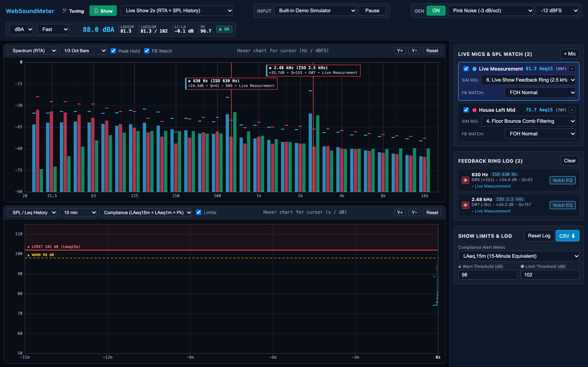

# WebSoundMeter — User Guide & Step-by-Step Tutorials

Welcome to **WebSoundMeter**! Whether you are time-aligning a main PA to subwoofers before doors open or monitoring `LAeq15` SPL limits and vocal mic feedback during a live show, this guide walks you through five practical Front-of-House workflows—all runnable right now using the built-in **Acoustic Demo Simulator** or with your multi-channel audio interface:

> **Looking for physical audio interface cabling diagrams, preamp gain-staging, and deep step-by-step walkthroughs?** Check out the dedicated **[FOH Tutorial Series (`docs/tutorials/`)](../../../docs/tutorials/README.md)**:
> - **[Tutorial 01: Hardware Setup, Cabling & Mic Calibration](../../../docs/tutorials/01-hardware-setup-and-mic-calibration.md)**
> - **[Tutorial 03: PA Time Alignment, Sub/Top Crossover & Virtual EQ](../../../docs/tutorials/03-pa-time-alignment-and-eq-in-wsm.md)**
> - **[Tutorial 04: Predict-to-Measure Field Verification](../../../docs/tutorials/04-predict-to-measure-field-verification.md)**
> - **[Tutorial 05: Live Show SPL Compliance & Feedback Ring-Out](../../../docs/tutorials/05-live-show-spl-compliance-and-feedback.md)**

1. **[Getting Started & Workspace Tour](#1-getting-started--workspace-tour)** — Launching the analyzer, switching between **🛠 Tuning** and **🎚 Show** modes, and connecting audio hardware.
2. **[Tutorial 1: Time-Aligning a PA & Capturing Reference Traces](#2-tutorial-1-time-aligning-a-pa--capturing-reference-traces)** — Locking measurement delay with the Auto Delay Finder, flattening phase, and saving Stored Traces.
3. **[Tutorial 2: Virtual Parametric EQ, Crossovers & Room Matching](#3-tutorial-2-virtual-parametric-eq-crossovers--room-matching)** — Modeling Linkwitz-Riley crossovers and dragging on-chart EQ handles before touching your system processor.
4. **[Tutorial 3: Multi-Mic Spatial Averaging & Trace Math](#4-tutorial-3-multi-mic-spatial-averaging--trace-math)** — Running simultaneous measurement mics and combining them into a `Vector` or `Power` spatial average.
5. **[Tutorial 4: Live Show SPL Compliance & Feedback Watch](#5-tutorial-4-live-show-spl-compliance--feedback-watch)** — Tracking rolling `LAeq15` / `LCeq` limits, logging CSV show reports, and catching narrowband feedback rings by musical note and `Hz`.
6. **[Quick Reference: Calibration, `.FRD` I/O & Keyboard Shortcuts](#6-quick-reference-calibration-frd-io--keyboard-shortcuts)**

---

## 1. Getting Started & Workspace Tour

Start the local web app from the `WebSoundTools` workspace root:

```bash
npm install
npm run dev:wsm
```

Open `http://localhost:5173` in your browser. **WebSoundMeter** boots immediately in **Demo Simulator Mode**, feeding synthetic pink noise through a virtual loudspeaker and room model so you can explore every chart, alignment tool, and EQ workflow without plugging in an audio interface.


### The Three Main Areas

1. **Top Control Bar:**
   - **Mode Switcher (`🛠 Tuning` / `🎚 Show`):**
     - **🛠 Tuning:** Full dual-FFT transfer function workflow with the Signal Generator, Auto Delay Finder, Stored Traces, Virtual EQ/Crossovers, and Math Union sources.
     - **🎚 Show:** Concert monitoring layout that locks out the hardware Signal Generator (so pink noise can never fire accidentally mid-show!) and switches the right dock to **Live Mics & SPL Watch**, **SPL Compliance**, and **Feedback Watch**.
   - **Chart Layout Selector:** Quickly switch between **`PA Alignment 3x (Mag + Phase + Impulse)`**, **`Transfer Function 2x (Mag + Phase)`**, **`Live Mixing 2x (RTA + Magnitude)`**, **`Live Show 2x (RTA + SPL History)`**, **`Live Show 3x`**, or **`Single Chart 1x`**.
   - **Input & Reference Routing:** Switch seamlessly between **Built-in Acoustic Simulator** and **Hardware Audio Interface** (`Ch 1..64`), choose your **Global Reference (`Internal Gen` loopback or physical `In Ch 1..N`)**, and **Pause / Resume** (`Space`).
   - **Signal Generator:** Built-in **Pink Noise**, **White Noise**, **Sine**, or **Log Sweep** generator with output level (`dBFS`) and physical output channel routing.
   - **Live Broadband SPL Meter:** Real-time **IEC 61672** readout (`A`, `C`, or `Z` weighting; `Fast`, `Slow`, `Impulse`, or `Leq`) with live Peak and Crest Factor indicators.

2. **Center Chart Stack:**
   - Each chart panel can independently display **Magnitude (dB)**, **Phase (°)**, **Impulse Response**, **Step Response**, **Group Delay (ms)**, **Coherence ($\gamma^2$)**, **RTA Spectrum** (continuous line or `1/3`, `1/6`, `1/12` octave bars), or **SPL / Leq History**.
   - Hover anywhere inside a plot to inspect exact **Frequency (`Hz`), Period (`ms`), Acoustic Wavelength (`m` / `ft`), Level (`dB`), Phase (`°`), and Coherence (`%`)** in the floating cursor HUD. Notice how trace brightness automatically fades where coherence drops in noisy or reverberant frequency regions!

3. **Right Dock (Sources Tree + Property Inspector):**
   - Lists all active **Live Measurements**, **Stored Traces**, **Virtual EQs**, and **Math / Union** sources with visibility checkboxes and color swatches, plus quick action buttons (`+ Meas`, `+ EQ`, `+ Math`, `+ .FRD`).

---

## 2. Tutorial 1: Time-Aligning a PA & Capturing Reference Traces

**Scenario:** Your measurement microphone is placed `~2.9 m` (`8.5 ms` acoustic flight time) in front of the PA. Until the reference signal is delayed by `8.5 ms` to match that air flight time, the **Phase (°)** plot wraps wildly across frequency and cannot be read cleanly.

1. Make sure you are in **`🛠 Tuning`** mode with **`PA Alignment 3x (Mag + Phase + Impulse)`** selected in the layout dropdown.
2. Select **`Live Measurement`** in the **Sources** list on the right.
3. Look at the **Auto Delay Finder** readout in the **Live Measurement** inspector:
   - It continuously deconvolves the impulse response peak and reports **`~8.50 ms`** (`~2.92 m`) along with detected acoustic polarity (`+ Normal` or `Ø Inverted`).
4. Click **`Apply Delay`** (or press **`D`** on your keyboard).


Watch all three charts snap into alignment immediately:
- The **Impulse Response** peak centers cleanly at **`0.0 ms`**.
- The **Phase (°)** trace unwraps into a smooth, readable curve across the passband so you can spot crossover phase shifts and horn-to-woofer transitions at a glance.
- Click **`Capture Trace`** (or press **`C`**) to freeze a snapshot into **Stored Sources**, and rename it (for example, `FOH Center Baseline`) so you can compare before-and-after changes at any time!

---

## 3. Tutorial 2: Virtual Parametric EQ, Crossovers & Room Matching

**Scenario:** Rather than blasting pink noise in the room for twenty minutes while experimenting with EQ cuts, capture a measurement once (or use a live trace) and design your corrective EQ and crossovers virtually!

1. Select **`Live Measurement`** (in Demo Mode, try choosing the **`PA Room Modes & Comb`** simulator preset in the Live Measurement inspector to see classic low-mid room buildup and high-frequency roll-off).
2. In the **Sources** header on the right, click **`+ EQ`** (or press **`E`**).
3. In the **Virtual Equalizer** inspector:
   - Verify **Apply Virtual EQ To Source** is set to your target live or stored trace.
   - Click **`Auto-Match Room`** to automatically synthesize a smooth corrective parametric EQ curve that tames resonant peaks without trying to boost narrow acoustic comb nulls!
4. **Interactive On-Chart Sculpting & Crossovers:**
   - Look at the **Magnitude** chart: numbered **EQ band handles** sit directly on the filter curve. **Drag any handle left/right** to sweep frequency or **up/down** to adjust gain (`dB`) while watching the predicted post-EQ room trace update in real time!
   - Under **Crossovers (HPF / LPF)** in the inspector, enable **`Linkwitz-Riley 24 dB/oct`** (`LR24` or `LR48`) high-pass or low-pass filters and electronic **Delay (`ms`)** / **Polarity (`Ø`)** to preview complete 2-way sub-to-top crossover summation in Magnitude, Phase, and Group Delay.
   - Press **`Cmd / Ctrl + Z`** anytime to undo any drag or filter tweak.


---

## 4. Tutorial 3: Multi-Mic Spatial Averaging & Trace Math

**Scenario:** Never EQ an entire venue from a single microphone position—a deep cancellation at one seat might be a `6 dB` peak two meters away. Let's run multiple measurement microphones simultaneously and compute a live **Spatial Average**.

1. Click **`+ Meas`** in the **Sources** header (or press **`M`**) to add a second simultaneous live measurement (`Live Measurement #2`), and rename it `House Left Mid` or `Balcony Lip`.
   - In Hardware Mode, assign each Live Measurement slot to its own physical input (`In Ch 1`, `In Ch 2`, `In Ch 3`, up to 8 simultaneous mics sharing the Global Reference!).
   - In Demo Simulator Mode, give each slot a different **Sim Rig** preset (for example, `FOH Flat + Reflections` on Mic 1 and `PA Room Modes` on Mic 2).
2. Click **`+ Math`** (or press **`U`**) to create a **Math / Union** source.
3. In the **Math / Union Source** inspector:
   - Choose **`Power Average (RMS Mag)`** to average magnitude across multiple seats around the room without high-frequency phase comb cancellation, or **`Vector Average (Complex)`** when averaging time-aligned measurements within a tight zone.
   - Check the boxes next to the live or stored traces you want to combine.
   - Other handy modes include **`dB Difference (A − B)`** (great for comparing actual PA response against an imported `.FRD` target curve!) and **`Sum (A + B Complex)`** (great for previewing how a separately measured Sub and Top will sum acoustically!).


---

## 5. Tutorial 4: Live Show SPL Compliance & Feedback Watch

**Scenario:** Soundcheck is done and the audience is walking in. You want to monitor vocal/monitor feedback and keep front-of-house sound levels safely below a venue **`98 dB LAeq15`** ordinance limit—with zero risk of turning on pink noise.

1. Click **`🎚 Show`** in the top-left corner of the Top Bar.
   - If you are on a hardware audio interface, the Signal Generator automatically mutes and hides.
   - The workspace switches to **`Live Show 2x (RTA + SPL History)`** with the dedicated **Show Sidebar** on the right.
2. **Test Feedback Watch (Even Without Mics):**
   - Under **Live Mics & SPL Watch** on the right, set the **Sim Rig** dropdown to **`Live Show + Feedback Ring`** to simulate program music with a runaway narrowband feedback ring.
   - Watch the **RTA Spectrum** chart: **Feedback Watch** distinguishes sustained narrowband sinusoidal rings from normal musical transients, pinning a callout flag right on the offending peak with its exact **frequency (`Hz`), musical pitch (`Note + cents`), and ISO 1/3-octave graphic EQ band**!
   - In the **Feedback Ring Log** card on the right, click **`Cut Notch`** next to any detected ring to drop a surgical narrowband notch directly into your Virtual EQ.
3. **Monitor Rolling SPL Limits & Export Show Logs:**
   - The bottom **SPL / Leq History** chart plots rolling **`LAeq15`** (solid), **`LAeq1`** (dashed), **`LAF`** (translucent), and **`Peak`** against configurable Warning/Limit guide lines (`15 min`, `60 min`, or `2 hr` windows).
   - At the end of the night, click **`Export CSV`** in the **SPL Compliance** card to download a timestamped SPL/Leq compliance report for venue management.



---

## 6. Quick Reference: Calibration, `.FRD` I/O & Keyboard Shortcuts

### Microphone Calibration & `.FRD` Trace Exchange

- **Microphone Calibration Curves (`.cal` / `.frd` / `.txt`):** Select any **Live Measurement**, expand **Microphone Calibration**, and upload your mic's calibration file. It is saved in your browser's offline `IndexedDB` library so you can assign different calibration curves to each measurement mic channel anytime.
- **Import & Export `.FRD` Traces:**
  - Click **`+ .FRD`** in the **Sources** header to import any standard 2-column or 3-column `.frd` curve (including predicted Virtual Mic curves exported from **[WebSpeakerSim](../../WebSpeakerSim/docs/user-guide.md)**—see **[Tutorial 04: Predict-to-Measure Field Verification](../../../docs/tutorials/04-predict-to-measure-field-verification.md)**!).
  - Select any **Stored Trace** and click **`Export .FRD`** to save its Magnitude + Phase response to disk.

### Keyboard Shortcuts

| Shortcut | Action |
| :--- | :--- |
| `Space` | **Pause / Resume** live analyzer & hardware signal generator |
| `C` | **Capture** active live trace into **Stored Sources** |
| `D` | **Apply** Auto Delay Finder propagation delay to active Live Measurement |
| `M` | Add a new simultaneous **Live Measurement** (`+ Meas`) |
| `E` | Add a new **Virtual Parametric EQ & Crossover** source (`+ EQ`) |
| `U` | Add a new **Math / Union** source (`+ Math`) |
| `R` | **Reset** averaging buffers and Peak Hold |
| `Cmd / Ctrl + Z` | **Undo** last authored source, EQ, or slot edit |
| `Cmd / Ctrl + Shift + Z` or `Ctrl + Y` | **Redo** edit |
| `1` / `2` / `3` / `4` | Switch between **1**, **2**, **3**, or **4** stacked charts |
| `Escape` | Close open modal or clear inspector |

