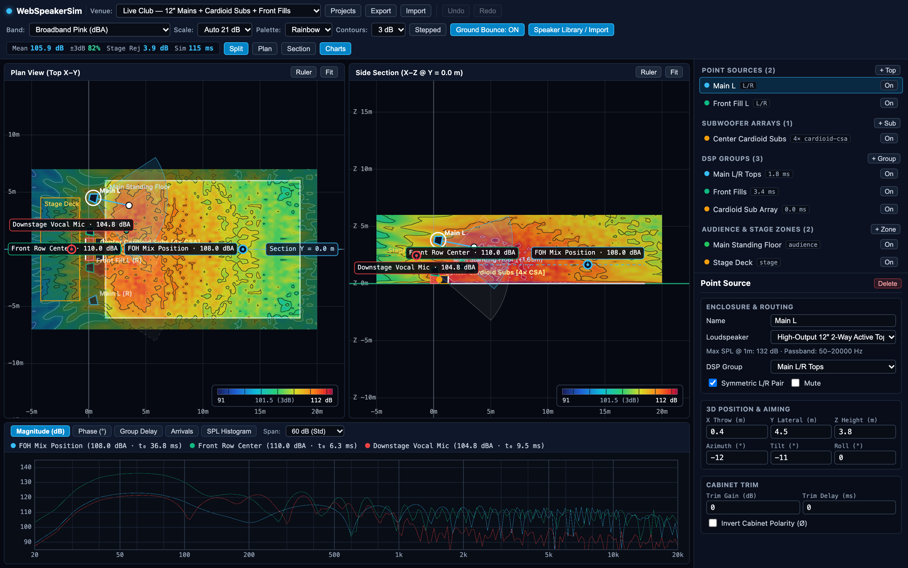
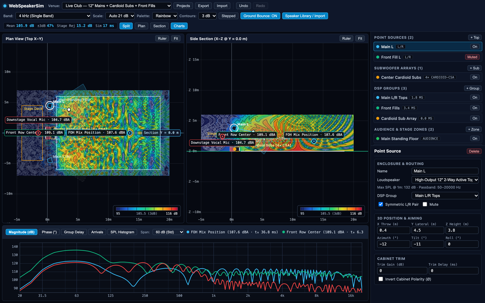
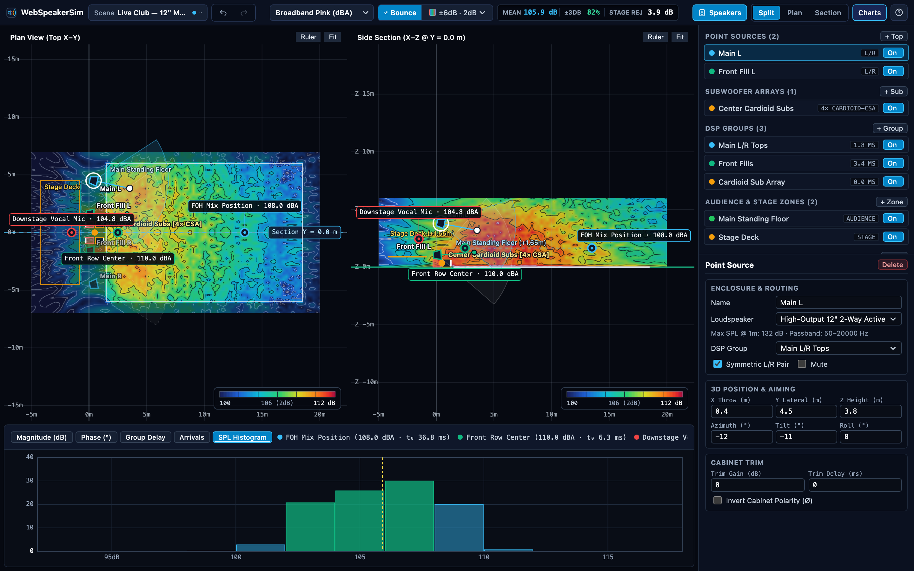
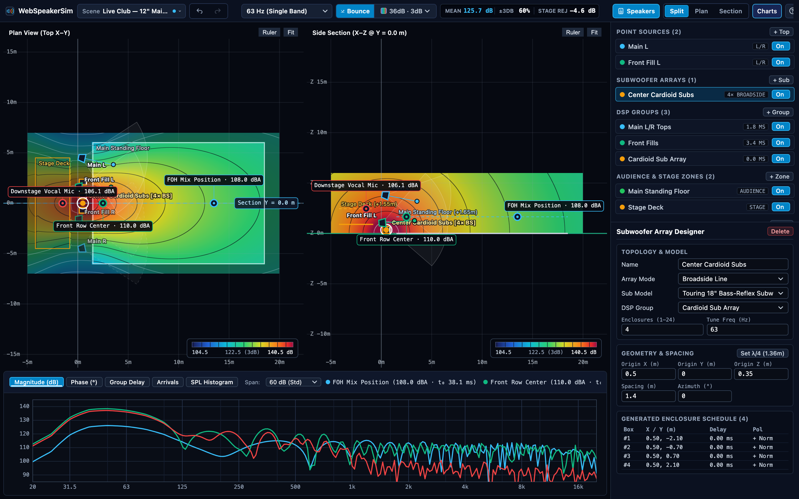
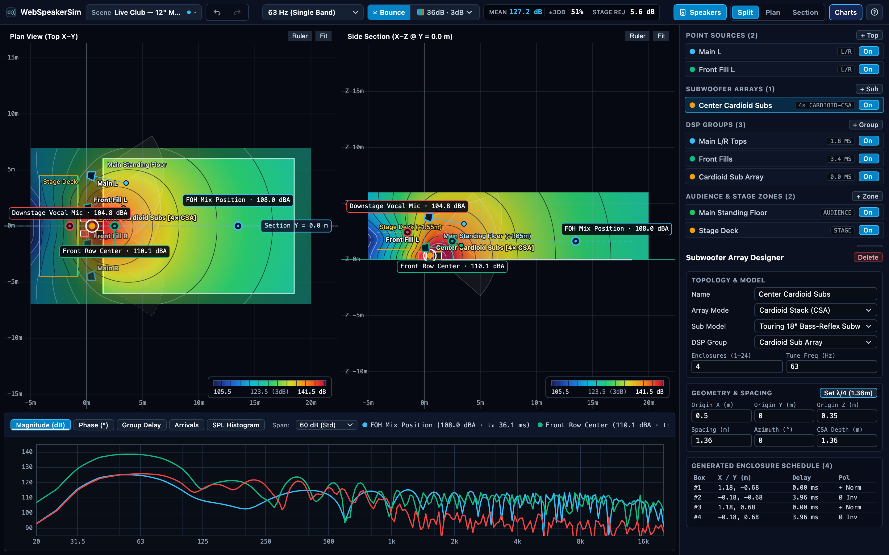
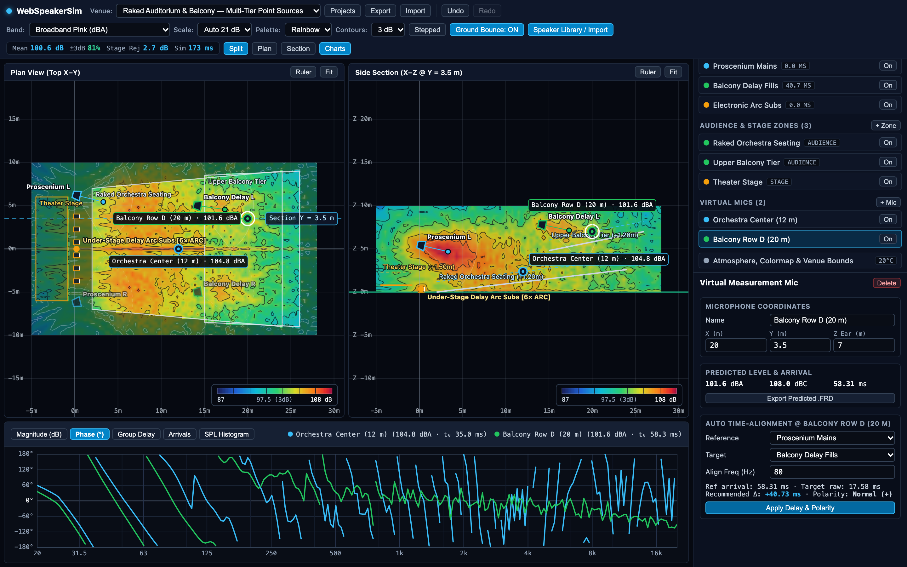
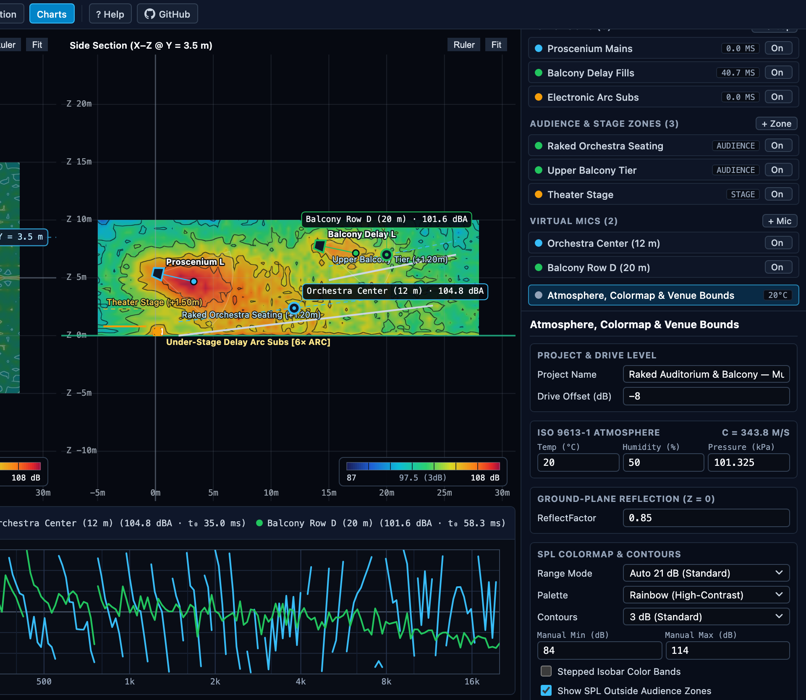
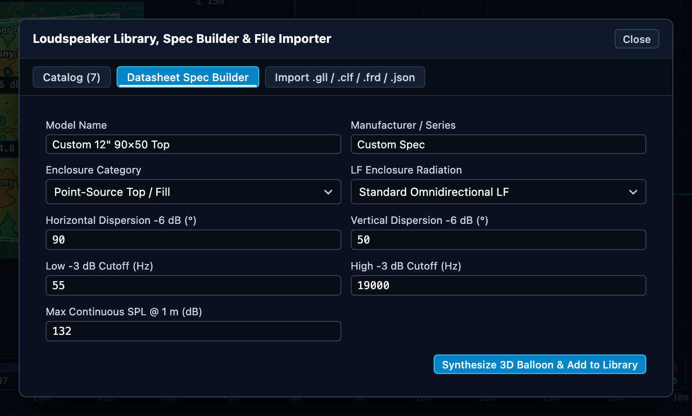
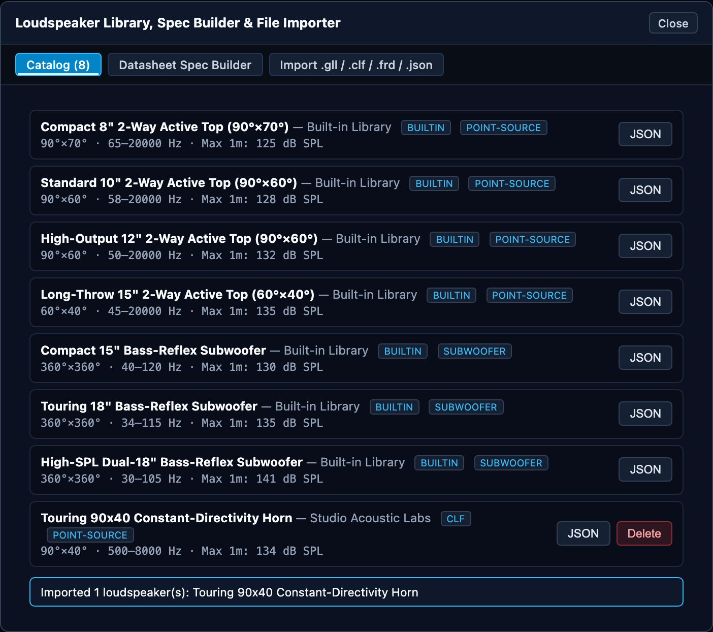

# WebSpeakerSim — UI, Inspectors & Acoustic Reference

**WebSpeakerSim** is an offline-capable 3D direct-field and planar-reflection loudspeaker venue simulator with synchronized 2D Plan and Side Section CAD viewports. It runs as an installable PWA or locally via `npm run dev:wss` (`http://localhost:5174`).

> **Looking for step-by-step system design walkthroughs?** See the **[FOH Tutorial Series (`docs/tutorials/`)](../../../docs/tutorials/README.md)** for club front-fill & cardioid sub design, custom raked/balcony venues, outdoor end-fire & delay-ring alignment, and Predict-to-Measure field verification.

---

## 1. 3D Venue Coordinate System & Built-In Presets

All spatial coordinates use a right-handed metric coordinate system in **meters (`m`)**:

| Axis | Positive Direction | Stage vs. FOH House Convention |
| :--- | :--- | :--- |
| **`X` (Throw)** | `+X` points from stage (`0 m`) toward the audience / FOH (`-X` is upstage) | Downstage edge sits near `X = 0 m`. |
| **`Y` (Lateral)** | `+Y` is **Stage Left** (top of Plan View); `-Y` is **Stage Right** (bottom of Plan View) | From the FOH mix position looking toward the stage, `+Y` is **House Right** and `-Y` is **House Left**. |
| **`Z` (Elevation)** | `+Z` points upward toward the ceiling | Main venue floor datum is `Z = 0 m`. |

- **Aiming Sign Conventions:**
  - **`Tilt (°)`:** Negative angles (`-11°`) aim a flown cabinet **downward** toward the floor; positive angles (`+4°`) tilt upward (e.g., low stage-lip front fills aiming up toward standing ear height).
  - **`Azimuth (°)`:** Counter-clockwise in Plan View (`0°` points straight down `+X`; on a `+Y` cabinet, `-12°` toes inward toward centerline `Y = 0 m`).
  - **`Roll (°)`:** Rotates the enclosure around its aiming axis (`90°` swaps horizontal and vertical horn dispersion planes when laying a 2-way wedge/front-fill cabinet on its side).
- **Built-In Venue Presets (`Venue` selector):**
  1. **`Live Club — 12" Mains + Cardioid Subs + Front Fills`** (`18 m × 12 m` standing club, flown `12"` tops, `4`-box `63 Hz` CSA sub stack, `8"` stage-lip fills).
  2. **`Outdoor Field — 15" Mains + End-Fire Subs + Delay Ring`** (`55 m × 30 m` festival field, `15"` long-throw mains, `4`-deep end-fire dual-`18"` subs, time-aligned `12"` delay towers at `X = 26 m`).
  3. **`Raked Auditorium & Balcony — Multi-Tier Point Sources`** (`26 m` theater with raked orchestra seating, overhanging upper balcony, balcony delay fills, and `6`-box electronic delay-arc subs).

---

## 2. Top Control Bar & Coverage Readouts

### Project & History Controls
- **`Venue`:** Loads one of the `3` built-in reference venues.
- **`Projects`:** Opens the local `IndexedDB` project manager to save/load named venues or click **`Reset Local Autosave`** to return to clean factory state.
- **`Export` / `Import`:** Saves or loads a portable `.wss-project.json` bundle containing the complete scene, colormap settings, and **all** custom speakers currently in your browser library.
- **`Undo` / `Redo`:** Steps backward/forward through up to `60` scene mutations (continuous CAD drags and EQ handle scrubs coalesce via `txKey` into single undo steps).

### Analysis Band & Colormap Controls

- **`Band`:**
  - **Broadband Weighted Spectra:** `Broadband Pink (dBA)`, `Broadband Pink (dBC)`, `Broadband Pink (dBZ)`, `Live Music Contour (dBA)`, `Live Music Contour (dBC)`, `Subband Average (31.5–100 Hz dBC)`.
  - **Single Bands:** `31.5 Hz`, `63 Hz`, `80 Hz`, `125 Hz`, `250 Hz`, `500 Hz`, `1 kHz`, `2 kHz`, `4 kHz`, `8 kHz`, `16 kHz`.
- **`Scale`:** `Auto ±3 dB` (`6 dB` window), `Auto ±6 dB` (`12 dB` window), `Auto 21 dB` (default), `Auto 36 dB` (wide range for stage sub rejection), or `Manual` (`Min`/`Max dB`). Both Plan and Section heatmaps lock to the Audience Plan grid scale so colors match across viewports.
- **`Palette`:** `Rainbow` (`Turbo` high-contrast), `Thermal` (`Inferno` monotonic luminance), or `Viridis` (perceptually uniform, colorblind-safe).
- **`Contours` & `Stepped`:** Overlays `1 dB`, `2 dB`, `3 dB`, or `6 dB` isolines (`Off` disables contours—helpful at `4–16 kHz` where narrowband interference fringes are dense) and quantizes continuous gradients into discrete dB bands.
- **`Ground Bounce` (`G`):** Toggles the 1st-order `Z = 0 m` planar image-source reflection (`+6 dB` coherent sub coupling and midband floor comb filtering).
- **`Speaker Library / Import` (`L`):** Opens the 3-tab Loudspeaker Catalog, Datasheet Spec Builder, and `.gll` / `.clf` / `.frd` file importer modal.

### Live Coverage Metrics & Layout Switcher

- **`Mean`:** Mean SPL across active `'audience'` surface cells for the currently selected `Band`.
- **`±3dB`:** Percentage of active audience cells within `±3 dB` of `Mean`.
- **`Stage Rej`:** `Mean Audience SPL − Mean Stage SPL` in dB (positive values mean the audience is louder than the stage deck; negative values mean stage wash exceeds audience level).
- **`Sim`:** Worker evaluation time in `ms` (interactive drags compute a fast `~46×46` coarse grid immediately followed `95 ms` later by a `~96×96` fine grid).
- **Layout Buttons (`Split` / `Plan` / `Section` / `Charts`):** View both CAD panes side by side (`1`), solo Plan (`2`) or Section (`3`), and toggle the bottom Virtual Mic chart drawer.

---

## 3. Synchronized CAD Viewports (`Plan View` & `Side Section`)

Each viewport header contains its own **`Ruler`** toggle and **`Fit`** camera reset button, plus a bottom-right SPL colorbar legend.

| Gesture | Action |
| :--- | :--- |
| **Click entity** | Selects a Point Source, Subwoofer Array, Virtual Mic, or Zone in the Right Inspector. |
| **Drag entity** | Moves `(X, Y)` in Plan View or `(X, Z)` in Side Section (coalesced into one Undo step). |
| **Drag white aim handle** | Aims Point Source **Azimuth (`°`)** in Plan View or **Tilt (`°`)** in Side Section. |
| **Drag empty space** / **Middle-drag** / **`Alt + Drag`** | Pans the viewport camera. |
| **Mouse wheel / trackpad pinch** | Zooms smoothly around the cursor position. |
| **`Shift + Drag`** (or **`Ruler`** mode + drag) | Draws an acoustic distance & flight-time ruler (`m` and `ms` at current atmospheric speed of sound $c$). |
| **Double-click viewport** (or click **`Fit`**) | Fits the camera cleanly to the venue grid bounds. |

> **In-canvas Virtual Mic pills:** Badges next to Virtual Microphones in Plan and Side Section always display each mic's **broadband `dBA`** level for quick reference, while topbar `Mean` / `±3dB` / `Stage Rej` track the active `Band`.

---

## 4. Scene Tree & Property Inspectors

### Point Source Inspector (`+ Top` / `P`)
- **Enclosure & Routing:** Editable **`Name`**, **`Loudspeaker`** model selector, **`DSP Group`** assignment, **`Symmetric L/R Pair`** (`Main L` automatically generates a mirrored `Main R` across `Y = 0` with inverted `Y`, `Azimuth`, and `Roll`), and **`Mute`**.
- **3D Position & Aiming:** `X Throw (m)`, `Y Lateral (m)`, `Z Height (m)`, `Azimuth (°)`, `Tilt (°)`, and `Roll (°)`.
- **Cabinet Trim vs. DSP Group Processing:** Individual enclosures provide **`Trim Gain (dB)`**, **`Trim Delay (ms)`**, and **`Invert Cabinet Polarity (Ø)`** for per-box shading/time-smearing, while crossovers, multi-band EQ, and system alignment delays live on the assigned **DSP Group**.

### Subwoofer Array Designer (`+ Sub` / `S`)

- **Array Modes:**
  - **`Broadside Line`:** Standard floor-stacked or flown lateral line (`0 ms` inter-box delay, normal polarity).
  - **`Cardioid Stack (CSA)`:** Front/rear directional stacks with rear enclosures physically rotated `180°`, polarity-inverted (`Ø`), and delayed by $d / c$. Clicking **`Set λ/4 (<m>)`** sets both lateral spacing and front-to-rear depth offset to $\lambda / 4$ at **`Tune Freq (Hz)`**. When **`Enclosures`** is a multiple of `3` (`3, 6, 9..`), WebSpeakerSim synthesizes 3-box CSA triplets (`2` front boxes at `-4.5 dB` trim + `1` rear inverted box at `0 dB`); otherwise it synthesizes 2-box front/rear pairs (`-1.0 dB` rear trim).
  - **`End-Fire`:** Longitudinal front-to-back line along `Azimuth` with progressive electronic delay $\tau_k = k \cdot d / c$ steering constructive summation forward and multi-null comb cancellation onto the stage.
  - **`Electronic Delay Arc`:** Broadside line with symmetric convex electronic delay steering widening horizontal low-frequency coverage to **`Arc Angle (°)`** without curving cabinets physically.
- **Generated Enclosure Schedule:** Read-only rigging table listing every synthesized cabinet's world `X / Y (m)`, electronic `Delay (ms)`, and `Pol` (`+ Norm` / `Ø Inv`).

### DSP Processor Group Inspector (`+ Group`)
- **Group Output:** `Gain (dB)`, `Delay (ms)`, `Invert Polarity (Ø)`, and `Mute Group`.
- **High-Pass & Low-Pass Crossovers:** `Butterworth` (`12`, `18`, `24`, `48 dB/oct`) and `Linkwitz-Riley` (`12`, `24`, `48 dB/oct`) filters.
- **Parametric EQ (`1` to `8` bands):** `Peaking`, `Low Shelf`, `High Shelf`, `Notch`, and `All-Pass` bands (`192 kHz` analytical evaluation). Selecting a DSP Group while viewing the **`Magnitude (dB)`** chart overlays interactive green **`EQ1..EQn`** handles anchored to the passband SPL mean (`Drag` = Freq/Gain, **`Shift + Drag / Wheel`** = `Q`).

### Virtual Microphone Inspector (`+ Mic` / `M`) & Bottom Chart Drawer

- **Predicted Level & Arrival:** Displays broadband **`dBA`**, **`dBC`**, **`dBZ`**, first-arrival flight reference **`t₀ (ms)`**, and per-radiator arrival breakdown (direct hangs + ground reflections).
- **Auto Time-Alignment:** Selects a **`Reference`** DSP Group (typically the latest-arriving acoustic group, such as stage subs or flown mains at a delay ring), a **`Target`** DSP Group to delay, and **`Align Freq (Hz)`**, then computes and applies exact idempotent electronic group delay + polarity via **`Apply Delay & Polarity`**.
- **`Export Predicted .FRD`:** Downloads `<mic-slug>-predicted.frd` (`20 Hz – 20 kHz` complex response phase-referenced to earliest acoustic arrival `t₀`) for field verification in `WebSoundMeter`.
- **Chart Tabs:** `Magnitude (dB)` (with `Span: 30 / 60 / 80 dB`), `Phase (°)`, `Group Delay` (magnitude-gated within `50 dB` of peak so deep comb nulls do not distort the `ms` scale), `Arrivals` (stem plot of direct vs. dashed ground-reflection arrivals), and `SPL Histogram`.

### Audience & Stage Zones (`+ Zone`) and Environment & Venue Bounds

- **Audience / Stage Zone Inspector:**
  - **`Role`:** `Audience` (contributes to `Mean`, `±3dB`, and `SPL Histogram`; overhanging elevated balconies take precedence over lower orchestra floors in Plan View) or `Stage` (contributes to `Stage Rej`).
  - **Trapezoid & Rake Geometry:** `X Start (m)`, `X End (m)`, `Y Center (m)`, `Width Start (m)`, `Width End (m)` (splayed fan-shaped seating), `Deck Z Start (m)`, `Deck Z End (m)` (sloped rakes and elevated balconies—for example, the Raked Auditorium balcony deck rises from `4.8 m` to `7.0 m`, placing seated `1.2 m` ears at `6.0–8.2 m`), and `Ear Height (m)` (`~1.65 m` standing, `~1.20 m` seated).
- **Atmosphere, Colormap & Venue Bounds Inspector:**
  - **`Project Name` & `Drive Offset (dB)`:** Global system headroom offset relative to each loudspeaker's continuous Max SPL @ `1 m`.
  - **ISO 9613-1 Atmosphere:** `Temp (°C)`, `Humidity (%)`, and `Pressure (kPa)` with live speed-of-sound readout (`c = 343.2 m/s`).
  - **Ground-Plane Reflection (`Z = 0`):** `ReflectFactor` (`0.00` anechoic free-field to `1.00` rigid concrete acoustic mirror).
  - **SPL Colormap & Contours:** Full range, palette, contour step, manual `Min`/`Max`, `Stepped Isobar Color Bands`, and **`Show SPL Outside Audience Zones`**.
  - **Venue Grid Bounds & Section Slice (`m`):** Editable **`X Min`**, **`X Max`**, **`Y Min`**, **`Y Max`**, **`Ceiling Z Max`**, and **`Slice Y (m)`** (lateral coordinate of the Side Section cut plane).

---

## 5. Loudspeaker Library, Spec Builder & Importers (`L`)

### Datasheet Spec Builder Tab

Synthesizes a 3D frequency-dependent directivity balloon from published manufacturer datasheet specs: **`Model Name`**, **`Manufacturer`**, **`Category`** (`Top / Full-Range` vs. `Subwoofer`), **`Horizontal Coverage (°)`**, **`Vertical Coverage (°)`**, **`Low -3 dB Cut (Hz)`**, **`High -3 dB Cut (Hz)`**, and **`Max Continuous SPL @ 1 m (dB)`**.

### Catalog & File Import Tab (`.GLL`, `.CLF`, `.FRD`, `.JSON`)

- **Catalog Tab:** Inspects built-in and custom enclosures, exports individual custom speakers as portable `.wss-speaker.json` files, or deletes custom speakers from `IndexedDB`.
- **Import File Tab:**
  - **`.gll`:** Client-side binary `EASE_GLL` (`v3–v6`) container parser extracting `SourceDefinitions`, compressed 3D polar balloons, and enclosure geometry.
  - **`.clf`:** Parses `CLF` text polar tables (`<HORIZONTAL>` / `<VERTICAL>`) into quadrant-symmetric 3D balloons.
  - **`.frd` / `.txt`:** Imports axial response curves (normalizing passband peak to `0 dB`) paired with a synthesized `90° × 60°` top (or omnidirectional sub) dispersion balloon.
  - **`.json`:** Imports `.wss-speaker.json` definitions.

---

## 6. Persistence & Keyboard Shortcuts

- **Autosave & URL Sync:** Scene and colormap edits debounce-save to `localStorage` after **`220 ms`**. Unmodified built-in presets keep `?preset=<id>` in the URL for quick sharing; once you customize the scene, `?preset=` is cleared from the URL so browser reloads restore your exact `localStorage` design rather than resetting to the factory preset.

| Shortcut | Action |
| :--- | :--- |
| `Cmd / Ctrl + Z` | Undo last scene edit |
| `Cmd / Ctrl + Shift + Z` / `Ctrl + Y` | Redo scene edit |
| `P` | Add Point Source (`+ Top`) |
| `S` | Add Subwoofer Array (`+ Sub`) |
| `M` | Add Virtual Microphone (`+ Mic`) |
| `G` | Toggle 1st-order Ground Bounce |
| `L` | Open Loudspeaker Library / Spec Builder / Importer |
| `1` / `2` / `3` | Switch viewport layout (`Split` / `Plan` / `Section`) |
| `?` | Open or close Help, Keyboard Shortcuts & GitHub dialog |
| `Escape` | Close open modal or clear selection |
| `Shift + Drag` (in viewport) | Measure acoustic distance (`m`) & flight time (`ms`) |
| `Shift + Drag` / `Shift + Wheel` (on EQ handle) | Adjust DSP Group EQ band `Q` (`0.25 .. 36`) |
