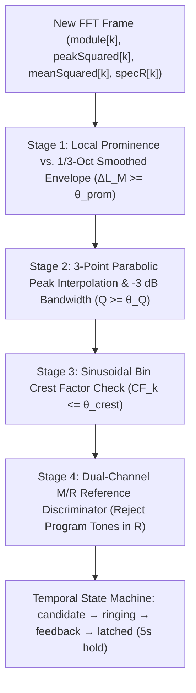

# 07. Real-Time Acoustic Feedback & Ringing Detection Design

> **Status**: Proposed Design Specification  
> **Related Modules**: `src/dsp/feedback-detector.ts` (new), `src/dsp/analyzer-pipeline.ts`, `src/dsp/transfer-function.ts`, `src/dsp/synthetic-rig.ts`, `src/charts/canvas-chart-painter.ts`, `src/ui/inspectors/live-measurement-inspector.ts`

---

## 1. Problem Statement & Acoustic Goals

During soundcheck ("ringing out" stage monitors or FOH) and during a live performance, acoustic feedback occurs when loop gain at a frequency $f_0$ approaches or exceeds $0\text{ dB}$ ($1.0\times$) with $0^\circ \pmod{360^\circ}$ phase shift:
- **Pre-Feedback Ringing ($G_{\text{loop}} \approx -6\text{ to }-1\text{ dB}$)**: High-$Q$ regenerative resonance that colors vocals with a metallic "ring" or overhang after transients.
- **Runaway Feedback / Howling ($G_{\text{loop}} \ge 0\text{ dB}$)**: Sustained or growing narrowband sinusoid that requires immediate fader or EQ intervention.

### 1.1 Why Traditional Single-Channel RTA Peak Finders Fail During a Show
Simple RTA peak detectors flag any frequency bin that rises $X\text{ dB}$ above the average spectrum. During a concert, a lead synth, distorted guitar harmonic, flute, or brass instrument holding a note produces a narrowband spectral peak, causing constant false alarms.

Because `WebSoundMeter` is a **dual-channel ($M / R$) multi-slot analyzer** that already computes **per-bin Peak Hold (`peakSquared`) and Mean Squared (`meanSquared`)**, its feedback detector can combine **four independent physical discriminators**—including comparing the microphone signal ($M$) against the console reference mix ($R$)—while running simultaneously across multiple live measurement slots (`FOH`, `Vocal Wedge L`, `Drum Fill`, etc.).

---

## 2. Four-Stage Feedback Detection Algorithm (`src/dsp/feedback-detector.ts`)



### 2.1 Stage 1: Local Spectral Prominence ($\Delta L_M$)
To make detection independent of overall program EQ tilt (e.g., heavy subwoofer bass vs. quieter high frequencies), the detector computes a 1/3-octave smoothed background envelope $B_M[k]$ from the narrowband RTA spectrum `module[k]` using the existing $O(1)$ prefix-sum smoother (`smoothMagnitudeOctave(module, bgModule, 3)` in `src/dsp/smoothing.ts`).

A bin $k$ (within $60\text{ Hz} \le f_k \le 16000\text{ Hz}$) is a local maximum and a candidate peak if:
1. $\text{module}[k] > \text{module}[k - 1]$ and $\text{module}[k] \ge \text{module}[k + 1]$
2. Its absolute level exceeds the noise floor gate: $20\log_{10}(\text{module}[k]) \ge L_{\text{gate}}$ (default $-55\text{ dBFS}$)
3. Its **prominence** above the local 1/3-octave neighborhood exceeds $\theta_{\text{prom}}$:
   $$\Delta L_M(k) = 20\log_{10}\!\left(\frac{\text{module}[k]}{B_M[k] + \epsilon}\right) \ge \theta_{\text{prom}}$$

### 2.2 Stage 2: Sub-Bin Parabolic Interpolation & Resonator $Q$ Estimation
Using log-magnitudes $\alpha = \ln(\text{module}[k-1])$, $\beta = \ln(\text{module}[k])$, $\gamma = \ln(\text{module}[k+1])$:
- **Sub-bin fractional offset**:
  $$\delta = \frac{1}{2} \frac{\alpha - \gamma}{\alpha - 2\beta + \gamma} \in [-0.5, 0.5], \quad f_0 = (k + \delta)\,\Delta f$$
- **$-3\text{ dB}$ Bandwidth & $Q$ Factor**:
  Walks outward left ($k_L$) and right ($k_R$) from bin $k$ with linear interpolation to find the frequencies $f_L, f_R$ where magnitude drops to $\frac{1}{\sqrt{2}}$ ($-3.01\text{ dB}$) of the peak amplitude:
  $$\Delta f_{-3\text{dB}} = \max(f_R - f_L, \, 0.75\,\Delta f), \quad Q_{\text{est}} = \frac{f_0}{\Delta f_{-3\text{dB}}}$$
  Broad vocal formants or instrument body resonances ($Q_{\text{est}} < \theta_Q$) are rejected.

### 2.3 Stage 3: Sinusoidal Crest Factor Check ($CF_k$)
In `TransferFunctionAnalyzer`, each bin tracks short-term peak power and mean power. For a pure steady sinusoid (acoustic feedback howl), the bin envelope has nearly constant amplitude across frames (temporal variance $\approx 0$, crest factor $\approx 3.0\text{ dB}$), whereas transient musical content exhibits higher frame-to-frame amplitude modulation:
$$CF_{\text{frame}}(k) = 10\log_{10}\!\left(\frac{\max_{t \in W} |M_t(k)|^2}{\frac{1}{|W|}\sum_{t \in W} |M_t(k)|^2 + \epsilon}\right)$$
When $CF_{\text{frame}}(k) \le 4.5\text{ dB}$ over a rolling 6-frame window (`~240 ms`), the peak is confirmed as a steady sinusoidal tone.

### 2.4 Stage 4: Dual-Channel Reference-vs-Measurement ($M / R$) Program Tone Rejection
When a Live Measurement slot has an active Reference channel $R$ carrying the console mix or matrix send ($R_{\text{rms}} > -55\text{ dBFS}$):
- Compute the Reference channel's local prominence at the same bin $k$:
  $$\Delta L_R(k) = 20\log_{10}\!\left(\frac{|R(k)|}{B_R[k] + \epsilon}\right)$$
- **Acoustic Feedback vs. Program Tone Decision**:
  - If $\Delta L_R(k) \ge \Delta L_M(k) - 5.0\text{ dB}$: The tonal peak is already present in the console send $R$ (e.g. a synthesizer lead or guitar feedback on stage intentionally in the mix). It is classified as `'program-tone'` and **suppressed** from triggering false feedback alerts.
  - If $\Delta L_M(k) - \Delta L_R(k) \ge 8.0\text{ dB}$: The tonal peak is generated or amplified in the acoustic path between the loudspeaker and microphone (true room/wedge feedback loop) and is classified as `'acoustic-feedback'`.

---

## 3. Per-Slot Threshold Profiles & State Machine

Because `WebSoundMeter` supports multiple simultaneous Live Measurement slots (`+ Meas`), each slot runs its own `FeedbackDetector` instance with an independent profile:

| Profile | Target Use Case | Prominence ($\theta_{\text{prom}}$) | Min $Q$ ($\theta_Q$) | Onset Persistence | Ref Tone Rejection |
| :--- | :--- | :---: | :---: | :---: | :---: |
| **`off`** | Disabled for this slot | — | — | — | — |
| **`foh-normal`** (Default in Show Mode) | FOH measurement mic during a live concert | `11.0 dB` (`ringing`) / `14.5 dB` (`feedback`) | `12` | `160 ms` (`4` frames) | Enabled (when $R$ active) |
| **`monitor-sensitive`** | Stage monitor / wedge ringing-out & vocal mic watch | `8.5 dB` (`ringing`) / `12.0 dB` (`feedback`) | `8` | `80 ms` (`2` frames) | Optional / Enabled |
| **`custom`** | User-configured thresholds | `6..24 dB` | `5..40` | `40..500 ms` | Configurable |

### 3.1 Temporal Track Lifecycle & 5-Second Visual Latch
Active frequency tracks are matched across frames within a $\pm \frac{1}{24}$-octave tolerance window:
1. **`candidate`**: Newly detected peak ($< \text{onsetFrames}$); tracked internally, not yet shown in UI.
2. **`ringing` (Amber Warning)**: Exceeds ringing prominence & $Q$ for $\ge \text{onsetFrames}$.
3. **`feedback` (Red Critical)**: Exceeds feedback prominence + low sinusoidal crest factor (or positive level growth $\ge +4\text{ dB/s}$).
4. **`latched` (5.0-Second Visual Hold)**: When the engineer pulls down the fader or cuts the EQ band and the peak drops below threshold, the track enters `'latched'` state for `latchDurationMs = 5000`. The callout flag remains visible on the RTA/Magnitude chart (with a decaying opacity bar) so the engineer can read the exact frequency after reacting on the console, and the event is recorded in the **Feedback Ring Log**.

---

## 4. Acoustic Utility Mappers: ISO 31-Band GEQ & Musical Pitch

Every detected feedback event automatically resolves two actionable reference values for live sound engineers:

1. **Nearest 31-Band ISO 1/3-Octave Graphic EQ Center Frequency**:
   - Standard ISO 266 center frequencies:
     `20, 25, 31.5, 40, 50, 63, 80, 100, 125, 160, 200, 250, 315, 400, 500, 630, 800, 1000, 1250, 1600, 2000, 2500, 3150, 4000, 5000, 6300, 8000, 10000, 12500, 16000, 20000` Hz.
   - Mapped via minimum $|\log_2(f_0 / f_{\text{ISO}})|$ so a console operator using a 31-band GEQ immediately sees which fader to reach for (e.g., `2,482 Hz → ISO 2.5 kHz`).
2. **Musical Pitch & Cents Deviation (`A4 = 440 Hz`)**:
   - $\text{midi} = \text{round}(69 + 12\log_2(f_0 / 440))$
   - Helps distinguish a musical key center (e.g., bass guitar holding `E1 = 41.2 Hz` or `A2 = 110.0 Hz`) from an off-pitch acoustic cavity resonance.

### 4.1 TypeScript Data Model (`src/dsp/feedback-detector.ts`)

```ts
export type FeedbackSensitivityMode =
  | 'off'
  | 'foh-normal'
  | 'monitor-sensitive'
  | 'custom';

export type FeedbackTrackState = 'ringing' | 'feedback' | 'latched';

export interface DetectedFeedbackTrack {
  readonly id: string;
  readonly slotId: string;
  readonly slotName: string;
  readonly slotColor: string;
  readonly state: FeedbackTrackState;
  readonly frequencyHz: number;
  readonly isoBandHz: number;
  readonly isoBandLabel: string;     // e.g. "2.5 kHz"
  readonly musicalNote: string;      // e.g. "D#7 (-8c)"
  readonly prominenceDb: number;     // Peak height above 1/3-oct neighborhood
  readonly peakLevelDb: number;      // Absolute dBFS / dB SPL
  readonly estimatedQ: number;       // Estimated resonator Q (e.g. 18.5)
  readonly durationMs: number;       // How long the ring persisted
  readonly firstDetectedAt: string;  // Wall-clock HH:MM:SS
  readonly latchRemainingRatio: number; // 1.0 while active, decays 1.0 -> 0.0 over 5s latch
}
```

---

## 5. UI & Virtual EQ Integration

### 5.1 RTA & Magnitude Chart Callout Flags (`src/charts/canvas-chart-painter.ts`)
When `rta` or `magnitude` plots are rendered, `drawFeedbackCalloutFlags()` draws markers for all active and latched tracks across visible Live Measurement sources:
- **Vertical Guide Line**: Dashed vertical line at `valueToNormX(track.frequencyHz, xMin, xMax, true)` colored `#ef4444` (`feedback`), `#f59e0b` (`ringing`), or translucent slate (`latched`).
- **Top Callout Badge**: Collision-avoiding pill at the top of the plot area showing:
  - Line 1: **`2.48 kHz (ISO 2.5k)`** + source color dot
  - Line 2: **`+15.8 dB • Q≈19 • D#7`**
- **Multi-Slot Attribution**: When multiple live slots are active (e.g., `FOH` in cyan and `Wedge L` in rose), the callout badge includes the slot color dot and short name so the engineer knows which microphone is ringing.

### 5.2 Feedback Ring Log & One-Click `[Notch in EQ]` Action
In the **Live Show Sidebar** (and as a collapsible section in the **Live Measurement Inspector**), the **Feedback Ring Log** lists the most recent detected rings across all active slots:
- Each row displays: `Severity Badge` | `Frequency (Hz)` | `ISO 1/3-Oct Band` | `Musical Note` | `Prominence & Q` | `Mic Name` | **`[Notch EQ]`**.
- **Clicking `[Notch EQ]` on a ring**:
  1. Finds the active `EqualizerSourceConfig` targeting that measurement slot (or creates a new `Virtual EQ` targeting that slot if none exists).
  2. Selects the first unused peaking band (or the band closest in frequency) and sets:
     - `type: 'peaking'`
     - `frequency: Math.round(track.frequencyHz)`
     - `q: Math.min(24, Math.max(8, Math.round(track.estimatedQ)))`
     - `gainDb: Math.max(-12, -Math.round(track.prominenceDb * 0.5))`
     - `enabled: true`
  3. Immediately updates the Virtual EQ curve on the Magnitude chart so the engineer can see the exact notch filter shape and copy the parameters (`Hz`, `Q`, `dB`) to their console channel/bus PEQ.

---

## 6. Deterministic Testing via `SyntheticAcousticRig` (`src/dsp/synthetic-rig.ts`)

To make `FeedbackDetector` 100% deterministically testable in Vitest unit/integration tests and Playwright E2E tests without physical microphones or loudspeakers:
- Extend `SimulatorRigConfig` in `src/dsp/synthetic-rig.ts` with an optional `simulatedFeedbackRings?: Array<{ frequencyHz: number; q: number; gainDb: number; injectIntoReference?: boolean }>`:
  - When `injectIntoReference: false` (default), a high-$Q$ biquad resonator (`q = 25`, `gainDb = +18 dB`) or low-level phase-locked sinusoid is applied **only** in the simulated acoustic path ($M$), modeling true acoustic feedback and triggering `FeedbackDetector` (`'acoustic-feedback'`).
  - When `injectIntoReference: true`, the tone is injected into the generator/reference feed ($R$) before the split to $M$, modeling a sustained synth note in the console mix and verifying that Stage 4 ($M/R$ discriminator) suppresses false alarms.
