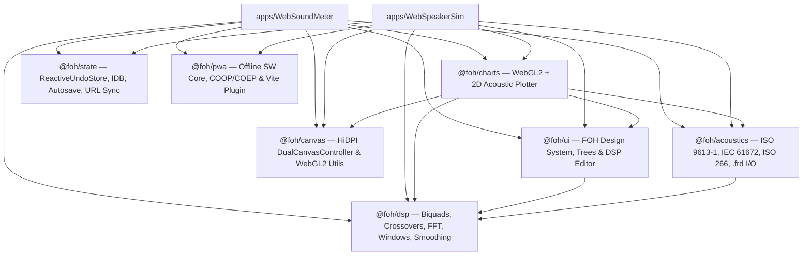

# 01. Monorepo Architecture & `@foh/*` Package Boundaries

`WebSoundTools` is a TypeScript + Vite + Lit 3 npm workspaces monorepo hosting two offline-capable Front-of-House (FOH) acoustic engineering web applications—**`WebSoundMeter`** (real-time dual-FFT measurement, transfer function & show SPL monitoring) and **`WebSpeakerSim`** (3D venue SPL prediction, subwoofer array design & alignment)—built atop seven focused `@foh/*` workspace packages.

---

## 1. Layered Package Dependency Graph

Dependencies flow strictly downward with zero circular references and zero cross-app imports:

### Worker-Safe Core vs. Browser Rendering Layer

A foundational boundary separates **worker-safe computation** from **Lit / DOM rendering**:

- **Zero-DOM Worker-Safe Packages (`@foh/dsp`, `@foh/acoustics`, `@foh/state`, `@foh/pwa`):**
  - Contain zero `lit`, `HTMLElement`, or `window`-only dependencies.
  - Can be imported directly inside `WebSoundMeter`'s `dsp.worker.ts`, `WebSpeakerSim`'s `sim.worker.ts`, Service Workers, and pure Node.js Vitest suites without DOM shims.
- **Browser Rendering & UI Packages (`@foh/canvas`, `@foh/ui`, `@foh/charts`):**
  - Target the main UI thread (`LitElement` + `WebGL2RenderingContext` + `CanvasRenderingContext2D`).
  - Share FOH dark-console CSS custom properties (`--foh-*`), `<foh-modal>`, `<foh-toast>`, grouped `.tree-section` sidebars, `<foh-dsp-chain-editor>`, `DualCanvasController`, and `<foh-chart-panel>`.

---

## 2. Package Responsibilities & Key Design Choices

| Package | Directory | Core Exports & Invariants |
| :--- | :--- | :--- |
| **`@foh/dsp`** | `packages/dsp` | RBJ 2nd-order & 1st-order bilinear biquads (`peaking`, `lowshelf`, `highshelf`, `lowpass`, `highpass`, `bandpass`, `notch`, `allpass`), Butterworth & Linkwitz-Riley (`12`/`18`/`24`/`48 dB/oct`) crossovers, `SourceDspConfig` chain compiler, Radix-2 & dual-real packed FFT, window tables, $O(N)$ prefix-sum fractional-octave smoothing, and unwrapped group delay. Analytical frequency evaluation defaults to `DSP_REFERENCE_SAMPLE_RATE_HZ = 192000` to prevent bilinear Nyquist cramping near `16–20 kHz`, whereas stateful time-domain `BiquadFilter` / `BiquadCascade` processors require an explicit runtime `sampleRateHz`. |
| **`@foh/acoustics`** | `packages/acoustics` | ISO 9613-1 atmospheric absorption & speed of sound $c(T, RH, P)$, wavelength/period helpers (`λ`, `λ/4`, `ms ↔ m`), dual IEC 61672-1 A/C/Z weighting APIs (analytical dB curves for `WebSpeakerSim` + pre-warped bilinear time-domain biquads for `WebSoundMeter`), ISO 266 octave/fractional-octave grids & band aggregators, musical note/cents lookup, and 2/3-column `.frd` / `.cal` / `.csv` curve parsing, serialization & phase-unwrapped log interpolation. |
| **`@foh/state`** | `packages/state` | `ReactiveUndoStore<TState>` with 60-deep history and `txKey` slider/drag transaction coalescing (`350 ms` window), `IdbRepository` with configurable `'memory'` or `'noop'` fallback for headless environments, `workspace-autosave` (`localStorage`), and `url-search-sync` (`URLSearchParams` / `history.replaceState`). |
| **`@foh/pwa`** | `packages/pwa` | Three explicit entrypoints: `@foh/pwa/client` (`registerAppServiceWorker`), `@foh/pwa/sw` (Network-First asset/navigation caching with `Cross-Origin-Opener-Policy: same-origin` & `Cross-Origin-Embedder-Policy: require-corp` header injection for offline `SharedArrayBuffer` support), and `@foh/pwa/vite` (`fohPwaPlugin` emitting hashed `dist/sw.js` precache manifests). |
| **`@foh/canvas`** | `packages/canvas` | `DualCanvasController` Lit `ReactiveController` managing `ResizeObserver`, DPR clamping, synchronized WebGL2 + HiDPI 2D overlay backing stores, and `requestAnimationFrame` paint coalescing; WebGL2 shader compilation/scissor helpers; and RGBA color utilities. |
| **`@foh/ui`** | `packages/ui` | FOH console CSS tokens (`tokens.css.ts`, `controls.css.ts`, `panels.css.ts`), compact inspector `field-primitives` (`numField`, `selectField`, `checkField`, `vec3Grid`, `inspectorSection` with `txKey` forwarding), shared `renderDspChainEditor`, grouped `renderEntityTree`, `<foh-modal>`, `<foh-toast>`, and Shadow-DOM-aware `shortcut-router`. |
| **`@foh/charts`** | `packages/charts` | Unified `<foh-chart-panel>` accepting zero-GC `Float32Array` `TraceSeries` (with per-vertex coherence alpha, $\pm 180^\circ$ phase-wrap break suppression, and multi-style solid/dashed/dotted Canvas2D overlays), fractional-octave RTA bars, impulse stems, histogram bars, callout flags, locked single-row `.chart-header` (preventing `ResizeObserver` layout thrash), canvas-rendered floating cursor HUD (`Hz · T ms · λ m/ft`, `ms`, or relative SPL history), adaptive bounds, and `referenceZeroDbY`-anchored draggable on-chart EQ handles. |

---

## 3. Source-Level TypeScript Workspace Resolution & Testing

- **Direct TypeScript Source Imports:** Each `@foh/*` `package.json` points its explicit `exports` directly at `./src/index.ts` (or `./src/client.ts`, `./src/sw-core.ts`, `./vite-pwa-plugin.js` in `@foh/pwa`). Both Vite (during `dev` and `build`) and `tsc --noEmit` resolve workspace packages directly from TypeScript source with zero intermediate package build steps, and tree-shake unused exports out of production bundles.
- **Co-Located Unit Tests:** Unit tests live directly alongside their source modules (`packages/*/src/**/*.test.ts` and `apps/*/src/**/*.test.ts`) and run across all 9 workspace projects in a single `vitest.config.ts` pass (`npm test`). Multi-module integration tests (`apps/*/tests/integration/*.test.ts`) and full-browser Playwright E2E specs (`apps/*/tests/e2e/*.spec.ts`, running on isolated ports `5173` and `5174`) live under each app's `tests/` directory.

