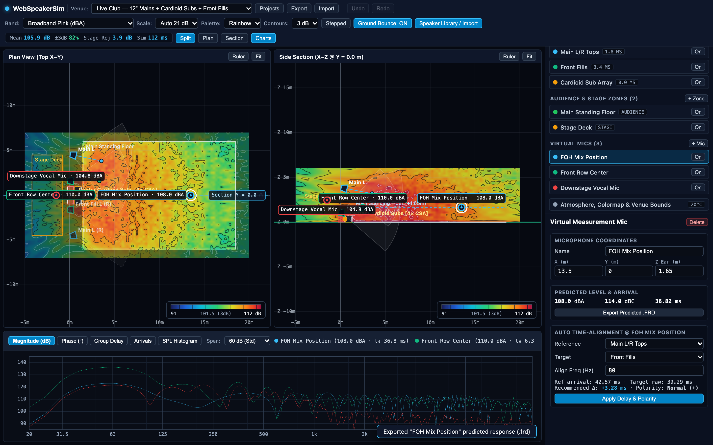
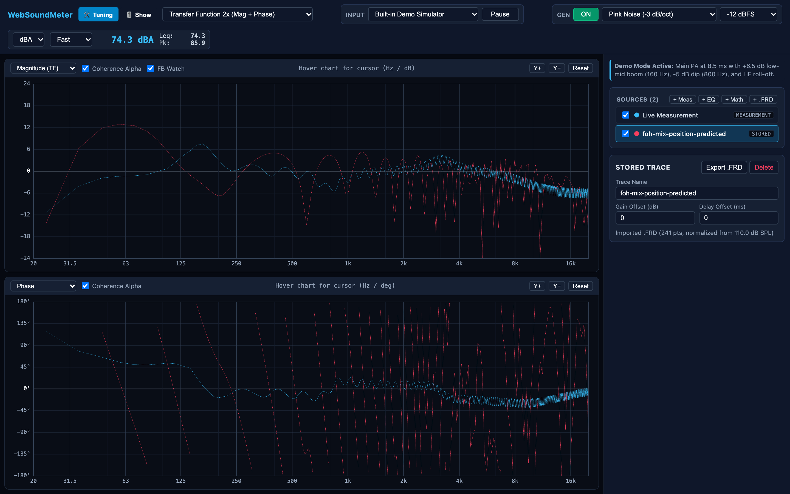

# Predict-to-Measure Workflow: From `WebSpeakerSim` to `WebSoundMeter`

One of the biggest time-savers on show day is arriving at load-in with your PA splay angles, cardioid subwoofer delays, and target FOH response **already predicted and verified**—so your on-site pink-noise time takes five minutes instead of an hour.

Because **[WebSpeakerSim](../apps/WebSpeakerSim/docs/user-guide.md)** and **[WebSoundMeter](../apps/WebSoundMeter/docs/user-guide.md)** share the same underlying acoustic math, crossover topologies, parametric EQ engine, and `.FRD` curve format, you can hand off your predicted Virtual Mic response directly from simulation into live measurement.

---

## Step 1: Design, Aim & Time-Align the System in `WebSpeakerSim`

1. Open **WebSpeakerSim** (`npm run dev:wss` $\rightarrow$ `http://localhost:5174`) and model your venue geometry, main L/R hangs, front fills, and subwoofer array (or start from the closest built-in venue preset).
2. Place **Virtual Measurement Microphones** at the exact positions where you plan to set up your real measurement mics on show day—for example:
   - **`FOH Mix Position`** (e.g., `X = 14 m, Y = 0 m, Z = 1.65 m`)
   - **`Front Row Center`** (handoff zone between Main PA and Front Fills)
   - **`Balcony Lip`** (handoff zone between Main PA and Delay Ring)
3. Set crossovers (`80 Hz LR24` on Subs and Tops), optimize cardioid subwoofer spacing, and click **`Apply Delay & Polarity`** in each Virtual Mic inspector to lock inter-group arrival times.

---

## Step 2: Export Your Predicted Virtual Mic `.FRD` Curve

1. In `WebSpeakerSim`'s right-hand Scene Tree, click the **Virtual Mic** you want to use as your on-site target reference (for example, **`FOH Mix Position`**).
2. In the **Virtual Measurement Mic** inspector, review **Predicted Level & Arrival** (`dBA`, `dBC`, and earliest arrival `ms`—write down that group delay number for your system processor!).
3. Click **`Export Predicted .FRD`**.

`WebSpeakerSim` downloads a standard 3-column `.frd` text file (`FreqHz   MagDb   PhaseDeg`) containing the complex acoustic summation of every active loudspeaker, ground reflection, atmospheric HF loss, crossover, and group EQ at that exact 3D coordinate.

---

## Step 3: Import the `.FRD` Target into `WebSoundMeter` On-Site

When the rig is flown and patched at the venue:

1. Open **WebSoundMeter** (`npm run dev:wsm` $\rightarrow$ `http://localhost:5173`—works 100% offline as an installed PWA even without venue Wi-Fi).
2. In **`🛠 Tuning`** mode, click **`+ .FRD`** in the **Sources** header on the right and select the `.frd` file you exported from `WebSpeakerSim`.
3. The predicted response appears immediately as a **Stored Trace** on both the **Magnitude** and **Phase** charts!
   - *Automatic `0 dB` Normalization:* Because `WebSpeakerSim` exports absolute predicted `dB SPL` (typically `100–110 dB SPL`) while a dual-FFT transfer function in `WebSoundMeter` centers around `0 dB` relative gain, `WebSoundMeter` **automatically normalizes** high-SPL `.frd` imports around `0 dB` (showing the exact normalization offset in the Stored Trace card). You can fine-tune **Gain Offset (dB)** and **Delay Offset (ms)** right in the Stored Trace inspector to line up passbands visually!

---

## Step 4: Verify Alignment & Sculpt Room EQ

With both your **Predicted `.FRD` Target** and your **Live Measurement** visible on screen:

1. **Verify Polarity & Sub/Top Alignment First:**
   - Run pink noise briefly, click **`Apply Delay`** (`D`) on your Live Measurement, and compare the live **Phase (°)** trace through the `60–120 Hz` crossover region against the predicted phase slope. If you see an unexpected `180°` wrap or deep crossover notch, check whether an amp channel or NL4 barrel was wired polarity-inverted before touching any EQ!
2. **Spot Real Room Modes vs. Expected Direct-Field Contour:**
   - Use **`+ Math`** $\rightarrow$ **`dB Difference (A − B)`** between your **Live Measurement** and the **Predicted `.FRD`** trace to isolate what the *room boundaries* added (such as low-mid room modes at `120–250 Hz` or air-conditioning humidity differences at `10 kHz+`).
3. **Transfer Exact DSP Settings Back to Hardware:**
   - Add a **`+ EQ`** Virtual Equalizer source in `WebSoundMeter`, drag the on-chart handles until your live response matches your target contour, and copy the exact **`Hz`**, **`Gain (dB)`**, **`Q`**, and **Crossover (`LR24` / `BW24`)** numbers straight into your FOH console or loudspeaker system processor.
   - Switch to **`🎚 Show`** mode for doors, and you are ready to mix!

