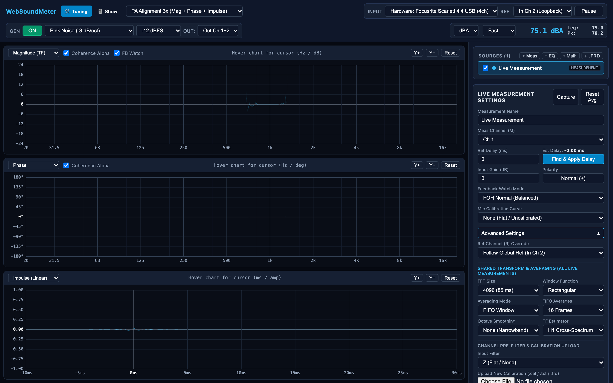

# Tutorial 01: Hardware Setup, Cabling & Microphone Calibration

Accurate dual-FFT acoustic measurements depend on a clean, phase-accurate signal chain before you ever touch an EQ band. This tutorial walks step by step through selecting hardware, wiring your USB audio interface, avoiding operating-system DSP traps, gain-staging your preamps, and calibrating your measurement microphone in **WebSoundMeter**.

---

## 1. Equipment Checklist

To measure loudspeaker **Magnitude, Phase, Coherence, and Impulse Response** (dual-channel transfer function), you need:

1. **Omnidirectional Measurement Microphone:**
   - Flat-response condenser capsule (e.g., *Earthworks M23/M30*, *Beyerdynamic MM1*, *Rational Acoustics RTA-420*, *Audix TM1*, *Dayton EMM-6*, or *Behringer ECM8000*).
   - Requires **+48V phantom power** and a tall boom stand positioned at listener ear height (`~1.2 m` seated, `~1.65 m` standing)—never resting directly on a mixing console surface or hard seat back!
2. **USB / Thunderbolt Audio Interface (`2-in / 2-out` minimum; `4-in / 4-out`+ for multi-mic):**
   - Examples: *Focusrite Scarlett 2i2 / 4i4 / 18i20*, *MOTU M2 / M4 / UltraLite*, *Radial USB-Pro / Catapult*, *RME Babyface Pro*, or *Audient iD14 / EVO 8*.
   - Must have **clean +48V mic preamps** and **discrete balanced line outputs**.
3. **Cables:**
   - **1× Balanced XLR Mic Cable** (long enough to reach FOH or audience positions from your interface).
   - **1× Balanced XLR or 1/4" TRS Cable** from **Interface Output 1** to your **FOH Console / System Processor Input**.
   - **1× Short Balanced 1/4" TRS-to-TRS Patch Cable** (or TRS-to-XLR line pad cable) for the **Physical Reference Loopback** from **Interface Output 2 $\rightarrow$ Interface Input 2**.
4. *(Optional, for legal SPL compliance)* **Acoustic SPL Calibrator (`94.0 dB` or `114.0 dB SPL @ 1 kHz`):**
   - Class 1 or Class 2 pistonphone/calibrator with a `1/2"` or `1/4"` mic barrel adapter.

---

## 2. Physical Wiring Diagrams

### Setup A: Standard 2-Channel Dual-FFT Rig (Recommended)

Why wire a physical loopback cable from `Output 2` back into `Input 2` instead of just comparing against the digital generator inside the computer?
- A **physical loopback** sends the exact same reference waveform through your interface's **DAC $\rightarrow$ analog output stage $\rightarrow$ analog input stage $\rightarrow$ ADC**, automatically canceling USB buffer round-trip latency, DAC/ADC reconstruction filter phase shift, and clock drift!

```mermaid
flowchart LR
  subgraph USB["2x2 USB Audio Interface (48 kHz)"]
    OUT1["Line Out 1 (Pink Noise)"]
    OUT2["Line Out 2 (Loopback Send)"]
    IN1["Mic In 1 (+48V ON)"]
    IN2["Line In 2 (+48V OFF / TRS)"]
  end

  PA["System Processor / Console Matrix\n(Mains + Subs)"]
  MIC["Measurement Condenser Mic\n(FOH / Audience Position)"]

  OUT1 -->|"Balanced TRS / XLR"| PA
  PA -.->|"Acoustic Flight Path (Air Delay τ)"| MIC
  MIC -->|"XLR Mic Cable"| IN1
  OUT2 ==>|"Short Balanced 1/4\" TRS Patch Cable\n(Timing & Phase Reference R)"| IN2
```

| Interface Port | Signal Role | Connector & Switch Settings |
| :--- | :--- | :--- |
| **Input 1 (`Ch 1`)** | **Measurement (`M`)** | **XLR** from Measurement Mic · **`+48V` Phantom ON** · `Inst/Hi-Z` OFF · `Air/Color` OFF |
| **Input 2 (`Ch 2`)** | **Reference Loopback (`R`)** | **1/4" Balanced TRS** from Output 2 · **`+48V` OFF** (using a 1/4" TRS plug bypasses phantom power on combo jacks!) · `Inst/Hi-Z` OFF |
| **Output 1 (`Out Ch 1`)** | **Generator Drive to PA** | Balanced TRS/XLR to System Processor or Console Talkback/Matrix input |
| **Output 2 (`Out Ch 2`)** | **Reference Loopback Send** | Balanced TRS patch directly back into **Input 2** *(ensure your interface's Stereo Monitor knob is panned or routed so Out 1 & Out 2 receive identical generator feed, or split Out 1 with a passive TRS/XLR Y-cable!)* |

> [!CAUTION]
> **Protect your interface output stage from +48V phantom power:** If your 2-channel interface has a **single global `+48V` button** that powers *both* Input 1 and Input 2 XLR pins simultaneously, always plug your Output 2 $\rightarrow$ Input 2 loopback into the **center 1/4" TRS jack** of the combo input (not the 3-pin XLR outer ring). Combo jacks only apply +48V to the XLR pins, keeping the 1/4" TRS line input completely isolated from phantom voltage.

---

### Setup B: 4-Channel Multi-Microphone Spatial Rig

With a `4-in / 4-out` (or `8-in / 8-out`) interface, you can measure **3 microphone positions simultaneously** against a single shared physical loopback on `Input 4`:

```text
  [ Mic 1: On-Axis Center ] ──(XLR, +48V)──► In Ch 1 (Slot 1 Meas)
  [ Mic 2: Off-Axis Mid   ] ──(XLR, +48V)──► In Ch 2 (Slot 2 Meas)
  [ Mic 3: Balcony / Rear ] ──(XLR, +48V)──► In Ch 3 (Slot 3 Meas)

  [ Out Ch 1 ] ──(Balanced TRS/XLR)────────► PA System Processor
  [ Out Ch 2 ] ══(Short 1/4" TRS Loopback)═► In Ch 4 (Global Reference R)
```

> **Playing your own music track from a console as the Reference?** Instead of using WebSoundMeter's internal pink-noise generator, patch a **post-fade Left+Right sum (or Matrix send) from your FOH console** into **`In Ch 4` (`Global Reference R`)**! Because $H_1(f) = G_{RM}(f) / G_{RR}(f)$ divides the mic cross-spectrum by whatever reference audio is present on `R`, you can measure live PA transfer functions silently during band line-check or walk-in music wherever program energy exists (watched via the Coherence trace).

---

### Setup C: Single-Channel USB Mic (`Internal Gen` Loopback)

If you only have a single-channel USB measurement microphone (such as a *miniDSP UMIK-1*) and feed pink noise out of a laptop headphone jack or Dante Virtual Soundcard:
1. Select your USB mic under **Input** (`Meas Channel: Ch 1`).
2. Set **Ref** in the top bar to **`Internal Gen`**.
3. **Important caveat:** Magnitude and RTA work great, and Auto-Delay works for snapshots, but because the USB mic and headphone DAC run on **two separate crystal clocks**, phase at `10–20 kHz` will slowly drift over tens of seconds. Re-click **`Find & Apply Delay`** before capturing phase traces, or step up to a 2-channel interface with physical loopback for rock-solid sub/top phase work.

---

## 3. Critical OS Audio Settings (Before Opening the Browser)

Modern laptop operating systems apply aggressive "conference call" voice processing by default that destroys acoustic phase and rolls off everything below `150 Hz` and above `7 kHz`. Even though **WebSoundMeter** explicitly requests raw capture (`echoCancellation: false, noiseSuppression: false, autoGainControl: false`), check these two OS settings once:

- **macOS (`Sonoma` / `Sequoia` / newer):**
  1. Open **Audio MIDI Setup** (`Cmd + Space` $\rightarrow$ *Audio MIDI Setup*), select your USB Audio Interface on both Input and Output, and set **Format** to **`48,000 Hz`** (`24-bit`).
  2. Once Chrome/Edge opens the microphone, click the **orange Microphone icon** in the macOS top-right Menu Bar and verify **Mic Mode** is set to **`Standard`** — **never** *Voice Isolation*!
- **Windows 11:**
  1. Open **Settings $\rightarrow$ System $\rightarrow$ Sound $\rightarrow$ More sound settings**.
  2. Double-click your USB interface under **Recording** $\rightarrow$ **Advanced**: set Default Format to **`24 bit, 48000 Hz`**, and **uncheck** *Enable audio enhancements*.

---

## 4. Step-by-Step Software Routing & Gain Staging

1. Start **WebSoundMeter** (`npm run dev:wsm` $\rightarrow$ `http://localhost:5173`) and stay in **`🛠 Tuning`** mode.
2. **Mute or turn down your PA amplifiers/processor input** before enabling the generator.
3. In the **Top Bar**:
   - Under **Input**, select **`Hardware: <Your USB Audio Interface>`** and click **Allow** when the browser asks for microphone access.
   - Set **Ref** next to Input to **`In Ch 2 (Loopback)`** (or `In Ch 4` on a 4-channel rig).
   - Set **Generator** to **`Pink Noise`** at **`-12 dBFS`** routed to **`Out Ch 1`** (or `All / Stereo` if feeding Out 1 to PA and Out 2 to Loopback), and click **`Gen Off` $\rightarrow$ `Gen On`**.
4. **Stage Reference Gain (`In Ch 2`):**
   - Slowly raise your interface's **Input 2 gain knob** (if it has a variable trim) until the input meter LEDs sit comfortably in the green/amber zone around **`-18` to `-12 dBFS`** with **at least `12 dB` of headroom** below `0 dBFS` clipping.
5. **Stage PA & Mic Gain (`In Ch 1`):**
   - Bring up your PA system processor input until pink noise in the venue reaches a comfortable conversational measurement level (`~75–82 dBC`—you rarely need ear-splitting pink noise to get `> 95%` coherence!).
   - Raise your interface's **Input 1 mic preamp knob** until the microphone signal also sits cleanly around **`-18` to `-12 dBFS`** without ever flashing the red clip LED.



---

## 5. Loading a `.cal` Microphone Calibration Curve

Even quality measurement microphones exhibit a `+1.5` to `+3 dB` capsule diffraction peak between `8 kHz` and `16 kHz` plus low-end roll-off below `30 Hz`. Loading your microphone's serial-numbered `.cal` / `.txt` / `.frd` file subtracts that capsule color from every live measurement slot and RTA trace:

1. Select **`Live Measurement`** in the right-hand **Sources** panel.
2. Click **`Advanced Settings ▾`** at the bottom of the **Live Measurement Settings** card.
3. Scroll to **`Upload New Calibration (.cal / .txt / .frd)`** and choose your manufacturer's calibration file (standard 2-column `Freq_Hz  Mag_dB` or 3-column `Freq_Hz  Mag_dB  Phase_Deg` text file).
4. Verify your file now appears selected in the **`Mic Calibration Curve`** dropdown (`M30-Serial-8412.cal (13 pts)`). It is automatically saved in your browser's `IndexedDB` so it reloads offline on every future gig!


---

## 6. Calibrating Absolute SPL (`94.0 dB` / `114.0 dB @ 1 kHz`)

A digital audio interface only knows **`dBFS`** (decibels below full-scale ADC clipping)—changing your preamp gain knob by `+6 dB` changes `dBFS` by `+6 dB` even though the sound pressure in the room didn't change! If you plan to monitor **real-world `dBA` / `dBC` SPL limits** during a show:

1. **Lock your physical preamp knob:** Set your Input 1 mic preamp gain low enough that the loudest peak of the concert (`e.g., 122–126 dB Peak`) will **never clip `0 dBFS`**, and put a piece of console tape next to the knob so nobody bumps it!
2. Slide your **Acoustic SPL Calibrator** snugly over the measurement microphone capsule and switch it on at **`94.0 dB`** (or **`114.0 dB`**) @ `1 kHz`.
3. In the **Top Bar** on the right, set the **SPL Weighting** dropdown to **`dBZ`** (or **`dBA`**, since A-weighting is exactly `0.0 dB` at `1,000 Hz`!) and **`Slow`**.
4. Compare the displayed **`dBZ`** / **`Leq`** number against `94.0 dB`, and adjust **`Input Gain (dB)`** in **Live Measurement Settings** until the topbar SPL readout reads **`94.0 dB`** steady.
5. Remove the calibrator from the mic—your topbar SPL meter, rolling `LAeq15` compliance badges, and Show Mode history logs are now referenced to true acoustic Pascals (`20 µPa`)!

---

**Next Step $\rightarrow$** [Tutorial 02: 3D Venue Prediction, Cardioid Subs & Alignment in WebSpeakerSim](./02-venue-prediction-and-sub-alignment-in-wss.md)
