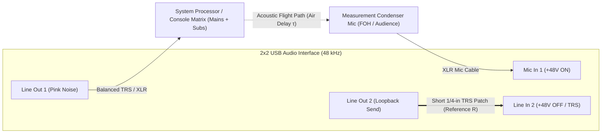
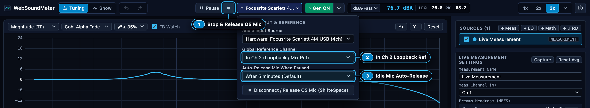
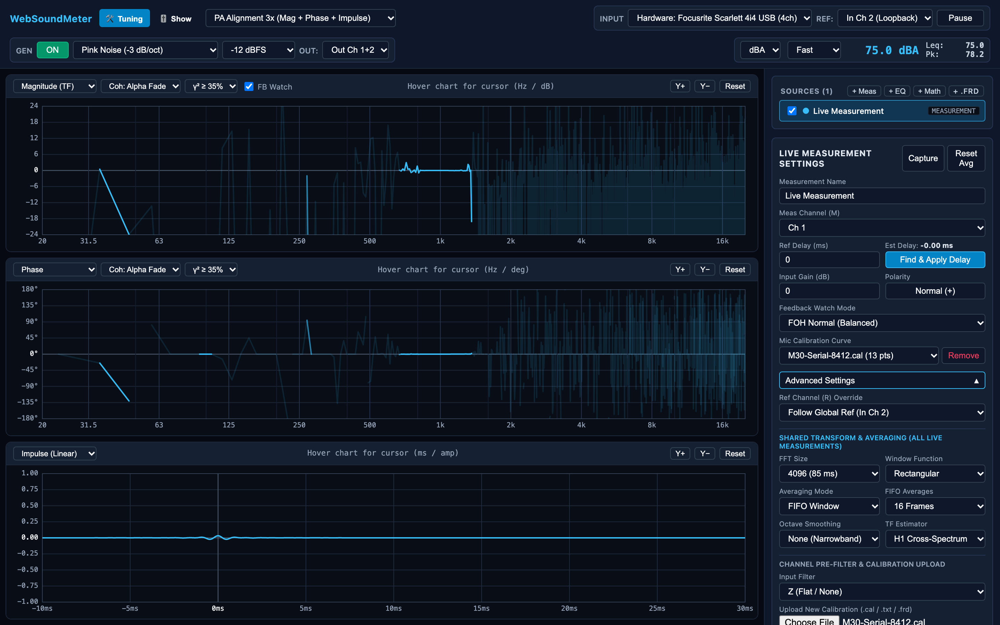
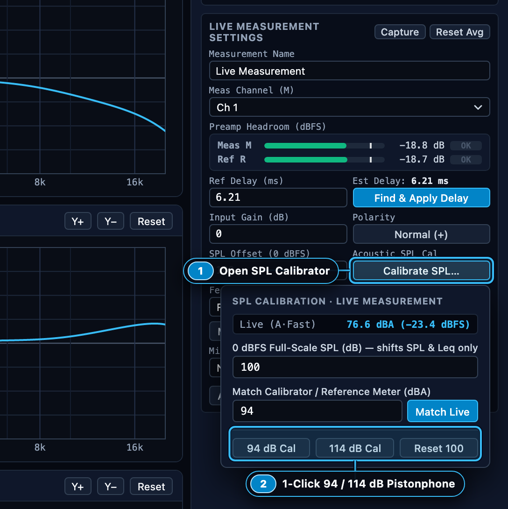

# Tutorial 01: Hardware Setup, Cabling & Microphone Calibration

Accurate dual-FFT acoustic measurements depend on a clean, phase-accurate signal chain before touching any EQ band. This tutorial walks through selecting hardware, wiring a USB audio interface, disabling operating-system voice processing, gain-staging preamps using the live `dBFS` headroom meters, and calibrating your measurement microphone in **WebSoundMeter**.

---

## 1. Equipment Checklist

To measure loudspeaker **Magnitude, Phase, Coherence, and Impulse Response** (dual-channel transfer function), you need:

1. **Omnidirectional Measurement Microphone:**
   - Flat-response condenser capsule (such as *Earthworks M23/M30*, *Beyerdynamic MM1*, *Rational Acoustics RTA-420*, *Audix TM1*, *Dayton EMM-6*, or *Behringer ECM8000*).
   - Requires **+48V phantom power** and a boom stand placed at listener ear height (`~1.2 m` seated, `~1.65 m` standing)—avoid resting the mic directly on a console surface or hard seat back.
2. **USB / Thunderbolt Audio Interface (`2-in / 2-out` minimum; `4-in / 4-out`+ for multi-mic):**
   - Examples: *Focusrite Scarlett 2i2 / 4i4 / 18i20*, *MOTU M2 / M4 / UltraLite*, *Radial USB-Pro / Catapult*, *RME Babyface Pro*, or *Audient iD14 / EVO 8*.
   - Must have clean `+48V` mic preamps and discrete balanced line outputs.
3. **Cables:**
   - **1× Balanced XLR Mic Cable** reaching FOH or audience positions from your interface.
   - **1× Balanced XLR or 1/4" TRS Cable** from **Interface Output 1** to your **System Processor / Console Matrix Input**.
   - **1× Short Balanced 1/4" TRS-to-TRS Patch Cable** for the **Physical Reference Loopback** from **Interface Output 2 → Interface Input 2**.
4. *(Optional, for statutory SPL compliance)* **Acoustic SPL Calibrator (`94.0 dB` or `114.0 dB SPL @ 1 kHz`):**
   - Class 1 or Class 2 calibrator with a `1/2"` or `1/4"` capsule adapter.

---

## 2. Physical Wiring Diagrams

### Setup A: Standard 2-Channel Dual-FFT Rig (Recommended)

A **physical loopback** sends the exact same reference waveform through your interface's **DAC → analog output stage → analog input stage → ADC**, automatically canceling USB buffer latency, DAC/ADC reconstruction filter phase shift, and sample-clock drift.



| Interface Port | Signal Role | Connector & Switch Settings |
| :--- | :--- | :--- |
| **Input 1 (`Ch 1`)** | **Measurement (`M`)** | **XLR** from Measurement Mic · **`+48V` Phantom ON** · `Inst/Hi-Z` OFF · `Air/Color` OFF |
| **Input 2 (`Ch 2`)** | **Reference Loopback (`R`)** | **1/4" Balanced TRS** from Output 2 · **`+48V` OFF** · `Inst/Hi-Z` OFF |
| **Output 1 (`Out Ch 1`)** | **Generator Drive to PA** | Balanced TRS/XLR to System Processor or Console Matrix input |
| **Output 2 (`Out Ch 2`)** | **Reference Loopback Send** | Balanced TRS patch directly back into **Input 2** (with Generator Output set to **`Out Ch 1+2`**, or split Output 1 via a passive Y-cable) |

> [!CAUTION]
> **Protect your interface output stage from +48V phantom power:** If your 2-channel interface has a single global `+48V` switch that powers both Input 1 and Input 2 XLR pins simultaneously, plug your Output 2 → Input 2 loopback into the **center 1/4" TRS jack** of the combo input (never the 3-pin XLR outer ring). Combo jacks apply `+48V` only to the XLR pins, keeping the 1/4" TRS line input isolated.

### Setup B: Multi-Microphone Spatial Rig (`Up to 7 Mics + 1 Loopback`)

**WebSoundMeter** taps up to `8` distinct physical hardware input channels simultaneously. On a `4-in / 4-out` or `8-in / 8-out` interface, wire your shared reference loopback (or console Left+Right matrix feed) into the last channel and connect up to `7` measurement mics across the remaining inputs:

```text
  [ Mic 1: On-Axis Center ] ──(XLR, +48V)──► In Ch 1 (Slot 1 Meas)
  [ Mic 2: Off-Axis Mid   ] ──(XLR, +48V)──► In Ch 2 (Slot 2 Meas)
  [ Mic 3: Balcony / Rear ] ──(XLR, +48V)──► In Ch 3 (Slot 3 Meas)

  [ Out Ch 1 ] ──(Balanced TRS/XLR)────────► PA System Processor
  [ Out Ch 2 ] ══(Short 1/4" TRS Loopback)═► In Ch 4 (Global Reference R)
```

### Setup C: Single-Channel USB Mic (`Internal Gen` Reference)

If using a single-channel USB measurement microphone (such as a *miniDSP UMIK-1*) while feeding pink noise from a separate headphone DAC or network audio card:
1. Select the USB mic under **`INPUT`** (`Meas Channel: Ch 1`).
2. Set **`Ref`** in the top bar to **`Internal Gen`**.
3. Magnitude and RTA work reliably, and Auto-Delay works for snapshots, but because the USB mic and output DAC run on separate crystal clocks, high-frequency phase (`10–20 kHz`) will drift slowly over tens of seconds. Re-click **`Find & Apply Delay`** right before capturing phase traces.

---

## 3. Critical OS Audio Settings

Laptop operating systems often enable conference-call voice processing that rolls off sub-bass and destroys acoustic phase. Verify these settings once before opening the browser:

- **macOS (`Sonoma` / `Sequoia` or newer):**
  1. Open **Audio MIDI Setup**, select your USB Audio Interface on both Input and Output, and set **Format** to **`48,000 Hz`** (`24-bit`).
  2. Once the browser opens the microphone, click the **orange Microphone icon** in the macOS Menu Bar and ensure **Mic Mode** is set to **`Standard`** (not *Voice Isolation*).
- **Windows 11:**
  1. Open **Settings → System → Sound → More sound settings**.
  2. Double-click your USB interface under **Recording → Advanced**: set Default Format to **`24 bit, 48000 Hz`**, and uncheck *Enable audio enhancements*.

---

## 4. Software Routing & Preamp Gain Staging

1. Open **WebSoundMeter** (`http://localhost:5173` or installed PWA) in **`🛠 Tuning`** mode.
2. **Safety Note:** In `Built-in Demo Simulator` mode, the internal generator starts `ON` so the demo plots immediately. As soon as you switch **`INPUT`** to any physical **`Hardware`** interface, **WebSoundMeter** automatically switches **`GEN`** to **`OFF`** so pink noise cannot blast an unmuted PA unexpectedly. Keep your PA processor muted until routing is verified.
3. In the **Top Bar**:
   - Set **`INPUT`** to **`Hardware: <Your USB Audio Interface>`** and allow microphone permission.
   - Set **`Ref`** to **`In Ch 2`** (or `In Ch 4` on a 4-channel rig).
   - Set **`GEN`** signal to **`Pink Noise (-3 dB/oct)`** at **`-12 dBFS`**, set **`Out`** to **`Out Ch 1+2`** (feeding Out 1 to the PA and Out 2 to the loopback), and click **`OFF`** → **`ON`**.
4. **Check `Preamp Headroom (dBFS)` in the Right Inspector:**
   - Raise your interface's **Input 2 (`Ref R`)** trim until the **`Ref R`** bar sits in the green zone around **`-18` to `-12 dBFS`** (`OK` badge, well below `-0.5 dBFS` `CLIP`).
   - Bring up your PA processor input to a comfortable conversational pink-noise level (`~75–82 dBC` in the room) and raise **Input 1 (`Meas M`)** mic preamp gain until **`Meas M`** also reads around **`-18` to `-12 dBFS`** without triggering **`CLIP`**.

<!-- screenshot
app: wsm
scene: t01-01-hardware-routing
regions: [topbar, chart-0, chart-1, sources-card, live-inspector]
description: Hardware USB interface active at 48 kHz with Pink Noise generator routed to Out Ch 1+2 and green Meas M / Ref R preamp headroom bars.
annotations:
  - badge: 1
    target: "[data-testid='btn-io-popover']"
    label: "USB Interface · Ref Ch 2"
    placement: bottom
  - badge: 2
    target: "[data-testid='btn-generator-toggle']"
    label: "Gen ON (Pink -12 dBFS)"
    placement: bottom
  - badge: 3
    target: "[data-testid='input-dbfs-meter-strip']"
    label: "Meas M & Ref R (-18..-12 dBFS)"
    placement: left
-->


### Warm `Pause` (`Space`) vs. Releasing the OS Microphone (`⏹` / `Shift + Space`)

Clicking the interface pill in the top bar opens **`Audio Input & Reference`**:
- **`Pause` (`Space`):** Freezes live FFT integration, SPL meters, and generator output while keeping the USB stream warm for instant resume between pink-noise bursts.
- **`Stop / Disconnect` (`⏹` split-pill button or `Shift + Space`):** Stops hardware capture tracks and turns off the OS active-microphone indicator while preserving your selected device and channel routing in standby.
- **`Auto-Release Mic When Paused`:** Automatically releases the OS microphone if left paused for `5 minutes` (configurable from `2` to `30` minutes, or `Never`).

<!-- screenshot
app: wsm
scene: t01-03-io-popover-stop-release
regions: [topbar, io-popover]
padding: { top: 0, right: 24, bottom: 20, left: 24 }
description: Open Audio Input & Reference popover showing Global Reference Channel Ch 2 loopback, idle mic auto-release timer, and warm Pause vs. Stop/Disconnect transport split-pill.
annotations:
  - badge: 1
    target: "[data-testid='btn-stop-hardware']"
    label: "Stop & Release OS Mic"
    placement: bottom
  - badge: 2
    target: "[data-testid='select-ref-channel']"
    label: "In Ch 2 Loopback Ref"
    placement: right
  - badge: 3
    target: "[data-testid='select-auto-release-minutes']"
    label: "Idle Mic Auto-Release"
    placement: right
-->


---

## 5. Loading a `.cal` Microphone Calibration Curve

Measurement condenser capsules typically exhibit a `+1.5` to `+3 dB` diffraction peak between `8 kHz` and `16 kHz` plus gentle roll-off below `30 Hz`. Loading your microphone's serial-numbered calibration file subtracts that capsule response from Transfer Function and RTA traces:

1. Select **`Live Measurement`** in **Sources (1)**.
2. Click **`Advanced Settings ▾`** at the bottom of **Live Measurement Settings**.
3. Under **`Upload Calibration (.cal / .txt / .frd)`**, choose your 2-column (`Freq_Hz  Mag_dB`) or 3-column (`Freq_Hz  Mag_dB  Phase_Deg`) calibration file.
4. Confirm the file is active in the **`Mic Calibration Curve`** dropdown (`M30-Serial-8412.cal (13 pts)`). Calibration curves persist in `IndexedDB` across offline reloads.

<!-- screenshot
app: wsm
scene: t01-02-mic-calibration-loaded
regions: [tuning-sidebar]
description: Right Tuning sidebar scrolled to Advanced Settings with serial-numbered M30-Serial-8412.cal curve active in Mic Calibration Curve.
annotations:
  - badge: 1
    target: "[data-testid='select-calibration-curve']"
    label: "Active .cal Curve (13 pts)"
    placement: top
  - badge: 2
    target: "#wsm-calibration-upload"
    label: "Upload .cal / .txt / .frd"
    placement: top
-->


---

## 6. Calibrating Absolute SPL (`94.0 dB` / `114.0 dB @ 1 kHz`)

A digital interface reports **`dBFS`** (decibels relative to full-scale ADC clipping). To reference **WebSoundMeter**'s broadband SPL meter and Show Mode compliance logs to true acoustic Pascals (`20 µPa`) **without shifting `0 dB` on your Transfer Function or RTA traces**:

1. **Lock physical preamp gain first:** Set your Input 1 preamp knob low enough that peak concert levels (`122–126 dB Peak`) will never clip `0 dBFS`, and mark or tape the knob.
2. Fit your **Acoustic SPL Calibrator** over the microphone capsule and turn it on at **`94.0 dB`** (or **`114.0 dB`**) at **`1 kHz`**.
3. In **Live Measurement Settings** (or on any mic row in **`🎚 Show`** mode), click **`Calibrate SPL…`** (`Cal…`):
   - Click **`94 dB Cal`** (or **`114 dB Cal`**) for a 1-click pistonphone calibration, or enter a side-by-side reference SPL meter reading and click **`Match Live`**.
   - **WebSoundMeter** computes and stores the exact **`SPL Offset (0 dBFS = X dB SPL)`** for that microphone channel.
4. Remove the calibrator.

<!-- screenshot
app: wsm
scene: t01-04-spl-calibrator-94db
regions: [live-inspector, cal-popover]
padding: { top: 14, right: 12, bottom: 44, left: 215 }
description: Live Measurement inspector with the SPL Calibration popover open showing live dBA/dBFS level, Match Live reference field, and 1-click 94 dB / 114 dB pistonphone buttons.
annotations:
  - badge: 1
    target: "[data-testid='btn-calibrate-spl']"
    label: "Open SPL Calibrator"
    placement: left
  - badge: 2
    target: "[data-doc-region='cal-popover'] .foh-popover-actions"
    label: "1-Click 94 / 114 dB Pistonphone"
    placement: bottom
-->


> [!IMPORTANT]
> **`SPL Offset (0 dBFS)` vs. `Input Gain (dB)`:** `SPL Offset` (`Calibrate SPL…`) calibrates broadband SPL, `Leq`, `Peak`, and Show History while leaving Transfer Function and RTA `dBFS` traces untouched. Use `Input Gain (dB)` only when digitally trimming channel level into the FFT (for example, matching `M` to `R` gain on a Transfer Function plot).

---

*Return to the [FOH Tutorial Index](./README.md).*
