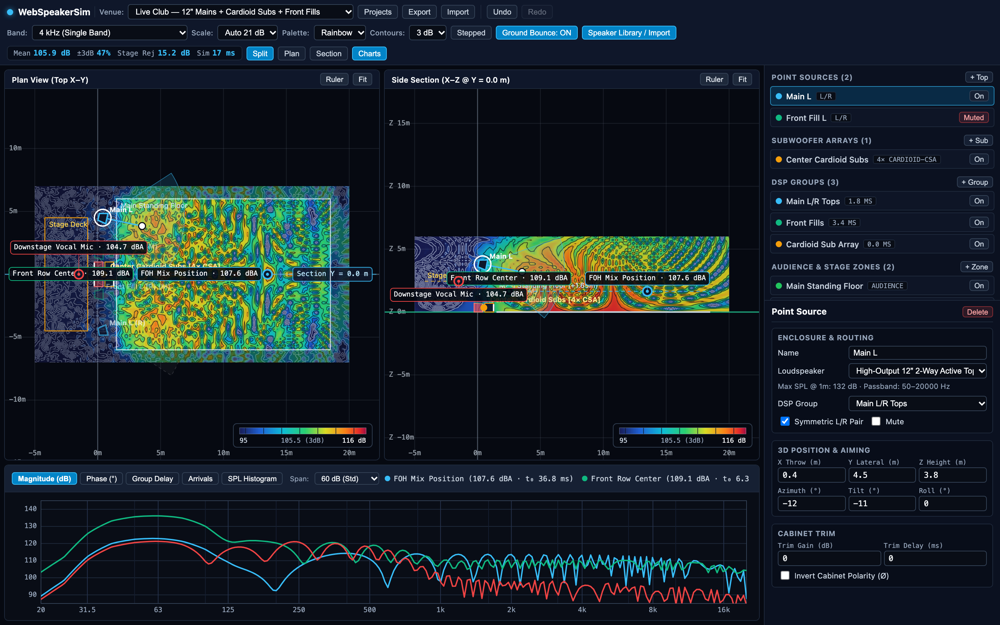
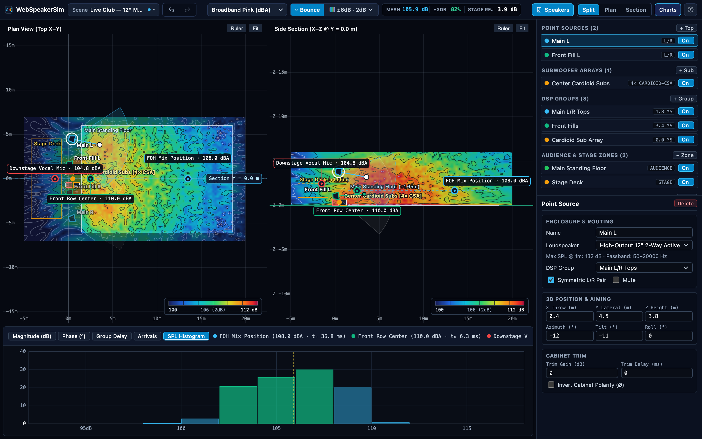
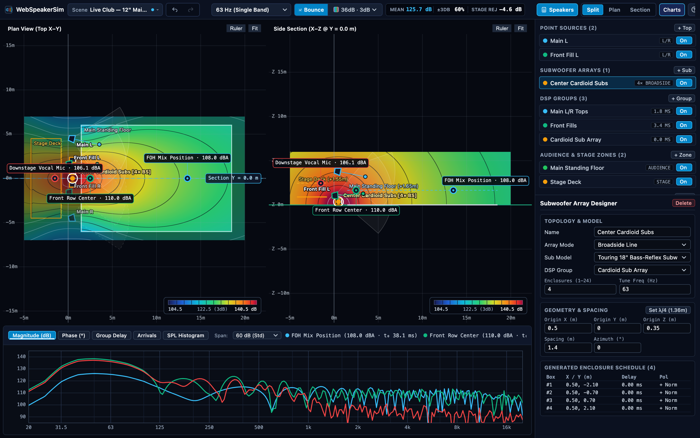
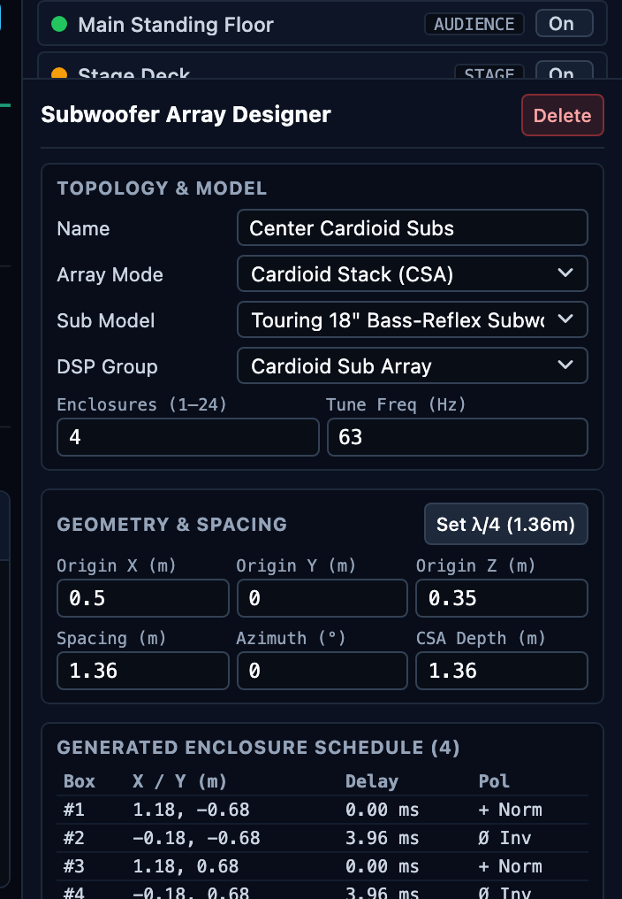
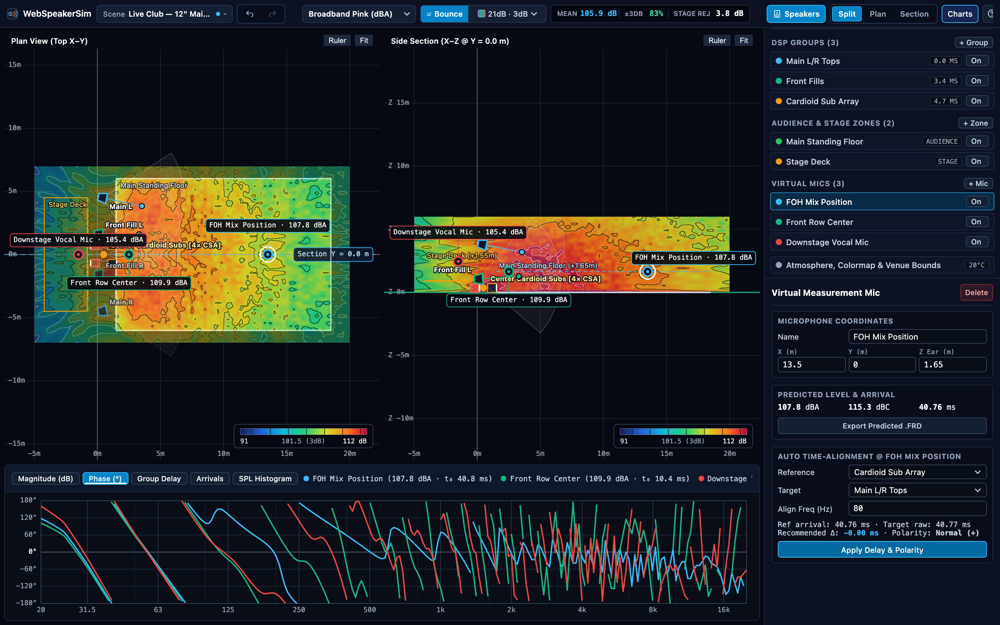
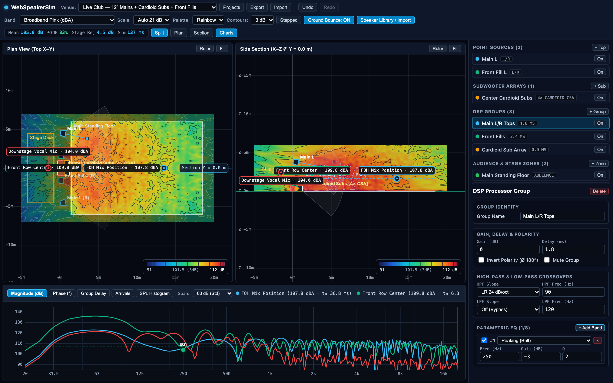

# Tutorial 02: Club Venue Prediction, Cardioid Subs & Alignment (`WebSpeakerSim`)

Before rolling cases out of the truck, acoustic prediction lets you verify horn aiming, front-fill coverage, stage bass rejection, and initial delay times in minutes. In this tutorial we design and align an `18 m × 12 m` live music club in **WebSpeakerSim** (`http://localhost:5174`).

---

## 1. Venue Coordinates & Scene Layout

Load **`Live Club — 12" Mains + Cardioid Subs + Front Fills`** from the **`Venue`** selector in the top bar.

**WebSpeakerSim** uses a right-handed metric coordinate system (`meters`):
- **`+X` (Throw):** Stage lip (`X = 0 m`) out toward FOH (`X = 13.5 m`) and back wall (`X = 18.5 m`).
- **`+Y` (Lateral):** **Stage Left** (`+Y`, top of Plan View, which is *House Right* when looking from FOH); `-Y` is **Stage Right** (*House Left*); `Y = 0 m` is room centerline.
- **`+Z` (Elevation):** Floor (`Z = 0 m`) upward toward the ceiling (`Z = 6.0 m`).

---

## 2. Aiming L/R Mains at `4 kHz` & Filling the Front-Center Gap

Broadband heatmaps include omnidirectional sub-bass that masks high-frequency vocal dead spots. Always inspect horn aiming at **`2 kHz` or `4 kHz`** first:

1. In the **Point Sources** tree on the right, click **`On`** → **`Muted`** next to **`Front Fill L`**.
2. Set **`Band`** in the top bar to **`4 kHz (Single Band)`**, set **`Contours`** to **`Off`**, and click **`Stepped`** so discrete isobar color bands reveal high-frequency coverage clearly.
3. Click **`Main L`** (`X = 0.4 m, Y = +4.5 m, Z = 3.8 m`). Because **`Symmetric L/R Pair`** is checked, its mirrored twin **`Main R`** (`Y = -4.5 m`) tracks every position and angle edit automatically.

Notice two key details:
- Right in front of the downstage edge around **`Front Row Center`** (`X = 2.5 m, Y = 0 m`), listeners sit inside the triangular shadow between the widely spaced `Main L` and `Main R` horns (`47%` within `±3 dB` at `4 kHz`).
- Dragging the white circular **aim handle** in **Plan View** adjusts inward toe-in (**`Azimuth = -12°`**), while dragging it in **Side Section** aims vertical throw (**`Tilt = -11°`**, pointing roughly two-thirds down the floor so inverse-square distance loss balances horn off-axis roll-off).

### Unmuting Stage-Lip Front Fills & Checking Broadband Evenness

1. Click **`Muted`** → **`On`** next to **`Front Fill L`** (`8"` stage-lip enclosures laid horizontally with `Roll = 90°` at `Z = 1.05 m`, `Y = ±1.6 m`, and **`Tilt = +4°`**—angling gently upward from the `1.05 m` stage lip toward `1.65 m` standing ear height).
2. Switch **`Band`** to **`Broadband Pink (dBA)`**, click **`Stepped`** off, set **`Scale`** to **`Auto ±6 dB`** with **`2 dB`** contours, and open the **`SPL Histogram`** tab in the bottom chart drawer.

Across the entire standing floor, broadband coverage within `±3 dB` reaches **`82%`** (`Mean 105.9 dB`) with the front-row center vocal gap filled smoothly.

---

## 3. Eliminating Stage Bass Wash (`63 Hz` Cardioid Stack)

Subwoofers stacked along the downstage edge sit closer to vocal and drum microphones on stage (`X = -1.5 m`) than to the audience (`X = 2.5–18.5 m`). Compare an omnidirectional broadside line against a quarter-wave **Cardioid Stack (`CSA`)**:

1. Set **`Band`** to **`63 Hz (Single Band)`**, **`Contours`** to **`3 dB`**, and **`Scale`** to **`Auto 36 dB`**.
2. Select **`Center Cardioid Subs`** under **Subwoofer Arrays** and set **`Array Mode`** to **`Broadside Line`**.

Notice **`Stage Rej: -4.6 dB`** in the top bar—at `63 Hz`, the stage deck is `4.6 dB` *louder* than the audience average.

3. Switch **`Array Mode`** to **`Cardioid Stack (CSA)`**, verify **`Tune Freq (Hz)`** is **`63`**, and click **`Set λ/4 (1.36m)`**:
   - Rear-facing cabinets (`#2` and `#4` at `X = -0.18 m`) rotate `180°`, invert polarity (`Ø Inv`), and apply quarter-wave electronic delay ($\tau = d / c = 3.96\text{ ms}$ for `d = 1.36 m` at `c = 343.2 m/s`):
     - **Forward (`+X` toward audience):** Rear-box wave travels an extra distance `+d` (`+d/c` acoustic lag) plus `+d/c` electronic delay (`λ / 2`, or `180°` total lag). Combined with the `180°` polarity flip, `180° + 180° = 360°`—arriving **in phase** with the front boxes.
     - **Backward (`-X` onto stage):** Because the rear box sits `d` closer to the stage (`-d/c` acoustic lead), its `+d/c` electronic delay brings both waves to the stage at the **exact same instant** (`0°` time offset), where the `180°` polarity flip cancels them out of phase.

**`Stage Rej`** improves by **`10.2 dB`** (from `-4.6 dB` to **`+5.6 dB`**), turning the stage deck cool blue while preserving full low-end impact out front. Copy the per-cabinet coordinates, `3.96 ms` delay, and `Ø Inv` polarity directly from **`GENERATED ENCLOSURE SCHEDULE (4)`** at the bottom right.

---

## 4. Virtual Mic Time Alignment & On-Chart DSP Group EQ

### One-Click Inter-Group Alignment

1. Select **`FOH Mix Position`** (`X = 13.5 m, Y = 0 m, Z = 1.65 m`) under **Virtual Mics** and open the **`Phase (°)`** tab in the bottom chart drawer.
2. In the **Auto Time-Alignment** section of the Virtual Mic inspector:
   - Set **`Reference`** to **`Cardioid Sub Array`** (the latest-arriving acoustic group due to low-pass crossover group delay and quarter-wave CSA delay).
   - Set **`Target`** to **`Main L/R Tops`** and **`Align Freq (Hz)`** to **`90`** (matching the `90 Hz` `LR24` crossover).
   - Click **`Apply Delay & Polarity`** to write the exact electronic alignment delay directly to the `Main L/R Tops` DSP Group.

### Sculpting Crossovers & Draggable DSP Group EQ Handles

1. Under **DSP Groups**, click **`Main L/R Tops`** (`LR 24 dB/oct` high-pass @ `90 Hz`) and switch the bottom chart back to **`Magnitude (dB)`**.
2. Click **`+ Add Band`** under **Parametric EQ** to insert corrective filters.
3. Drag the green **`EQ1..EQ3`** handles directly on the **Magnitude (dB)** chart:
   - **Horizontal drag** sweeps **Frequency (`Hz`)**.
   - **Vertical drag** adjusts **Gain (`dB`)**.
   - **`Shift + Vertical Drag`** or **`Shift + Mouse Wheel`** narrows or widens **`Q`**.

---

## 5. Custom Loudspeakers & Exporting Predicted `.FRD` Curves

- **Loudspeaker Library (`L` / `Speaker Library / Import`):** Click **`Speaker Library / Import`** in the top bar to browse built-in enclosures, synthesize a 3D directivity balloon from a PDF datasheet in the **`Datasheet Spec Builder`** tab (`H° × V°` coverage, `-3 dB` passband cuts, and continuous Max SPL @ `1 m`), or import `.gll`, `.clf`, and `.frd` files into `IndexedDB`.
- **Exporting `.FRD` Targets:** Select **`FOH Mix Position`** under **Virtual Mics** and click **`Export Predicted .FRD`** inside **`Predicted Level & Arrival`** to save `foh-mix-position-predicted.frd` for field verification on site.

---

*Return to the [FOH Tutorial Index](./README.md).*
