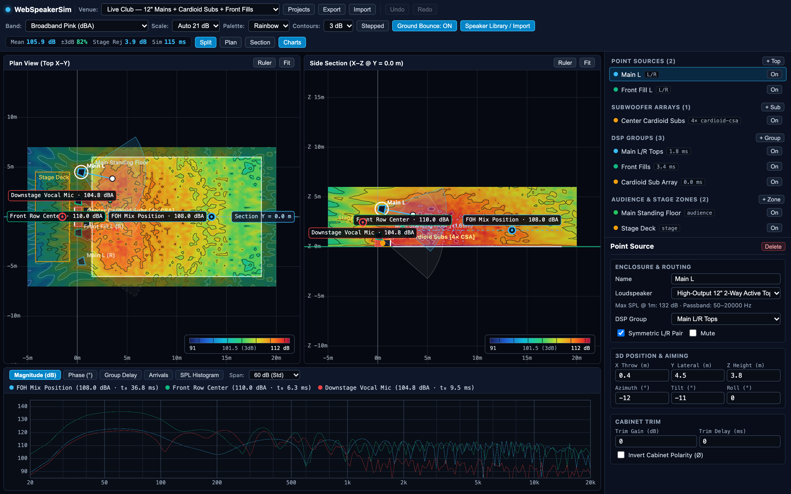
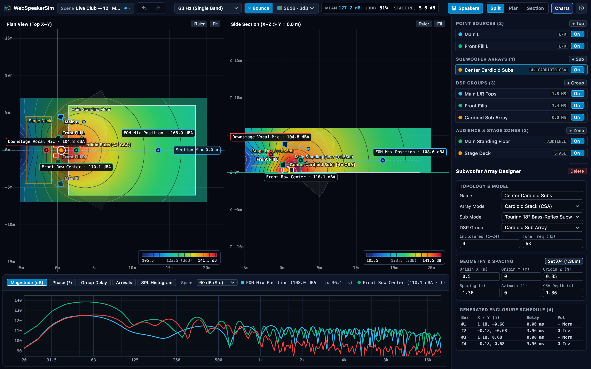
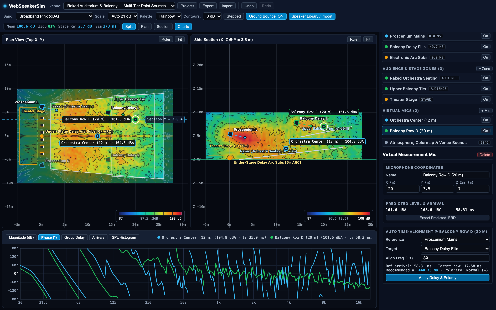

# Tutorial 02: 3D Venue Prediction, Cardioid Subs & Alignment (`WebSpeakerSim`)

Before loading a truck or rigging a single point-source cabinet, **WebSpeakerSim** lets you verify horizontal/vertical horn coverage, eliminate stage bass wash with directional subwoofer arrays, time-align fills and subs at virtual microphone positions, and export predicted `.FRD` target curves for on-site verification.

---

## 1. Launch & Load the Venue Model

Start **WebSpeakerSim** from the `WebSoundTools` workspace root:

```bash
npm run dev:wss
```

Open `http://localhost:5174`. By default, **WebSpeakerSim** opens the **Live Club — 12" Mains + Cardioid Subs + Front Fills** venue (`18 m` deep $\times$ `12 m` wide standing floor + stage deck).



### Room Coordinate System & Atmosphere Check

1. Click **`Atmosphere, Colormap & Venue Bounds`** at the bottom of the right-hand **Scene Tree**.
2. Enter the expected show-time air conditions (**`Temperature °C`** and **`Relative Humidity %`**):
   - Air temperature shifts the speed of sound ($c \approx 331.3 + 0.606 T_C\text{ m/s}$)—a `10 °C` warm-up between afternoon soundcheck (`18 °C`) and a packed show (`28 °C`) changes a `20 m` delay ring's arrival time by **`~1.0 ms`** and shifts subwoofer quarter-wave cardioid cancellation frequencies!
   - Relative humidity governs **ISO 9613-1 high-frequency air absorption** (`8–16 kHz` loss over long throws).

---

## 2. Step-by-Step: Aiming L/R Mains & Spotting Near-Field Gaps

Broadband pink-noise heatmaps look deceptively smooth because omnidirectional low frequencies mask high-frequency horn beaming. Always aim point-source tops at **`4 kHz`** first:

1. In the **Top Bar**, set **Band** to **`4 kHz (Single Band)`**.
2. In the **Point Sources** section of the right sidebar, click **`On`** next to **`Front Fill L`** so it toggles to **`Muted`**.
3. Click **`Main L`** (`Z = 3.8 m`, `Y = +4.5 m`, `90° × 60°` 12" 2-way active top) to highlight its 3D aiming vector in both **Plan View** and **Side Section**.


### What to Look For
- **Downstage Center Hole (`X = 1.5–4.5 m, Y = 0 m`):** Listeners standing at the front barrier sit well inside and underneath both flown `90° × 60°` horns, dropping vocal intelligibility by `10+ dB` and pulling overall **`±3dB`** coverage evenness down to **`47%`**.
- **Interactive Aiming:** Drag the white circular **aim handle** in **Plan View** to adjust inward toe-in (**`Azimuth = -12°`**) and drag it in **Side Section** to aim vertical throw (**`Tilt = -11°`**, pointing roughly two-thirds of the way toward the back wall so inverse-square distance loss balances the horn's vertical off-axis roll-off). Because **`Symmetric L/R Pair`** is checked, `Main L (R)` mirrors every edit automatically.

### Filling the Center Gap & Checking the Histogram

1. Click **`Muted` $\rightarrow$ `On`** next to **`Front Fill L`** (`8"` stage-lip fills at `Z = 1.05 m`, `Y = ±1.6 m`, `Tilt = -4°`).
2. Switch **Band** back to **`Broadband Pink (dBA)`**, set **Scale** to **`Auto ±6 dB`** with **`2 dB`** contours, and select the **`SPL Histogram`** tab in the bottom chart drawer.


Coverage within `±3 dB` across the entire audience zone jumps from `47%` to **`82%`**!

---

## 3. Step-by-Step: Eliminating Stage Bass Wash (`63 Hz` Cardioid Stack)

Subwoofers placed along the downstage edge are physically closer to the band's vocal and drum microphones (`2 m` behind the subs) than to the audience (`4–18 m` in front). Let's compare an unsteered broadside array against a quarter-wave **Cardioid Subwoofer Array (`CSA`)**:

1. Set **Band** in the top bar to **`63 Hz (Single Band)`** and **Scale** to **`Auto 36 dB`**.
2. Select **`Center Cardioid Subs`** under **Subwoofer Arrays** and switch **Array Mode** to **`Broadside Line`**.


Notice **`Stage Rej: -4.6 dB`** in the top bar—the stage deck is `4.6 dB` *louder* at `63 Hz` than the audience floor!

3. Now switch **Array Mode** to **`Cardioid Stack (CSA)`**, set **Tune Freq (Hz)** to **`63`**, and click **`Set λ/4 Depth + Delay`**:
   - Rear-facing cabinets automatically invert polarity (`Ø`) and apply quarter-wave electronic delay ($\tau = d / c \approx 3.9\text{ ms}$ for `1.35 m` acoustic offset):
     - **Forward (`+X` toward audience):** Rear box wave arrives in phase with front boxes.
     - **Backward (`-X` onto stage):** Rear box wave arrives $180^\circ$ out of phase (`d/c + d/c = λ/2` + polarity flip), carving a deep rear cancellation null!



**`Stage Rej`** improves by over **`17 dB`** (to **`+12.8 dB`**), turning the entire stage deck deep blue/violet while maintaining solid low-end punch out front.

---

## 4. Step-by-Step: Virtual Mic Time Alignment & On-Chart DSP Group EQ

### Auto-Aligning Arrival Times & Phase

1. Select **`FOH Mix Position`** under **Virtual Mics** in the right sidebar (`X = 14.0 m, Y = 0 m, Z = 1.65 m`) and open the **`Arrivals`** or **`Phase (°)`** tab in the bottom chart drawer.
2. In the **Auto Time-Alignment** section of the Virtual Mic inspector:
   - Set **Reference Group** to **`Subs`** (or whichever acoustic source arrives latest when you cannot physically move cabinets).
   - Set **Target Group to Delay** to **`Mains`** (or **`Front Fills`** when aligning fills at a front-row mic).
   - Click **`Apply Electronic Delay`**—**WebSpeakerSim** computes the exact geometric + crossover group-delay offset and writes it directly to the target DSP Group.



### Sculpting Crossovers & Draggable DSP Group EQ Handles

1. Under **DSP Groups** in the right sidebar, click **`Mains`**.
2. In the **DSP Group Inspector**, configure the high-pass crossover (**`LR 24 dB/oct` @ `85 Hz`**) and click **`+ Band`** under **Parametric EQ** to add or tweak corrective bands.
3. Look at the **Virtual Mic Magnitude** chart at the bottom: **interactive numbered EQ handles** appear directly on the response curve—drag horizontally for frequency, vertically for gain (`dB`), or hold `Shift` while dragging/scrolling to narrow or widen **`Q`**!


---

## 5. Adding Custom Loudspeakers & Exporting Predicted `.FRD` Curves

- **Custom Enclosures (`L` / `Speaker Library`):** Click **`Speaker Library`** in the top bar to browse built-in models, synthesize any loudspeaker from published PDF datasheet specs (**`Spec Builder`** tab: `H° × V°`, `-3 dB` passband, dimensions, sensitivity & Max SPL), or import `.gll`, `.clf`, and `.frd` files locally into `IndexedDB`.


- **Exporting `.FRD` for Field Measurement:** Select **`FOH Mix Position`** under **Virtual Mics** and click **`Export Predicted .FRD`**. Save `FOH-Mix-Position.frd`—in [Tutorial 04](./04-predict-to-measure-field-verification.md) we will load this exact prediction into **WebSoundMeter** to verify the rigged PA in the venue!

---

**Next Step $\rightarrow$** [Tutorial 03: PA Time Alignment, Sub/Top Crossover & Virtual EQ in WebSoundMeter](./03-pa-time-alignment-and-eq-in-wsm.md)
