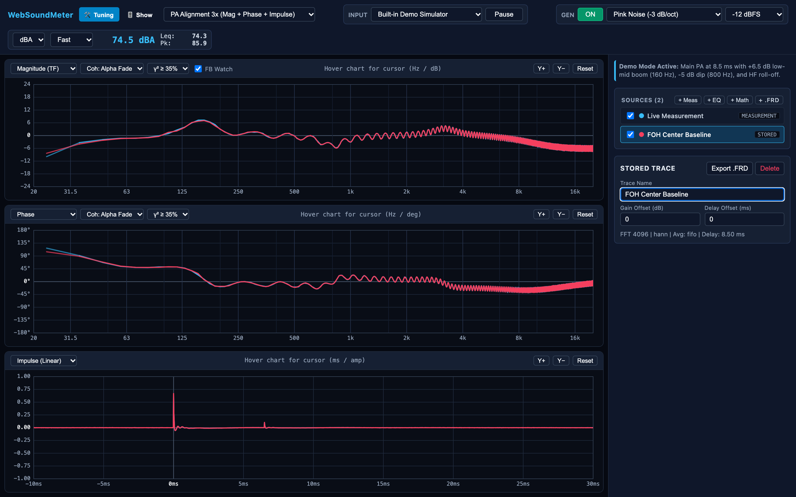
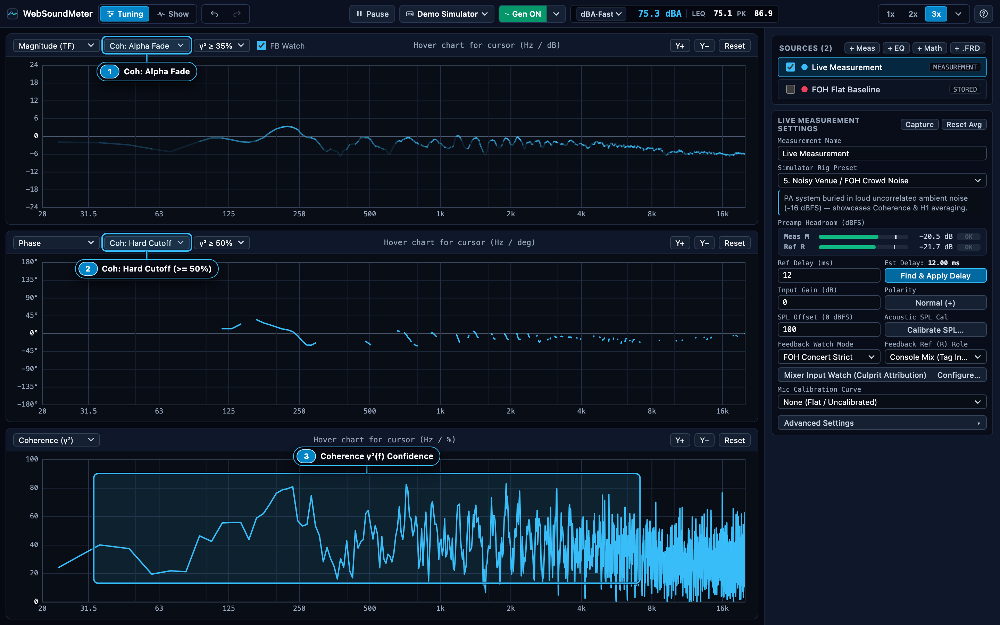
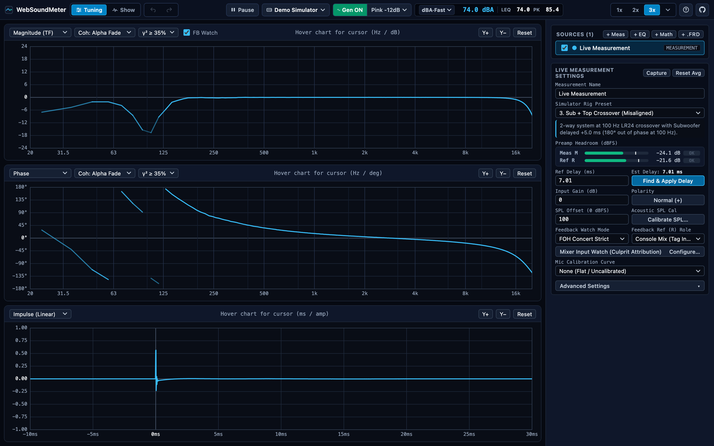
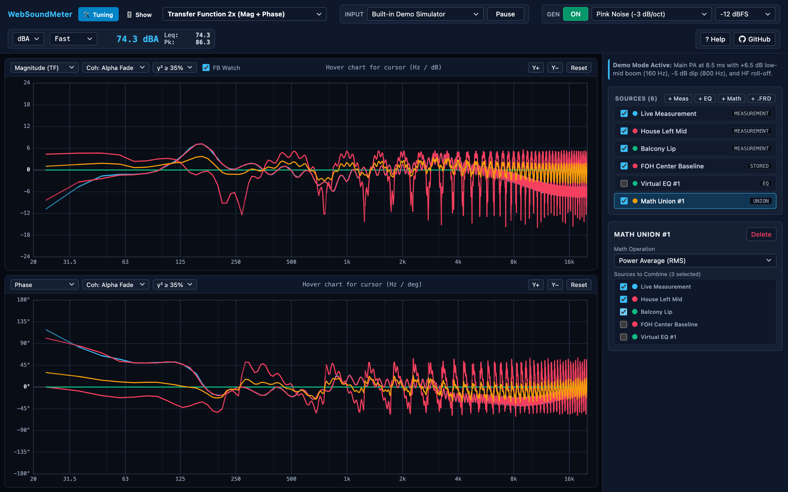

# Tutorial 03: PA Time Alignment, Sub/Top Crossover & Virtual EQ (`WebSoundMeter`)

Once your measurement microphone and physical loopback are gain-staged ([Tutorial 01](./01-hardware-setup-and-mic-calibration.md)), this tutorial walks step by step through **WebSoundMeter**'s core Front-of-House tuning workflow: locking reference delay, reading coherence in real rooms, aligning subwoofers to tops through the crossover region, spatially averaging multiple mic positions, and sculpting Virtual EQ offline.

---

## 1. Step 1: Why Unaligned Phase Wraps — Locking Propagation Delay

Start **WebSoundMeter** (`npm run dev:wsm` $\rightarrow$ `http://localhost:5173`), select **`🛠 Tuning`** mode, and choose **`PA Alignment 3x (Mag + Phase + Impulse)`** in the topbar layout menu.

### Before Delay Compensation (`Ref Delay = 0 ms`)

Suppose your FOH microphone stands **`3.43 m`** (`10.0 ms` at `343 m/s`) away from the main PA (simulated by preset **`1. Flat System (Delayed 10ms)`** when **Ref Delay** is `0 ms`):
- Even on a ruler-flat `+0.0 dB` loudspeaker, a `10.0 ms` air flight delay adds $\Delta\phi(f) = -360^\circ \cdot f \cdot 0.010\text{ s}$ of linear phase slope—wrapping $360^\circ$ every **`100 Hz`**!
- On a logarithmic frequency chart, that produces a dense wall of vertical sawtooth stripes above `500 Hz`, while the **Impulse Response** spike sits `10.0 ms` to the right of `0 ms`.

### Locking Reference Delay (`Find & Apply Delay` / `D`)

1. Select **`Live Measurement`** in the right-hand **Sources** list.
2. Check **`Est Delay`** in the inspector (`10.00 ms`—computed via sub-sample parabolic interpolation of the deconvolved impulse peak, along with acoustic polarity detection).
3. Click **`Find & Apply Delay`** (or press **`D`**).
4. Click **`Capture`** (or press **`C`**) to save a reference **Stored Trace** snapshot.

The **Impulse** peak snaps to `0.0 ms` and **Phase (°)** flattens right across `0°` so true transducer/crossover phase rotations stand out clearly!

---

## 2. Step 2: Reading Coherence ($\gamma^2$) — Knowing What *Not* to EQ

In a real venue with HVAC rumble, crowd chatter, and reverberant room tails, not every wiggle on a magnitude trace comes from your loudspeaker. **Coherence** ($\gamma^2(f) \in [0\%, 100\%]$) measures how much of the microphone signal at frequency $f$ is linearly caused by your reference signal:

1. Switch the 3rd chart panel's plot dropdown from `Impulse Response` to **`Coherence`**.
2. *(In Demo Mode, select preset **`5. Noisy Venue / FOH Crowd Noise`** and click **`Find & Apply Delay`**.)*

### Golden FOH Rules for Coherence
- **Alpha Fade vs. Hard Cutoff Blanking:** In any **Magnitude**, **Phase**, or **Group Delay** chart header, choose between **`Coh: Alpha Fade`** (smoothly tapering opacity below your chosen $\gamma^2$ threshold so noisy sub-bass or comb nulls ghost out), **`Coh: Hard Cutoff`** (completely hiding bins below your chosen `γ² ≥ 20%..95%` threshold—ideal for keeping wrapped Phase clean), or **`Coh: Off`**.
- **Low Coherence + Deep Narrow Dip = Acoustic Reflection Comb Null:** Moving the microphone `30 cm` shifts the dip to a different frequency. **Never boost a low-coherence dip with EQ**—you will only burn amplifier headroom and make neighboring seats harsh.
- **Broad Low Coherence Across the Whole Band:** Either your reference delay (`Ref Delay`) is off by more than half an FFT window, or ambient room noise is overpowering your pink noise—increase `FIFO Averages` (`16` $\rightarrow$ `32` or `64` frames) or raise generator level slightly.

---

## 3. Step 3: Aligning Subwoofers to Tops Through Crossover

**Scenario:** Your Tops have an `LR24` high-pass at `100 Hz` and your Subs have an `LR24` low-pass at `100 Hz`, but the subwoofer path is `4.5 ms` late and polarity-inverted (preset **`3. Sub + Top Crossover (Misaligned)`**).

Look at the three diagnostic signatures right around `100 Hz`:
1. **Magnitude:** Instead of summing `+6 dB` smoothly across `100 Hz`, destructive interference carves a deep **`-18 dB` cancellation chasm** right in the punch octave (`80–120 Hz`).
2. **Phase:** Phase twists sharply across `100 Hz` where the two out-of-phase passbands fight each other.
3. **Impulse Response:** Two distinct arrival spikes appear—the crisp HF/MF spike at `0.0 ms` followed by a broad, inverted low-frequency wave `4.5 ms` later.

### Field Procedure for Sub-to-Top Alignment on Hardware

1. **Measure Tops Alone:** Mute Subs on your processor, run Pink Noise through Tops at your FOH/crossover reference mic, click **`Find & Apply Delay`** (`D`), and click **`Capture`** (`C`) $\rightarrow$ rename stored trace to **`Tops Only`**. **Do not change `Ref Delay` after this step!**
2. **Measure Subs Alone:** Mute Tops, unmute Subs, let the live trace settle (keep the exact same `Ref Delay`!), and click **`Capture`** (`C`) $\rightarrow$ rename to **`Subs Only`**.
3. **Match Phase Angle & Slope at Crossover (`80–100 Hz`):**
   - Overlay **`Tops Only`** and **`Subs Only`** on the **Phase (°)** chart.
   - Whichever source has the **shallower/earlier phase curve** (usually flown or stage-aligned Tops when Subs have heavy low-pass group delay, or front-stacked Subs when Tops are flown further back) needs electronic processor delay until both **Phase traces sit directly on top of each other across the entire crossover octave (`70–130 Hz`)**!
   - You can preview the exact delay + polarity flip right inside **WebSoundMeter** without touching your rack: select **`Tops Only`** (or create a `+ EQ` source on it), adjust **Delay Offset (`ms`)** / **Polarity (`Ø`)**, and create a **`+ Math` $\rightarrow$ `Sum (A + B Complex)`** trace combining `Tops` + `Subs` to verify maximum `+6 dB` constructive summation before entering the final delay number into your loudspeaker processor!

---

## 4. Step 4: Multi-Microphone Spatial Averaging (`+ Math`)

Never equalize an entire room from a single FOH microphone—a floor-bounce comb dip at `420 Hz` at the mix desk may not exist anywhere else in the audience.

1. Place **2 to 4 microphones** across the main coverage zone (e.g., `On-Axis Center`, `Mid-House Off-Axis`, `Rear Raked`), or move a single mic across 4 positions and click **`Capture`** at each spot (`Pos 1` .. `Pos 4`).
2. For simultaneous live mics, click **`+ Meas`** in the **Sources** header for each input channel (`Ch 1`, `Ch 2`, `Ch 3`) and lock each slot's individual propagation delay (`Find & Apply Delay`).
3. Click **`+ Math`** in **Sources** and set **Math Operation** to **`Power Average (RMS Mag)`**:
   - **Why `Power Average` for tonal EQ?** At mid and high frequencies (`> 500 Hz`), mics several meters apart have random relative acoustic phase; `Power Average` averages acoustic energy ($10 \log_{10}(\frac{1}{N}\sum 10^{L_i/10})$) across seats so localized comb ripples average out while true cabinet/room tonal imbalances remain crystal clear!
   - *(Use **`Vector Average`** only when averaging closely spaced mics or checking phase-coherent low-frequency summation.)*

---

## 5. Step 5: Offline Virtual EQ & Auto-Match (`+ EQ`)

Once you have captured your spatial average (or baseline room trace), **press `Space` (`Pause`) or turn `Gen Off`**—everyone else on stage will thank you for stopping the pink noise while you dial in your EQ!

1. Click **`+ EQ`** in **Sources** to create a **Virtual Equalizer** source.
2. Set **`Apply Virtual EQ To Source`** to your captured spatial average (or `Live Measurement`).
3. Click **`Auto-Match Room`** to compute an initial set of gentle subtractive biquad filters targeting broad room resonances (`+6.5 dB @ 160 Hz`) while ignoring narrow comb dips.
4. **Fine-Tune Visually on the Chart:**
   - Drag the numbered **EQ handles** directly on the **Magnitude** chart (`Drag` = Freq/Gain, `Shift + Wheel` / `Shift + Drag` = `Q`).
   - Enable **`LR 24 dB/oct`** high-pass/low-pass crossovers or all-pass filters in the inspector to preview both magnitude and phase impact simultaneously.
   - Copy the final `Frequency`, `Gain (dB)`, and `Q` values straight into your loudspeaker system processor or console matrix PEQ, then unpause pink noise for 10 seconds to confirm!

---

**Next Step $\rightarrow$** [Tutorial 04: Predict-to-Measure Field Verification](./04-predict-to-measure-field-verification.md)
