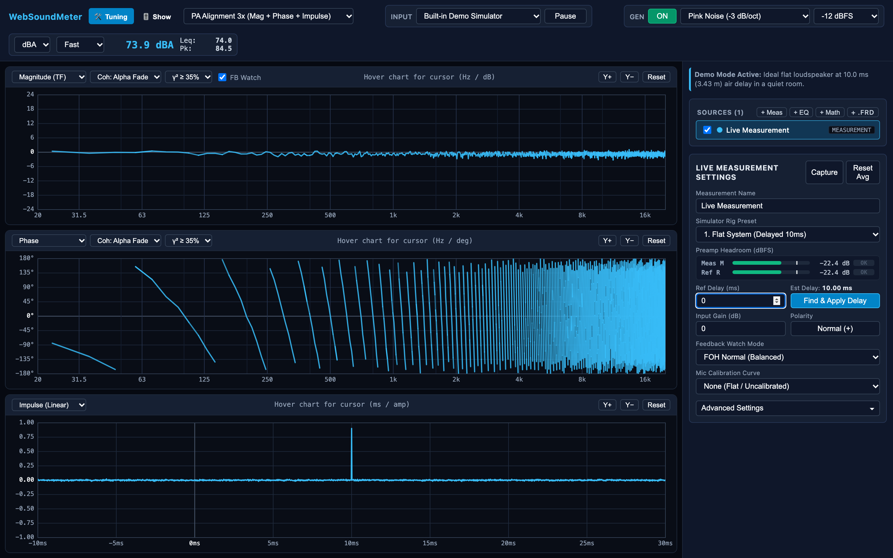
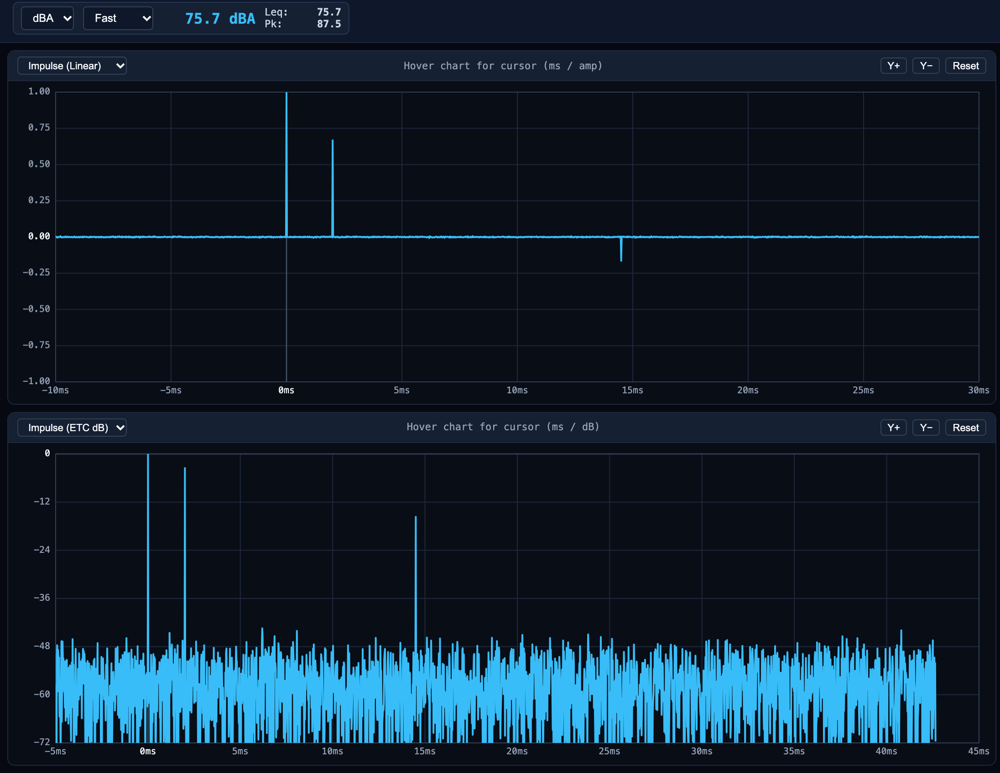
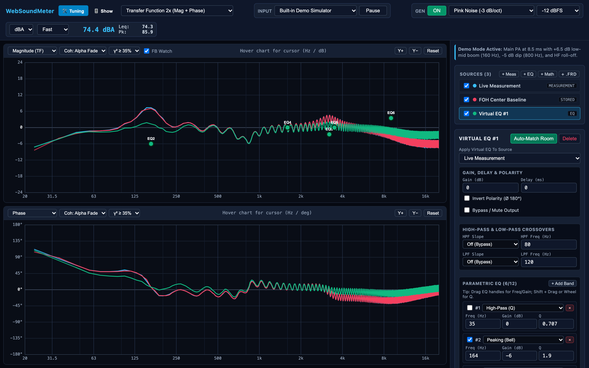

# Tutorial 03: PA Time Alignment, Sub/Top Crossover & Virtual EQ (`WebSoundMeter`)

Once your measurement microphone and loopback reference are gain-staged, **WebSoundMeter** (`http://localhost:5173`) gives you everything needed to lock propagation delay, judge room reflections and coherence ($\gamma^2$), phase-align subwoofers to tops through crossover, average multiple microphone positions, and dial in room EQ offline with pink noise muted.

---

## 1. Unwrapping Phase by Locking Propagation Delay (`D`)

Sound travels roughly `343 m/s` (`~2.92 ms` per meter at `20 °C`). If your microphone sits `2.9 m` (`8.5 ms`) from the main hang while your loopback cable arrives in `0.0 ms`, that `8.5 ms` time offset adds a linear phase slope of $\Delta \phi(f) = -360^\circ \times f \times 0.0085\text{ s}$—wrapping `360°` every `118 Hz` and turning the Phase plot into unreadable sawtooth stripes:

1. In **`🛠 Tuning`** mode, choose **`PA Alignment 3x (Mag + Phase + Impulse)`** in the layout dropdown.
2. Select **`Live Measurement`** (on Demo Simulator preset **`1. Flat System (Delayed 8.5 ms)`** with `Ref Delay` set to `0 ms`, or with your real mic at FOH).

3. Check **`Est Delay`** in **Live Measurement Settings** (`8.50 ms`, with a red **`(−POL)`** indicator whenever acoustic polarity is inverted) and click **`Find & Apply Delay`** (shortcut **`D`**):
   - **Impulse (Linear)** snaps its direct-arrival spike to **`0.0 ms`**.
   - **Phase** unwraps into a smooth curve across the passband, revealing true driver crossover and horn phase behavior.
4. Click **`Capture`** (`C`) and rename the stored trace **`FOH Baseline`**.

---

## 2. Reading Coherence ($\gamma^2$) & `Impulse (ETC dB)` Reflections

### Coherence Masking in Noisy or Reverberant Venues
**Coherence ($\gamma^2 \in [0\%, 100\%]$)** measures what fraction of the microphone signal at each frequency is linearly caused by your reference signal versus uncorrelated HVAC rumble, wind, crowd chatter, or late reverberation:

- **`γ² > 85%`:** Trustworthy direct-field measurement—safe for phase alignment and EQ decisions.
- **`γ² = 35% – 70%`:** Contaminating room reflections, horn off-axis shadowing, or background noise—increase **`FIFO Averages`** (`16` or `32` frames under **Advanced Settings**) or raise pink noise slightly.
- **`γ² < 30%`:** Unreliable data (below subwoofer cutoff, deep acoustic comb cancellation, or loud ambient noise).Never boost an EQ band where coherence drops into a narrow notch.

Each Transfer Function chart header lets you choose **`Coh: Alpha Fade`** (smoothly dimming noisy bins) or **`Coh: Hard Cutoff`** (hiding trace segments completely below `γ² ≥ 20%..95%`):

### Spotting Early Reflections with `Impulse (ETC dB)`
While **`Impulse (Linear)`** makes polarity obvious (`+` upward spike vs. `-` downward spike), secondary wall or floor reflections `-10` to `-20 dB` down look tiny on a linear amplitude axis. Switch a chart panel to **`Impulse (ETC dB)`** (logarithmic Energy-Time Curve, $20\log_{10}|h(t)|$)—try Simulator Preset **`4. Floor Bounce Comb Filtering`**—to read exact reflection arrival delays (`+2.0 ms` floor bounce at `-3.5 dB` and `+14.5 ms` rear-wall slap at `-14 dB`):

---

## 3. Aligning Subwoofers to Tops Through Crossover

**Scenario:** Tops have an `LR24` high-pass at `100 Hz` and Subs have an `LR24` low-pass at `100 Hz` (which are naturally $0^\circ$ in phase at $f_c$), but the subwoofer path arrives **`+5.0 ms` late** ($180^\circ$ half-wavelength lag at `100 Hz` — preset **`3. Sub + Top Crossover (Misaligned)`**).

Look at the three diagnostic signatures around `100 Hz`:
1. **Magnitude (TF):** Instead of summing flat across `100 Hz`, $180^\circ$ destructive interference carves a deep **`-20+ dB` cancellation chasm** right in the punch octave (`80–125 Hz`).
2. **Phase:** Phase twists sharply across `100 Hz` where the delayed sub passband fights the tops.
3. **Impulse (Linear):** Two arrivals appear—the crisp HF/MF spike at `0.0 ms` followed by a broad low-frequency wave peaking around `+5.0 ms`.

### Field Procedure for Hardware Sub-to-Top Alignment
1. **Measure Tops Alone:** Mute Subs on your system processor, run Pink Noise through Tops at your crossover reference mic, click **`Find & Apply Delay`** (`D`), and click **`Capture`** (`C`) $\rightarrow$ rename to **`Tops Only`**. **Do not change `Ref Delay` after this step.**
2. **Measure Subs Alone:** Mute Tops, unmute Subs, keep the exact same `Ref Delay`, let averaging settle, and click **`Capture`** (`C`) $\rightarrow$ rename to **`Subs Only`**.
3. **Match Phase Across the Crossover Octave (`70–130 Hz`):**
   - Overlay **`Tops Only`** and **`Subs Only`** on the **`Phase`** chart.
   - Whichever passband has the **shallower/earlier phase curve** needs electronic processor delay until both phase traces track directly on top of each other through `100 Hz`.
   - To preview both electronic delay and polarity (`Ø`) virtually before touching the rack: attach a **`+ EQ`** Virtual EQ source (`E`) to `Tops Only`, adjust **`Delay (ms)`** and **`Invert Polarity (Ø)`** in the DSP editor, and add a **`+ Math` $\rightarrow$ `Vector Sum (A + B)`** (`U`) combining the Virtual EQ + `Subs Only` to confirm maximum `+6 dB` summation at `100 Hz`.

---

## 4. Multi-Microphone Spatial Averaging (`+ Math`)

Avoid equalizing an entire venue from a single FOH microphone—a narrow floor-bounce comb dip at one seat may be a peak two meters away:

1. Place **3 to 4 microphones** across the main coverage zone (or move one mic across multiple seats and click **`Capture`** at each position).
2. For simultaneous live mics, click **`+ Meas`** (`M`) for each input channel (`Ch 1`, `Ch 2`, `Ch 3`) and click **`Find & Apply Delay`** on each slot.
3. Click **`+ Math`** (`U`), set **`Math Operation`** to **`Power Average (RMS)`**, and check all `3+` microphone traces in **`Sources to Combine`**:
   - **`Power Average (RMS)`** averages acoustic energy ($10 \log_{10}(\frac{1}{N}\sum 10^{L_i/10})$) across seats so localized comb ripples average out while true cabinet/room tonal imbalances remain clear.
   - Use **`Vector Average`** when averaging closely spaced microphones or inspecting phase-coherent low-frequency zones.

---

## 5. Offline Virtual EQ & Target-Aware Room Matching (`+ EQ`)

Once your spatial average or baseline trace is captured, press **`Space` (`Pause`)** or click **`GEN` $\rightarrow$ `OFF`** so the room stays quiet while you design your EQ:

1. Click **`+ EQ`** (`E`) to create a **Virtual Equalizer** source and set **`Apply Virtual EQ To Source`** to your spatial average or stored trace.
2. Click **`Auto-Match Room`** to analyze the target trace's `1/3`-octave smoothed response and synthesize initial subtractive peaking cuts for broad resonances (plus gentle HF shelf compensation) while ignoring narrow acoustic comb dips.
3. **Fine-Tune Visually on the Magnitude Chart:**
   - Drag **`EQ1..EQn`** handles horizontally for **Frequency**, vertically for **Gain (`dB`)**, or hold **`Shift` while dragging/scrolling** to adjust **`Q`**.
   - Enable **`Linkwitz-Riley 24 dB/oct`** (`BW/LR 12–48 dB/oct`) under **High-Pass & Low-Pass Crossovers** to preview magnitude and phase impact simultaneously, then copy the final filter values into your system processor.

---

*Return to the [FOH Tutorial Index](./README.md).*
