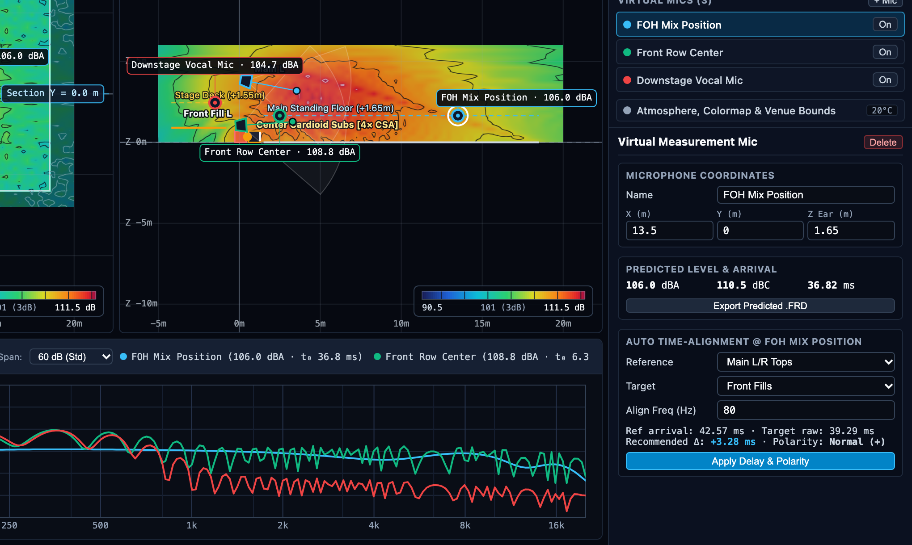
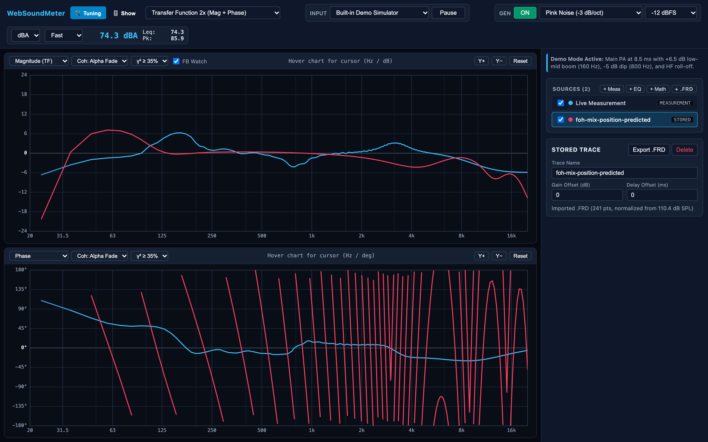
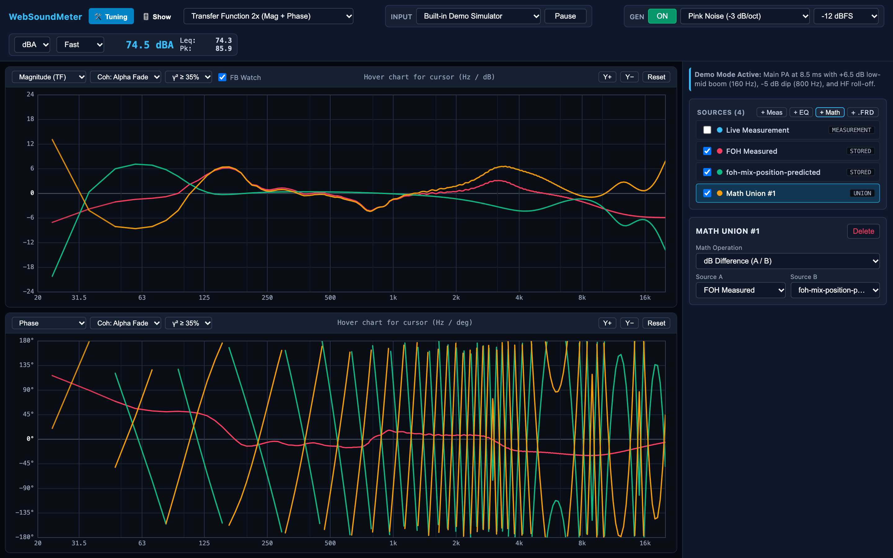

# Tutorial 04: Predict-to-Measure Field Verification (`WebSpeakerSim` $\rightarrow$ `WebSoundMeter`)

A venue prediction is only half the story until you hang the PA and verify that the physical rig matches your design. Because **WebSpeakerSim** and **WebSoundMeter** share the exact same `@foh/dsp` filter evaluation and `@foh/acoustics` `.FRD` parser/interpolator, you can export predicted Virtual Microphone responses straight onto the gig and compute a smoothed **`Measured − Predicted`** error curve in seconds.

---

## 1. Export Predicted `.FRD` Target Curves from `WebSpeakerSim`

1. In **WebSpeakerSim** (`http://localhost:5174`), place Virtual Microphones at the physical coordinates where you will set your measurement mic stands on site:
   - **`FOH Mix Position`** (`X = 13.5 m, Y = 0.0 m, Z = 1.65 m` in the `Live Club` preset).
   - Click **`+ Mic`** (`M`) in the **Virtual Mics** section if you also want an off-axis spot check (for example, `Front Row Off-Axis` at `X = 3.5 m, Y = 2.5 m, Z = 1.65 m`).
2. Select **`FOH Mix Position`** under **Virtual Mics** in the right-hand **Scene Tree**.
3. Inside the **`Predicted Level & Arrival`** card, click **`Export Predicted .FRD`** to download `foh-mix-position-predicted.frd` (standard 3-column `FreqHz  MagDb  PhaseDeg` format across `20 Hz – 20 kHz`, phase-referenced to earliest arrival $t_0$).

---

## 2. Import, Normalize & Smooth in `WebSoundMeter` on Site

1. At the venue, place your physical measurement microphone at the matching FOH coordinate (`X = 13.5 m`), gain-stage your loopback reference, and open **WebSoundMeter** (`http://localhost:5173`).
2. Lock your live FOH propagation delay (**`Find & Apply Delay`** / `D`) and expand **`Advanced Settings ▾`** to set **`Octave Smoothing`** to **`1/6 Octave`** or **`1/3 Octave`** (matching tonal resolution across multi-source ground-bounce comb ripples).
3. Click **`+ .FRD`** in the **Sources** header and load `foh-mix-position-predicted.frd`:
   - **Automatic `200 Hz – 2 kHz` Passband Normalization:** **WebSpeakerSim** exports absolute predicted SPL (e.g., `~108 dB SPL`), whereas a dual-FFT transfer function in **WebSoundMeter** centers around `0 dB` relative gain. Whenever an imported `.FRD` curve's `200 Hz – 2 kHz` passband mean exceeds `35 dB`, **WebSoundMeter** automatically subtracts that mean upon import so the predicted trace overlays directly onto your `0 dB` measurement.
   - **Fine Level & Arrival Alignment:** Select the imported trace in **Sources** to open the **Stored Trace** inspector and fine-tune **`Gain Offset (dB)`** or **`Delay Offset (ms)`** (especially when multiple cabinets contribute before the dominant arrival so phase slopes align across `200 Hz – 4 kHz`).

---

## 3. Compute a Smoothed `dB Difference (A / B)` Error Curve (`+ Math`)

Rather than squinting at two overlapping traces, subtract the prediction directly from your measurement:

1. Click **`Capture`** (`C`) on your aligned FOH measurement and rename the stored trace **`FOH Measured`** (uncheck `Live Measurement` visibility if you want a clean 3-trace comparison).
2. Click **`+ Math`** (`U`) in **Sources** to add a **Math Union** source.
3. In the **Math Union** inspector:
   - Set **`Math Operation`** to **`dB Difference (A / B)`** (plotting $L_{\text{Measured}}(f) - L_{\text{Predicted}}(f)$ in dB and $\phi_A - \phi_B$ in degrees).
   - Set **`Source A`** to **`FOH Measured`**.
   - Set **`Source B`** to **`foh-mix-position-predicted`**.

*(Note: when practicing in Demo Simulator mode, Demo Preset 2 models generic room modes rather than the exact `Live Club` geometry; on a real rig, `dB Difference (A / B)` isolates real venue boundary loading and rigging errors directly.)*

---

## 4. Diagnosing Differences Between Prediction & Reality

Wherever the **`dB Difference (A / B)`** trace sits near `0 dB`, your rigged PA matches the model. When it deviates, check the frequency band to separate **rigging/wiring mistakes** from **normal room acoustics**:

| Deviation Signature | Likely Physical Cause | Action to Take |
| :--- | :--- | :--- |
| **Deep notch (`-10` to `-20 dB`) right at `80–100 Hz`** where prediction was smooth | Subwoofer or Main processor polarity flipped, or wrong delay preset loaded in amp rack | Check processor polarity (`Ø`) & delay—do not boost with EQ. |
| **`+4` to `+8 dB` broad rise below `160 Hz`** compared to half-space prediction | Side-wall / rear-wall boundary loading ("room gain") and modal buildup not modeled by direct-field + floor bounce | Apply gentle low-shelf / broad subtractive cut in Virtual EQ (`+ EQ`) after checking a multi-seat spatial average. |
| **Entire shelf `-6 dB` down above `3 kHz`** at a specific seat | Cabinet vertical tilt hung steeper/flatter than the CAD sheet, or HF compression driver muted/damaged | Verify cabinet inclinometer / rigging pin angle first, then solo the cabinet close-up. |
| **Smooth gentle droop above `8–12 kHz`** (`-2` to `-4 dB`) at `25 m+` FOH | Venue air is drier (`20–30% RH`) or warmer than modeled, or heavy stage drapery absorption | Compensate gently with a broad high-shelf (`Q = 0.7`) if appropriate for FOH without over-brightening front rows. |

---

## 5. Archiving Post-Tuning As-Built `.FRD` Files

Once your PA is aligned and equalized:
1. Capture final post-EQ traces (`FOH Final`, `Balcony Final`, `Front Fill Final`).
2. Select each stored trace and click **`Export .FRD`** in the **Stored Trace** inspector to archive standard `.FRD` show files alongside your `.wss-project.json` venue bundle for future tour stops.

---

*Return to the [FOH Tutorial Index](./README.md).*
