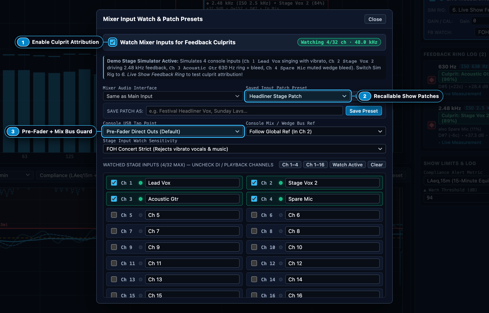
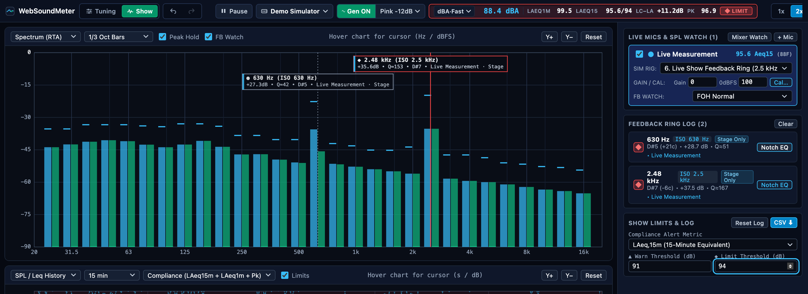
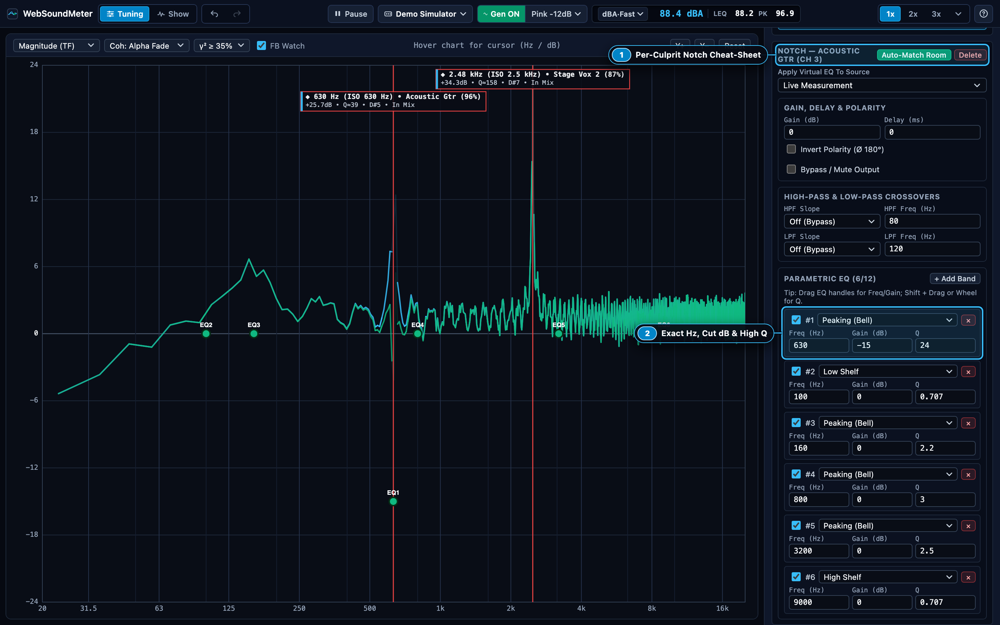
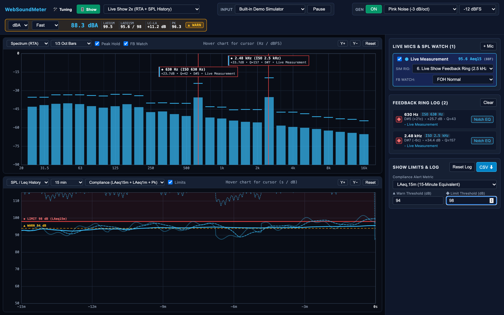
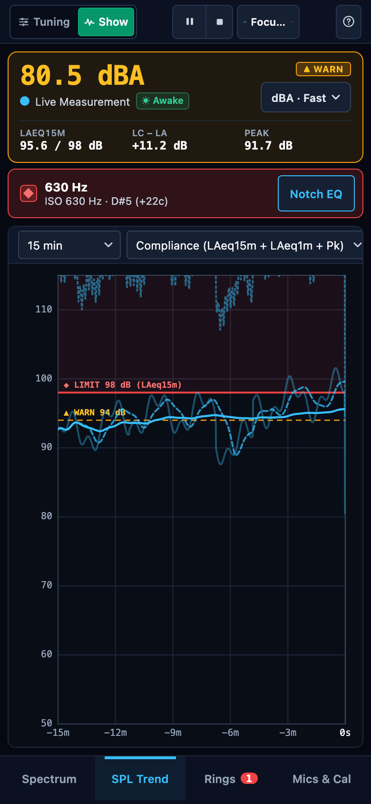
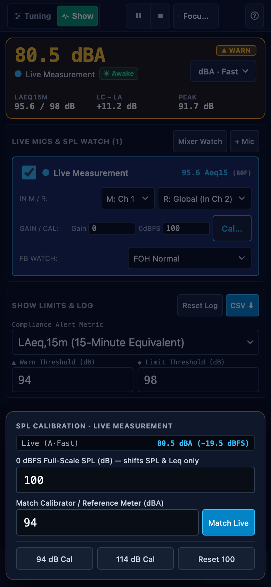

# Tutorial 05: Live Show SPL Compliance & Feedback Ring-Out (`WebSoundMeter`)

Once system tuning is complete and doors are about to open, **WebSoundMeter** (`http://localhost:5173`) switches from a dual-FFT alignment analyzer into a concert-safe **Show Mode (`🎚 Show`)**—muting and hiding the hardware Signal Generator, running multi-stage narrowband **Feedback Watch**, and logging statutory **`LAeq` / `LCeq` / `Peak`** compliance with `IndexedDB` crash checkpoints.

---

## 1. Switching Safely Into `🎚 Show` Mode

1. Click **`🎚 Show`** next to the **WebSoundMeter** title in the top-left corner:
   - **Hardware Generator Safety Interlock:** Whenever **`INPUT`** is connected to a physical hardware audio interface, entering **`🎚 Show`** immediately forces **`GEN`** off and hides the generator toolbar so pink noise can never fire mid-show. *(When practicing in `Built-in Demo Simulator` mode, the generator and per-slot `Sim Rig` selectors remain visible so you can test feedback and SPL alerts without hardware.)*
   - **Concert Layout:** The center stack switches to **`Live Show 2x (RTA + SPL History)`** (or choose **`Live Show 3x`** to add live program Transfer Function Magnitude fed from a console matrix reference).

---

## 2. Ringing Out Monitors & Pinpointing Culprit Mixer Inputs

Acoustic feedback begins as a phase-locked, high-`Q` narrowband resonance or post-syllable overhang before turning into a loud howl. Rather than flagging sustained vocals or synth notes, **WebSoundMeter** runs unaveraged phase-vocoder pitch-stability tracking, sparse-safe prominence, and a 2nd–6th harmonic comb sieve—working with **just a single measurement mic** or **connected over USB to your console** to tell you specifically which open channel is feeding back:

1. **Single-Mic Setup vs. Multi-Channel Mixer Input Watch:**
   - **Single Measurement Mic (FOH or Stage):** Keep your calibrated mic on `In Ch 1` (`FB Watch: FOH Concert Strict` during a show, or `Soundcheck / Wedge Ring-Out` before doors). If your console Main L/R mix is patched to `Ref (R)` for live Transfer Function, leave **`Feedback Ref (R) Role`** on **`Console Mix (Tag In-Mix vs Stage)`** so closed-loop PA rings are tagged `In Mix` while monitor-only rings are tagged `Stage Only` *(use `Playback / Stem Veto` only when `R` carries non-acoustic backing tracks)*.
   - **Multi-Channel Console USB (`Mixer Watch`):** Click **`Mixer Watch`** (available in both **`🛠 Tuning`** and **`🎚 Show`**) to watch up to **`32` console USB direct outs**—either on the same multi-channel interface or on a **Separate USB Mixer** alongside your 2-channel FOH measurement interface. Label your open stage channels (`Lead Vox`, `Stage Vox 2`, `Acoustic Gtr`…), uncheck DI/playback channels, and click **`Save Preset`** so your channel names recall automatically whenever that console is connected (or switch saved band patches manually between sets).
   - *(Practicing without hardware? Enable **`Mixer Watch`** and set **`SIM RIG`** to **`6. Live Show Feedback Ring (2.5 kHz & 630 Hz)`** to watch the 4-channel stage simulator ignore vibrato vocals and muted wedge bleed while pinpointing `Stage Vox 2 · Ch 2`!)*

<!-- screenshot
app: wsm
scene: t05-05-mixer-input-watch-modal
regions: [mixer-watch-modal]
padding: { top: 20, right: 215, bottom: 20, left: 215 }
description: Mixer Input Watch & Patch Presets modal with culprit attribution enabled, Headliner Stage Patch saved, Pre-Fader Direct Outs mode, and live per-channel signal LEDs.
annotations:
  - badge: 1
    target: "[data-testid='toggle-mixer-watch-enabled']"
    label: "Enable Culprit Attribution"
    placement: left
  - badge: 2
    target: "[data-testid='select-mixer-watch-preset']"
    label: "Recallable Show Patches"
    placement: right
  - badge: 3
    target: "[data-testid='select-mixer-tap-mode']"
    label: "Pre-Fader + Mix Bus Guard"
    placement: left
-->

2. **Reading RTA Callout Flags vs. the Feedback Ring Log:**
   - Simultaneous acoustic bleed across multiple open mics is merged into **one unified alert** showing center frequency, nearest **ISO 31-band GEQ** slider, and top culprit confidence (`◆ 2.48 kHz (ISO 2.5 kHz) • Stage Vox 2 (86%)`).
   - In **`Feedback Ring Log`**, each row shows severity (`◆` runaway feedback, `▲` overhang/persistent ring, `●` 5s latched hold), culprit + runner-up channels, `In Mix` / `Stage Only` tag, and fine **cents offset** (`D#7 (-6c)`).
3. **Per-Channel Surgical Notch (`Notch EQ`):**
   - Click **`Notch EQ`** next to any ring to insert a narrowband peaking cut (`Q = 8..24`) into an isolated per-culprit Virtual EQ cheat-sheet (`Notch — Stage Vox 2 (Ch 2)`, or `Feedback Notch (<Mic Name>)` in single-mic mode). Clicking **`Notch EQ`** again on the same frequency deepens the notch by `-3.0 dB` per click (down to `-18 dB`) so you can copy clean strip PEQ values (`Hz`, `Q`, `dB`) straight to that mixer channel.

<!-- screenshot
app: wsm
scene: t05-02-show-limit-and-ring-log
regions: [topbar, chart-0, show-live-mics, show-ring-log]
description: Show mode topbar in LIMIT alert state alongside RTA feedback callout flags, Culprit channel attribution in Feedback Ring Log, and 1-click Notch EQ.
annotations:
  - badge: 1
    target: "[data-testid='spl-status-badge']"
    label: "◆ LIMIT Alert Badge"
    tone: danger
    placement: bottom
  - badge: 2
    target: "[data-testid='ring-log-list']"
    label: "Culprit Channel & ISO Band"
    tone: warn
    placement: left
  - badge: 3
    target: ".btn-notch-eq"
    label: "1-Click Surgical Notch"
    placement: top
-->

Switching briefly back to **`🛠 Tuning`** reveals the per-culprit Virtual EQ cheat-sheet (`Notch — Stage Vox 2 (Ch 2)`) with exact center frequency, narrow `Q`, and cut depth ready to dial into that input strip on your mixing console:

<!-- screenshot
app: wsm
scene: t05-06-culprit-notch-eq-cheatsheet
regions: [topbar, chart-0, sources-card, eq-inspector]
description: Auto-generated per-culprit Virtual EQ cheat-sheet in Tuning mode displaying the narrowband surgical peaking notch frequency, gain cut, and Q to copy to the mixing console.
annotations:
  - badge: 1
    target: "[data-testid='inspector-eq-source'] .foh-form-section-title"
    label: "Per-Culprit Notch Cheat-Sheet"
    placement: left
  - badge: 2
    target: "[data-testid='eq-band-0']"
    label: "Exact Hz, Cut dB & High Q"
    placement: left
-->

---

## 3. Monitoring Venue SPL Limits (`LAeq15m`, `LC−LA` & Peak)

Municipal ordinances and festival sound limits typically enforce **time-integrated equivalent continuous level** (`LAeq,15m` or `LAeq,60m`), often paired with a low-frequency `dBC` or `LZpeak` ceiling:

1. In the **`Show Limits & Log`** card at the bottom right:
   - **`Compliance Alert Metric`:** Select the enforced metric (`LAeq,15m (15-Minute Equivalent)` default, `LAeq,60m`, `LAeq,5m`, `LAeq,1m`, `LCeq,1m`, `LAF`, or `LZpeak`).
   - **`Warn Threshold (dB)` & `Limit Threshold (dB)`:** Defaults are `98 dB` / `102 dB`. Set **`Warn`** `3–4 dB` below your venue ceiling (for example, `94 dB` Warn / `98 dB` Limit) so you get an early heads-up while you still have average bank remaining.
2. **Reading the Topbar Show Strip at a Glance:**
   - **`LAeq1m`:** Your **1-minute "speedometer"**—when `LAeq1m` exceeds the limit, `LAeq15m` will climb steadily; pull the master/VCA back `1–2 dB` early.
   - **`LAeq15m` (`95.6 / 98`):** Your rolling **15-minute legal average** vs. the configured limit.
   - **`LC−LA` (`+11.8 dB`):** Live 1-minute C-minus-A sub-to-mid balance (`+10` to `+15 dB` is typical modern rock/pop; `+18 dB+` indicates heavy sub energy dominating headroom).
   - **Status Badges:** **`● OK`** (green), **`▲ WARN`** (amber + dashed chart guide), and **`◆ LIMIT`** (red + solid chart guide).

<!-- screenshot
app: wsm
scene: t05-01-show-spl-compliance-warn
description: Desktop Live Show mode tracking a 15-minute concert SPL arc crossing the 94 dB Warning threshold while staying below the 98 dB statutory ceiling.
annotations:
  - badge: 1
    target: "[data-testid='spl-show-compliance-metrics']"
    label: "LAeq1m · LAeq15m · LC−LA · ▲ WARN"
    tone: warn
    placement: bottom
  - badge: 2
    target: "[data-testid='chart-panel-1']"
    subbox: [0.18, 0.2, 0.68, 0.55]
    label: "15-Min Rolling Compliance Arc"
    placement: top
  - badge: 3
    target: "[data-testid='card-show-limits-export']"
    label: "Warn / Limit & UTC CSV Export"
    placement: left
-->

3. **`SPL / Leq History` Timeline Controls:**
   - **Time Span:** `1 min`, `5 min` (`4 Hz` high-resolution buffer), `15 min`, `60 min`, or `4 hours` (`1 Hz` 4-hour ring buffer).
   - **Trace Mode:** `Compliance (LAeq15m + LAeq1m + Pk)`, `dBA (Fast + LAeq1m)`, `dBA vs dBC (Leq1m)`, or `Multi-Mic (LAeq1m per Mic)` to compare FOH against Front Barrier or Nearest Neighbor simultaneously.

---

## 4. Crash Checkpoints (`30-Min` Window) & UTC CSV Export

- **Automatic `IndexedDB` Checkpoints:** Every `10 seconds` during active capture, **WebSoundMeter** saves all live slots' `1 Hz` energy ring buffers to `IndexedDB` (`spl-show-logs`). If the browser reloads mid-set, checkpoints **less than `30 minutes` old** restore automatically into both the `15m/60m/4h` and `1m/5m` timelines. (Checkpoints older than `30 minutes` expire automatically; click **`Reset Log`** before the first act to clear manually.)
- **Downloading the Official CSV Report:** At curfew, click **`CSV ⬇`** in **`Show Limits & Log`** to download `websoundmeter-spl-log-<YYYY-MM-DDTHH-mm-ss-sssZ>.csv` in chronological long format—one row per active microphone slot per second (`timestamp_iso, slot_id, laf_db, lcf_db, laeq_1m_db, lceq_1m_db, laeq_5m_db, laeq_15m_db, laeq_60m_db, lpeak_db`).

---

## 5. Walking the Venue: Handheld Phone & Tablet Show Mode

When walking the balcony, checking property-line SPL with a USB-C measurement mic, or propping a tablet beside the console, **WebSoundMeter** adapts its **`🎚 Show`** layout automatically and holds a **Screen Wake Lock (`☀ Awake`)** so the display never dims mid-set:

<!-- screenshot
image: ./images/t05-03-handheld-phone-spl-trend.png
app: wsm
scene: t05-03-handheld-phone-spl-trend
viewport: { width: 390, height: 844, touch: true }
description: Handheld phone Show mode on the SPL Trend tab showing the pinned Hero SPL scoreboard, Wake Lock badge, 1-tap Active Ring Alert banner, and 15-minute compliance timeline.
annotations:
  - badge: 1
    target: "[data-testid='wake-lock-badge']"
    label: "Screen Wake Lock"
    placement: bottom
  - badge: 2
    target: "[data-testid='mobile-ring-alert-banner']"
    label: "1-Tap Active Ring & Notch"
    tone: danger
    placement: bottom
  - badge: 3
    target: "[data-testid='mobile-show-tablist']"
    label: "Thumb-Zone 4-Tab Bar"
    placement: top
-->
<!-- screenshot
image: ./images/t05-04-handheld-phone-mics-calibration.png
app: wsm
scene: t05-04-handheld-phone-mics-cal
viewport: { width: 390, height: 844, touch: true }
description: Handheld phone Show mode on the Mics & Cal tab with the SPL Calibration sheet open for 1-tap 94 dB / 114 dB pistonphone matching.
annotations:
  - badge: 1
    target: "[data-testid='btn-show-cal-live-measurement']"
    label: "Open Calibrator"
    placement: top
  - badge: 2
    target: "[data-doc-region='cal-popover'] .foh-popover-actions"
    label: "94 / 114 dB Match"
    placement: bottom
-->

| Handheld Phone `SPL Trend` & Ring Alert | Handheld `Mics & Cal` Bottom-Sheet Calibrator |
| :---: | :---: |
|  |  |

1. **Phone Handheld Deck (`< 680 px`):**
   - **Pinned Hero SPL Scoreboard:** Keeps primary `dBA / dBC / dBZ`, **`● OK` / `▲ WARN` / `◆ LIMIT`**, `LAeq,15m`, `LC − LA`, and `Peak` readable at arm's length while switching views on the 4-tab thumb bar (**`Spectrum`**, **`SPL Trend`**, **`Rings`**, **`Mics & Cal`**).
   - **1-Tap Ring Banner & Calibration:** Active feedback rings surface in a top alert banner with direct **`Notch EQ`**, while **`Mics & Cal` → `Cal…`** opens a bottom sheet for 1-tap **`94 dB Cal`** / **`114 dB Cal`** pistonphone matching.
2. **Tablet Landscape & Portrait (`680–959 px`):**
   - Scales all buttons, channel selectors, and EQ handles for coarse touch pointers, lets you **drag your finger across any chart** to scrub and pin the cursor HUD, and stacks full-width Show charts above a 2-column control deck in **Tablet Portrait**.

---

*Return to the [FOH Tutorial Index](./README.md).*
