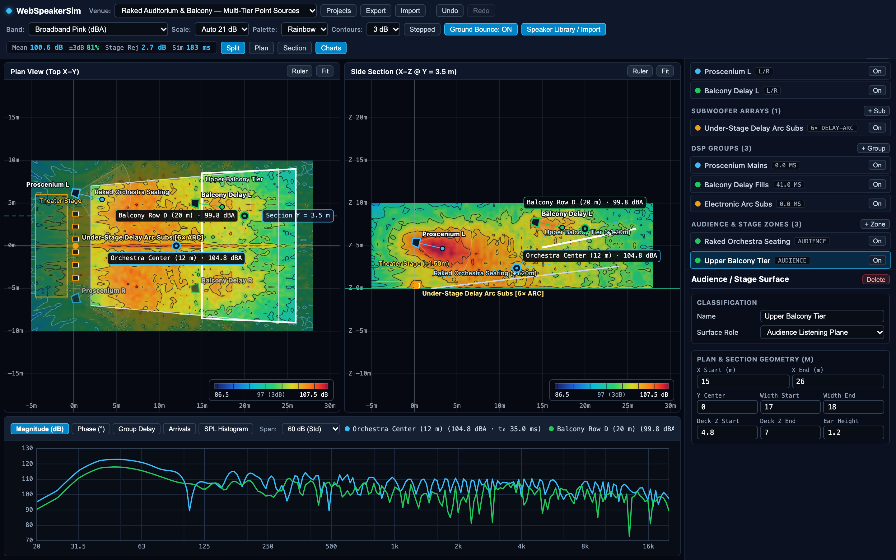
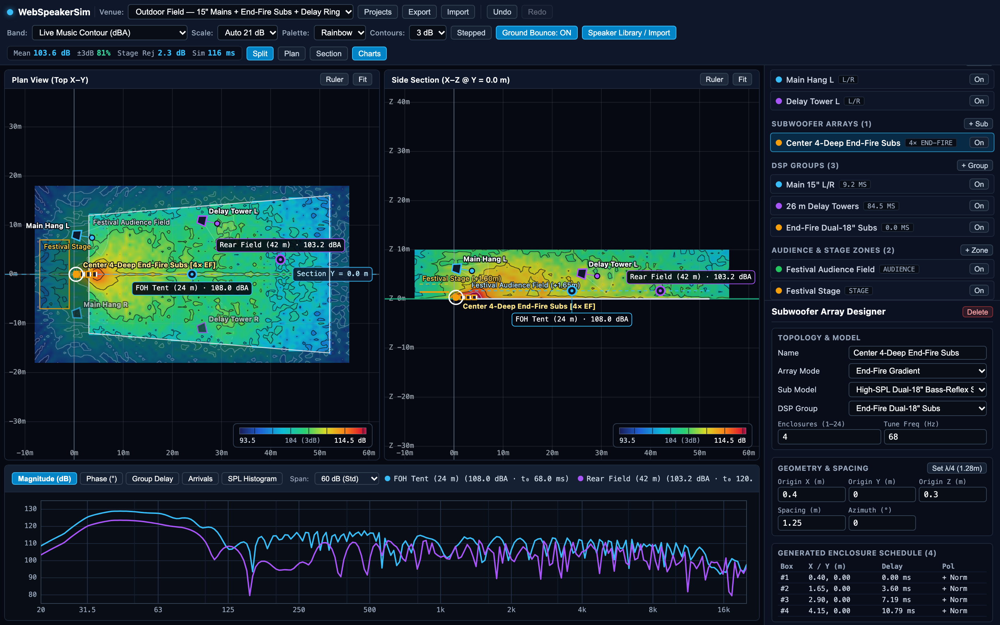
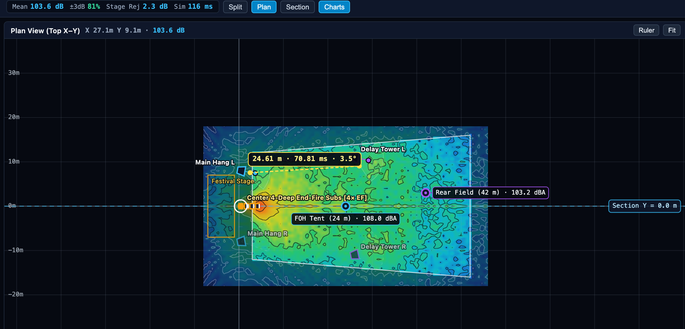

# Tutorial 06: Custom Multi-Zone Venues, End-Fire Subs & Delay Rings (`WebSpeakerSim`)

Beyond small standing clubs, real-world productions span multi-tier raked theaters with overhanging balconies and `50 m+` outdoor festival fields requiring end-fire subwoofer arrays and time-aligned delay towers. This tutorial covers building custom multi-zone venues from scratch and designing long-throw outdoor systems in **WebSpeakerSim** (`http://localhost:5174`).

---

## 1. Sizing Venue Grid Bounds & Building Multi-Zone Seating from Scratch

Every venue in **WebSpeakerSim** is built from two foundational ingredients: **Venue Grid Bounds** (the simulated 3D volume) and **Audience / Stage Zones** (trapezoidal flat, raked, or elevated listening planes).

1. Click **`Atmosphere, Colormap & Venue Bounds`** at the bottom of the right-hand **Scene Tree**:
   - Under **`Venue Grid Bounds & Section Slice (m)`**, enter your room or field dimensions: **`X Min`** (upstage wall, e.g. `-5 m`), **`X Max`** (rear wall, e.g. `28 m`), **`Y Min` / `Y Max`** (side walls, e.g. `-10` to `+10 m`), and **`Ceiling Z Max`** (`10 m`).
   - Double-click inside **Plan View** and **Side Section** (or click **`Fit`** in each viewport header) to frame the updated grid.
2. **Creating Stage, Raked Orchestra & Overhanging Balcony Zones (`+ Zone`):**
   - Load **`Raked Auditorium & Balcony — Multi-Tier Point Sources`** in the **`Venue`** dropdown (or click **`+ Zone`** under **Audience & Stage Zones** to add surfaces manually) and select **`Upper Balcony Tier`**:
     - **`Role`:** Set to **`Audience`** for seating areas (included in `Mean`, `±3dB`, and `SPL Histogram`) or **`Stage`** for the performance deck (`Stage Rej`).
     - **Splayed Trapezoid Widths:** Set **`Width Start (m)`** (`17 m`) and **`Width End (m)`** (`18 m`) around **`Y Center (m)`** (`0 m`) to model fan-shaped auditoriums.
     - **Sloped Rakes & Elevated Balconies:** Set **`Deck Z Start (m)`** and **`Deck Z End (m)`**—for example, `Raked Orchestra Seating` rises from `0.0 m` at `X = 2 m` to `2.6 m` at `X = 24 m`, while `Upper Balcony Tier` overhangs `X = 15–26 m` with deck height rising from **`4.8 m` to `7.0 m`**. Adding **`Ear Height (m)`** (`1.20 m` seated) places balcony listener ears at **`6.0–8.2 m`** (`cyan` dashed ear-line in Side Section).
     - **Overhang Priority:** Where an elevated balcony overhangs the rear orchestra in **Plan View**, WebSpeakerSim displays the highest active audience surface at `(X, Y)`, while **Side Section** slices cleanly through both tiers at **`Slice Y (m)`** (`3.5 m`).

> **Electronic Delay Arc Subwoofers in Wide Theaters:** Notice **`Under-Stage Delay Arc Subs`** (`6×` 18" cabinets in **`Electronic Delay Arc`** mode, `85°` arc angle) under the theater stage. By applying progressive convex electronic delays to the outer pairs, a straight under-stage broadside line widens horizontal low-frequency coverage smoothly across splayed seating without narrowing into a tight center "power alley."

---

## 2. Outdoor Festival Design: End-Fire Subs & `26 m` Delay Towers

Switch **`Venue`** in the top bar to **`Outdoor Field — 15" Mains + End-Fire Subs + Delay Ring`** (`55 m × 30 m` festival field, `26 °C`, `45% RH`).

### How the `4`-Deep End-Fire Subwoofer Array Works
Select **`Center 4-Deep End-Fire Subs`** under **Subwoofer Arrays** (`Array Mode: End-Fire`, `4` dual-18" enclosures spaced `1.25 m` front-to-back along `+X`, tuned to `68 Hz`):
- Unlike a `CSA` stack (which flips rear cabinets backward), **every cabinet in an End-Fire line faces forward (`+X`)** with normal polarity (`+ Norm`).
- **WebSpeakerSim** applies progressive electronic delay $\tau_k = k \cdot d / c$ from the rear box (`0.00 ms` at `X = -1.48 m`) forward to the front box (`10.80 ms` at `X = +2.28 m`) so each rear wave catches up and **sums coherently in phase toward the field (`+X`)**, while spreading arrivals backward onto the stage into multi-tap comb cancellation (`Stage Rej` stays positive even with `4` dual-18" boxes on the downstage lip).

---

## 3. Checking Throw & Delay Ring Timing with the Acoustic Ruler (`Shift + Drag`)

On a `52 m` field, inverse-square spreading ($-6\text{ dB}$ per distance doubling) plus `26 °C` high-frequency air absorption (`ISO 9613-1`) causes main hangs alone to drop more than `14 dB` from front barrier to the rear field. Adding **`Delay Tower L / R`** at **`X = 26 m`** restores rear-field vocal intelligibility and brings broadband `±3 dB` evenness to **`81%`**.

1. **Quick Geometric Flight-Time Check (`Shift + Drag` Ruler):**
   - Switch layout to **`Plan`** (key **`2`**) or use **Split** view, hold **`Shift`**, and drag from **`Main Hang L`** (`X = 0.5 m, Y = 8.0 m`) out to **`Delay Tower L`** (`X = 26 m, Y = 11 m`) or **`Rear Field (42 m)`**:
   - The live yellow ruler overlay reports both **3D/2D distance (`m`)** and **acoustic flight time (`ms`)** at the current atmospheric speed of sound ($c = 346.9\text{ m/s}$ at `26 °C`).

2. **Exact Phase Alignment at the Hand-Off Mic:**
   - Select **`Rear Field (42 m)`** under **Virtual Mics**, set **`Reference`** to **`Main 15" L/R`** (including its `9.2 ms` end-fire sub alignment delay) and **`Target`** to **`26 m Delay Towers`**, and click **`Apply Delay & Polarity`** (`~84.5 ms` total electronic delay—combining the `~75 ms` air flight delta from mains to the delay mast plus the mains' `9.2 ms` base delay so arrivals lock coherently in the overlap zone).

---

*Return to the [FOH Tutorial Index](./README.md).*

