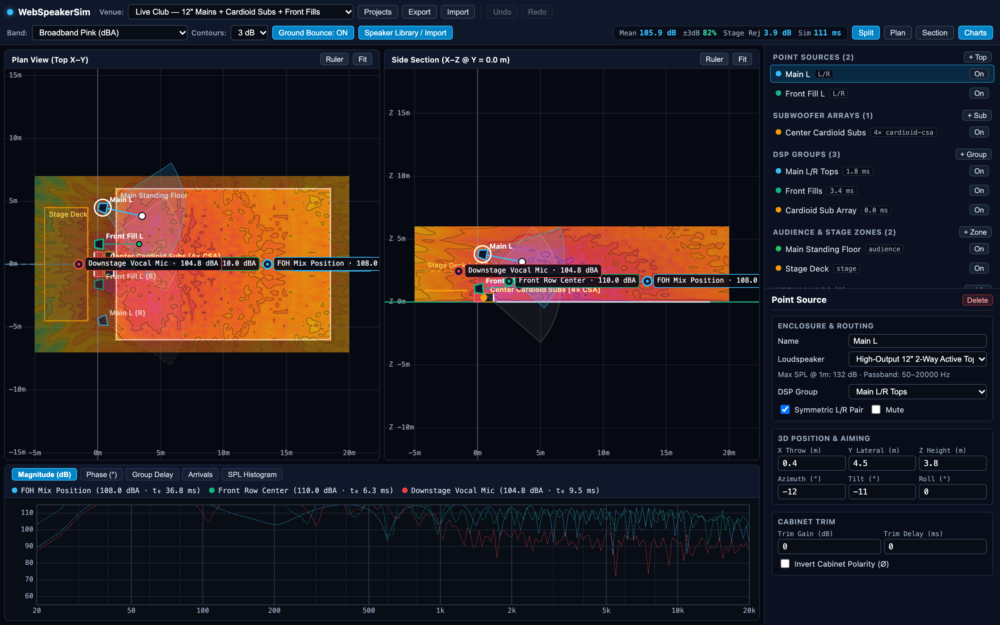
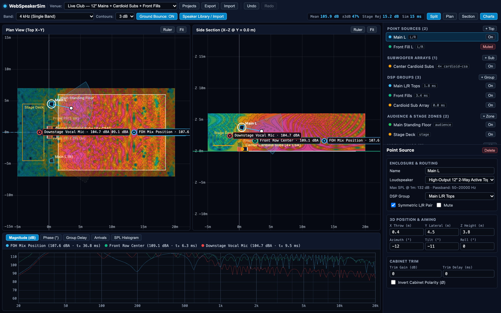
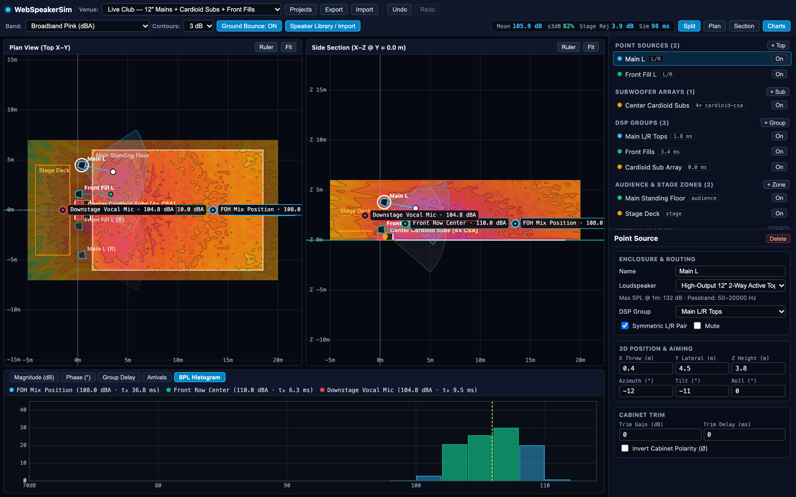
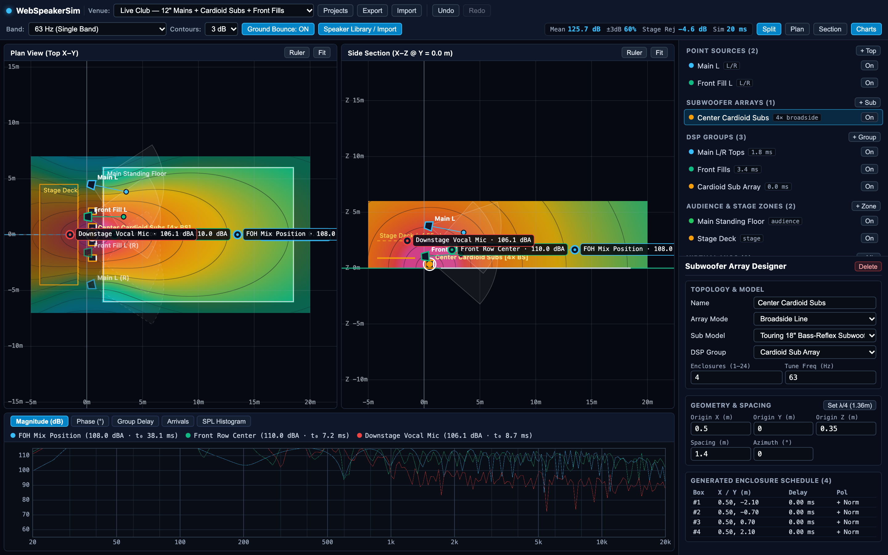
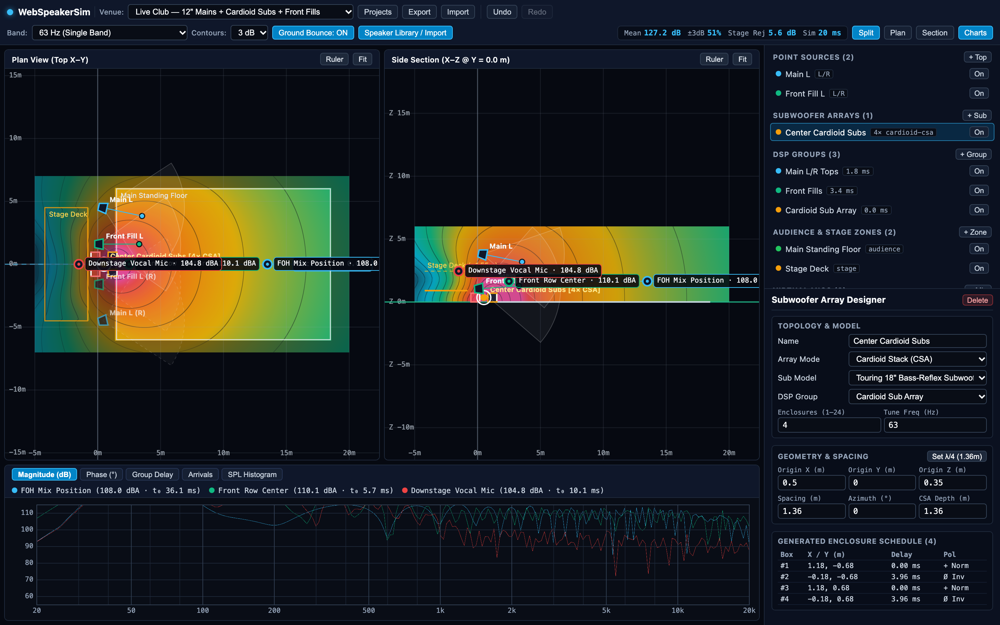
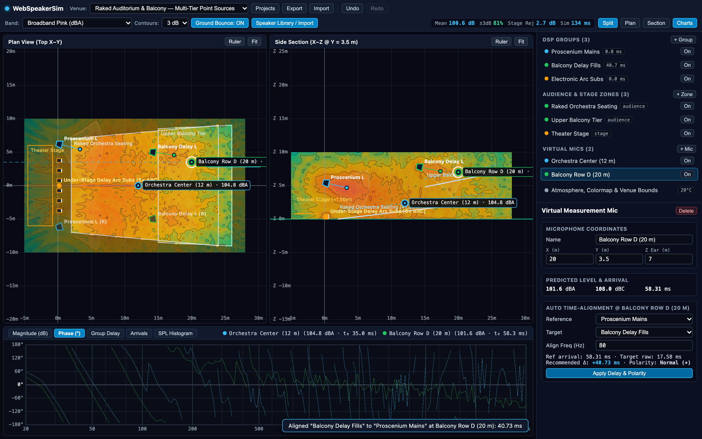
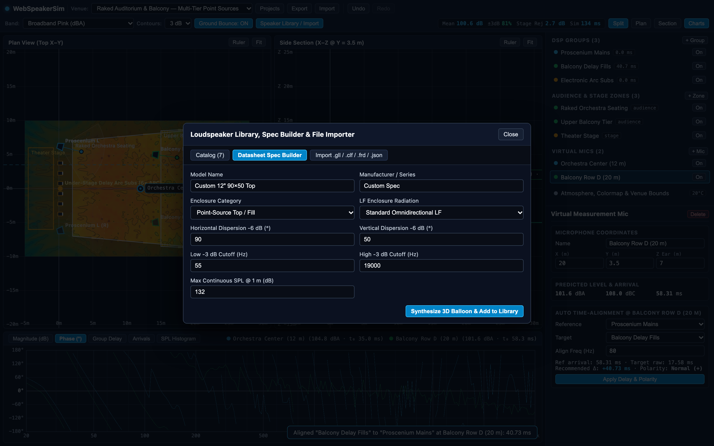

# WebSpeakerSim — User Guide & Step-by-Step Tutorials

Welcome to **WebSpeakerSim**! This guide walks you from the basics of navigating the interface and 3D room coordinates through four everyday live-sound design workflows:

1. **[Getting Started & Workspace Tour](#1-getting-started--workspace-tour)** — Launching the app, reading SPL heatmaps, and understanding room coordinates.
2. **[Tutorial 1: Aiming Mains & Filling the Front Row](#2-tutorial-1-aiming-mains--filling-the-front-row)** — Placing L/R tops, spotting high-frequency coverage gaps, and checking coverage evenness.
3. **[Tutorial 2: Keeping Bass Off the Stage with a Cardioid Sub Array](#3-tutorial-2-keeping-bass-off-the-stage-with-a-cardioid-sub-array)** — Comparing a standard broadside sub line against a quarter-wave Cardioid Stack (`CSA`) at `63 Hz`.
4. **[Tutorial 3: Time- & Phase-Aligning Speakers with Virtual Mics](#4-tutorial-3-time---phase-aligning-speakers-with-virtual-mics)** — Delaying balcony/delay fills or subwoofers to match main PA arrival times in one click.
5. **[Tutorial 4: Adding Your Own Speakers & Saving Projects](#5-tutorial-4-adding-your-own-speakers--saving-projects)** — Building enclosures from a PDF datasheet, importing `.gll` / `.clf` / `.frd` files, and exporting `.wss-project.json` bundles.
6. **[Quick Reference: Mouse Gestures & Keyboard Shortcuts](#6-quick-reference-mouse-gestures--keyboard-shortcuts)**

---

## 1. Getting Started & Workspace Tour

Start the local web app from the project folder:

```bash
npm install
npm run dev
```

Open the local URL printed in your terminal (typically `http://localhost:5173`). WebSpeakerSim opens immediately with the **Live Club — 12" Mains + Cardioid Subs + Front Fills** venue loaded and simulated.



### The Four Main Areas

1. **Top Control Bar:**
   - **Venue Preset & Project Controls (`Venue`, `Projects`, `Export`, `Import`, `Undo`, `Redo`):** Switch between built-in example venues, save named scenes inside your browser, or export/import portable `.wss-project.json` files.
   - **Acoustic Analysis Controls (`Band`, `Contours`, `Ground Bounce`):**
     - **Band:** Choose what the heatmap displays—broadband pink noise (`dBA`, `dBC`, `dBZ`), a live-music spectral contour, the subwoofer passband (`31.5–100 Hz`), or any single octave band (`31.5 Hz` up to `16 kHz`).
     - **Contours:** Draw `3 dB` or `6 dB` equal-level contour lines over the heatmap so you can judge drop-off even without relying on color alone.
     - **Ground Bounce:** Toggle the 1st-order floor reflection (`Z = 0 m`) on or off to hear/see the effect of half-space subwoofer loading and floor comb filtering.
   - **Live Coverage Readout (`Mean`, `±3dB`, `Stage Rej`, `Sim`):**
     - **Mean:** Average predicted SPL across all active audience zones.
     - **±3dB:** Percentage of the audience listening area that falls within `±3 dB` of the average level (higher = smoother front-to-back and side-to-side coverage; `75%+` is highlighted in green).
     - **Stage Rej:** Difference in dB between average audience SPL and average stage SPL (higher positive numbers mean quieter stage wash).
   - **View Switcher (`Split`, `Plan`, `Section`, `Charts`):** Focus on a single viewport or view Top + Side + Charts side by side.

2. **Center Viewports (`Plan View` & `Side Section`):**
   - **Plan View (Top `X–Y`):** Looks straight down on the venue from above, calculating SPL at listener ear height across each audience/stage zone.
   - **Side Section (`X–Z`):** Slices vertically through the venue from stage to back wall at a chosen lateral position (`Y` slice, shown as a cyan dashed line in Plan View) so you can aim vertical tilt angles onto raked seating and balconies.

3. **Right Dock (Scene Tree + Property Inspector):**
   - **Top half (Scene Tree):** Lists every **Point Source**, **Subwoofer Array**, **DSP Group**, **Audience / Stage Zone**, and **Virtual Mic**, plus **Atmosphere, Colormap & Venue Bounds**. Click `On`/`Muted` to solo or mute items quickly, or click `+ Top`, `+ Sub`, `+ Group`, `+ Zone`, or `+ Mic` to add new ones.
   - **Bottom half (Inspector):** Displays editable coordinates, aiming angles, subwoofer array calculators, crossovers/EQ, or alignment tools for whichever item is currently selected.

4. **Bottom Chart Drawer:**
   - Displays predicted responses at every active **Virtual Microphone** (`Magnitude (dB)`, `Phase (°)`, `Group Delay`, and `Arrivals`), plus the venue-wide **`SPL Histogram`**.

### Understanding the 3D Room Coordinates

WebSpeakerSim uses a consistent right-handed metric coordinate system measured in **meters (`m`)**:

| Axis | Direction | Typical Reference (`0 m`) |
| :--- | :--- | :--- |
| **`X` (Throw)** | `+X` points from the stage toward the audience / FOH (`-X` is upstage) | Downstage edge / PA line (`X = 0 m`) |
| **`Y` (Lateral)** | `+Y` is **Stage Left** (top of Plan View); `-Y` is **Stage Right** (bottom of Plan View) | Room centerline (`Y = 0 m`) |
| **`Z` (Height)** | `+Z` points straight up toward the ceiling | Venue main floor (`Z = 0 m`) |

> **Aiming sign tip:** For **Tilt**, negative angles (`-10°`) tilt a flown cabinet **downward** toward the floor. For **Azimuth** on a Stage-Left (`+Y`) cabinet, negative angles (`-12°`) toe the cabinet **inward** toward the room centerline. When **Symmetric L/R Pair** is checked, WebSpeakerSim automatically mirrors `Y` and `Azimuth` for the opposite side!

---

## 2. Tutorial 1: Aiming Mains & Filling the Front Row

**Scenario:** You are flying a Left/Right pair of 12" 2-way tops (`90° × 60°`) at `3.8 m` height, `9 m` apart (`Y = ±4.5 m`) for an `18 m × 12 m` club floor. You want even high-frequency vocal clarity from the front barrier all the way to FOH.

### Step 1: Check High-Frequency Horn Coverage on Its Own

 Low frequencies wrap wide around speaker cabinets, so broadband heatmaps can hide high-frequency dead spots. Always check aiming at **`2 kHz` or `4 kHz`** first:

1. In the top bar, set **Venue** to `Live Club — 12" Mains + Cardioid Subs + Front Fills`.
2. Change **Band** to **`4 kHz (Single Band)`**.
3. In the right-hand **Point Sources** list, click **`On`** next to `Front Fill L` so it switches to **`Muted`**.
4. Click **`Main L`** in the list (or click the speaker icon in Plan View) to inspect its aiming cone and controls.



Look at two clues right away:
- Right in front of the stage around `Front Row Center` (`X = 2–4 m, Y = 0 m`), listeners sit outside both main horns, creating a noticeable center dip while the `±3dB` evenness score drops to **`47%`**.
- Notice the white circular **aim handle** out in front of `Main L` in both Plan View and Side Section: you can **drag that white dot directly** in Plan View to pan azimuth, or drag it in Side Section to aim vertical tilt!

### Step 2: Aim the Mains & Bring In Stage-Lip Front Fills

1. With **`Main L`** selected, verify **Symmetric L/R Pair** is checked—any position or angle tweak you make to `Main L` automatically updates `Main L (R)` in mirror symmetry.
2. Adjust **Z Height** (`3.8 m`), **Azimuth** (`-12°` inward toe-in), and **Tilt** (`-11°` aiming roughly two-thirds of the way back into the room so louder near-field off-axis energy balances distance loss toward the back).
3. Unmute **`Front Fill L`** (click **`Muted`** $\rightarrow$ **`On`**) to cover the near-field center gap with compact 8" cabinets sitting on the stage lip (`Z = 1.05 m`, `Tilt = -4°`).
4. Switch **Band** back to **`Broadband Pink (dBA)`** and click the **`SPL Histogram`** tab in the bottom chart drawer.



The **SPL Histogram** shows a tight green cluster centered around `105.9 dBA`, and **`±3dB`** jumps up to **`82%`** across the entire standing floor!

---

## 3. Tutorial 2: Keeping Bass Off the Stage with a Cardioid Sub Array

**Scenario:** Four 18" subwoofers are stacked on the floor in front of the stage. A single subwoofer radiates omnidirectionally at `63 Hz`, washing the stage deck in boomy low end and causing vocal/drum mic feedback. Let's turn that 4-box line into a directional **Cardioid Stack (`CSA`)**.

### Step 1: Observe Stage Wash with a Standard Broadside Line

1. Load `Live Club — 12" Mains + Cardioid Subs + Front Fills` and set **Band** to **`63 Hz (Single Band)`**.
2. *(Optional visual tip)* When viewing a full-output single sub frequency on a multi-sub array, click **Atmosphere, Colormap & Venue Bounds** at the bottom of the scene tree and set **Min / Max SPL** to `102` and `138 dB` so the full dynamic range maps cleanly across blue–green–orange–red.
3. Click **`Center Cardioid Subs`** under **Subwoofer Arrays** in the scene tree.
4. Change **Array Mode** to **`Broadside Line`**.



Look at what happens in **Broadside Line** mode:
- Both Plan View and Side Section show bright orange/red `63 Hz` energy blasting **backward across the `Stage Deck`** just as hard as it goes forward!
- In the top bar, **`Stage Rej`** reads **`-4.6 dB`**—meaning the stage is actually `4.6 dB` *louder* on average than the audience floor because the stage is right behind the subs.

### Step 2: Switch to Cardioid Stack (`CSA`) & Set Quarter-Wave Spacing

1. In the **Subwoofer Array Designer** inspector on the right, change **Array Mode** from `Broadside Line` to **`Cardioid Stack (CSA)`**.
2. Set **Tune Freq (Hz)** to **`63`**.
3. Click the **`Set λ/4 (1.36m)`** button in the **Geometry & Spacing** header.



Compare the result immediately:
- The **`Stage Deck`** turns cool **blue/teal** in both Plan View and Side Section!
- **`Stage Rej`** swings from `-4.6 dB` to **`+5.6 dB`** (over **`10 dB` cleaner on stage**), while forward audience average SPL actually *increases* from `125.7 dB` to **`127.2 dB`**!
- Look at the red trace (`Downstage Vocal Mic`) in the bottom **Magnitude (dB)** chart: there is now a deep cardioid cancellation notch right around `55–70 Hz`.
- Scroll down to **Generated Enclosure Schedule (4)** at the bottom-right to read your exact real-world patch sheet for the amplifier rack:
  - Boxes `#1` & `#3` (front pair): **`0.00 ms` delay, `+ Norm` polarity**
  - Boxes `#2` & `#4` (rear pair): **`3.96 ms` delay, `Ø Inv` (inverted) polarity**

> **Other Sub Array Modes to Explore:** Try **`End-Fire Gradient`** (all cabinets facing forward in deep front-to-back lines delayed progressively) for maximum narrow-stage punch, or **`Electronic Delay Arc`** (widening horizontal bass coverage smoothly across wide festival stages without physical curved stacking).

---

## 4. Tutorial 3: Time- & Phase-Aligning Speakers with Virtual Mics

**Scenario:** In a multi-tier theater or deep outdoor venue, delay fills sit much closer to back-row listeners than the main PA. Without electronic delay on those fills, listeners hear the fill `30–40 ms` *before* the main PA (ruining localization toward the stage and causing comb filtering).

### Step 1: Select a Venue & Inspect Virtual Mic Arrivals

1. In the top bar **Venue** dropdown, choose **`Raked Auditorium & Balcony — Multi-Tier Point Sources`**.
   - Notice in **Side Section** how the audience seating slopes upward (`Raked Orchestra Seating`) and includes an elevated **`Upper Balcony Tier`** (`Z = 5.2 m` to `7.4 m`) covered by **`Balcony Delay L / R`** hangs at `X = 14 m`.
2. In the bottom chart drawer, click **`Phase (°)`** (or **`Arrivals`** to see individual speaker impulse stems over time).
3. In the right-hand **Virtual Mics** list, click **`Balcony Row D (20 m)`**.

### Step 2: Run One-Click Auto Time-Alignment

With **`Balcony Row D (20 m)`** selected, look at the **Virtual Measurement Mic** inspector in the bottom-right corner:

1. Check **Predicted Level & Arrival** (`101.6 dBA`, `108.0 dBC`, earliest arrival `58.31 ms`).
2. Under **Auto Time-Alignment @ Balcony Row D (20 m)**:
   - Set **Reference** to **`Proscenium Mains`** (the main stage PA we want sound to localize to).
   - Set **Target** to **`Balcony Delay Fills`** (the closer fill group that needs electronic delay).
   - Set **Align Freq (Hz)** to your crossover or vocal handoff frequency (e.g., `80 Hz` for sub/top crossovers, or `1000 Hz` for full-range delay rings).
3. Read the live calculation (`Ref arrival: 58.31 ms · Target raw: 17.58 ms · Recommended Δ: +40.73 ms`) and click **`Apply Delay & Polarity`**.



WebSpeakerSim automatically writes **`40.73 ms`** (and optimal polarity) directly into the **`Balcony Delay Fills`** DSP Group!

### Step 3: Fine-Tune Crossovers & EQ on Any DSP Group

To shape crossovers or room/voicing EQ for any speaker group:
1. Click a group under **DSP Groups** in the scene tree (for example, `Proscenium Mains` or `Cardioid Sub Array`).
2. Choose **HPF Slope** / **LPF Slope** (`LR24`, `LR48`, `BW24`, etc.) and cutoff frequencies (such as `80 Hz LR24` high-pass on Tops and `80 Hz LR24` low-pass on Subs).
3. Click **`+ Add Band`** under **Parametric EQ** to add up to 8 bell, low-shelf, high-shelf, notch, or 2nd-order all-pass phase filters—watching the Virtual Mic **Magnitude** and **Phase** traces update live!

---

## 5. Tutorial 4: Adding Your Own Speakers & Saving Projects

When you want to simulate specific cabinets from your own inventory, click **`Speaker Library / Import`** in the top bar (or press **`L`**).



### Option A: Quick Entry from Any PDF Datasheet (`Datasheet Spec Builder`)

Even if you only have a manufacturer's 1-page spec sheet, you can build a calibrated 3D directivity model in seconds:
1. Open **`Speaker Library / Import`** $\rightarrow$ **`Datasheet Spec Builder`**.
2. Enter the **Model Name**, choose **Point-Source Top / Fill** or **Subwoofer Enclosure**, and fill in:
   - **Horizontal & Vertical Dispersion (`-6 dB °`):** e.g., `90° × 50°` or `60° × 40°`
   - **Low & High `-3 dB` Cutoff (`Hz`):** e.g., `55 Hz` to `19000 Hz`
   - **Max Continuous SPL @ 1 m (`dB`):** e.g., `132 dB`
3. Click **`Synthesize 3D Balloon & Add to Library`**. Your custom cabinet is now selectable in every Point Source or Subwoofer Array dropdown!

### Option B: Importing `.gll`, `.clf`, `.frd`, or `.json` Files

1. Switch to the **`Import .gll / .clf / .frd / .json`** tab.
2. Drag and drop (or click to browse) loudspeaker data files from your computer:
   - **`.gll`** — Binary loudspeaker container files downloaded from manufacturer product pages.
   - **`.clf` / `.tab`** — Text-based horizontal/vertical polar dispersion tables.
   - **`.frd` / `.csv`** — Measured frequency/magnitude/phase curves (`FreqHz MagDb [PhaseDeg]`).
   - **`.wss-speaker.json`** — Previously exported WebSpeakerSim speaker definitions.
3. Imported speakers are saved automatically in your browser's local `IndexedDB` catalog so they remain available across future sessions—even offline.

### Saving, Restoring & Sharing Venue Designs

- **Automatic Crash/Reload Recovery:** Every change you make is automatically saved locally within `250 ms`. Refreshing the browser picks up right where you left off.
- **Browser Project Slots (`Projects` button):** Click **`Projects`** in the top bar to save multiple named venue setups inside your browser and switch between them anytime.
- **Portable File Sharing (`Export` / `Import` buttons):** Click **`Export`** to download a self-contained `.wss-project.json` file (which bundles your room geometry, speaker placements, DSP settings, **and** any custom/imported speakers used in the scene) to back up or send to a colleague.

---

## 6. Quick Reference: Mouse Gestures & Keyboard Shortcuts

### Viewport Mouse & Trackpad Controls

| Gesture | Action |
| :--- | :--- |
| **Click** speaker / sub array / mic | Select item and open its Property Inspector |
| **Drag** speaker / sub array / mic body | Move its 3D position in Plan (`X–Y`) or Section (`X–Z`) |
| **Drag** white circular aim handle | Aim horizontal **Azimuth** (in Plan) or vertical **Tilt** (in Section) |
| **Drag** cyan dashed centerline (`Plan View`) | Move the `Y` lateral slice position shown in **Side Section** |
| **Scroll wheel / two-finger pinch** | Zoom viewport in/out around the cursor |
| **Middle-drag** / **`Space` + drag** / **drag empty space** | Pan viewport camera |
| **`Ruler` button + drag** | Measure exact distance (`m`) and acoustic flight time (`ms`) between any two points |
| **`Fit` button** | Re-center and zoom viewport to fit the whole venue |

### Keyboard Shortcuts

| Shortcut | Action |
| :--- | :--- |
| `Cmd / Ctrl + Z` | Undo last edit |
| `Cmd / Ctrl + Shift + Z` or `Ctrl + Y` | Redo edit |
| `P` | Add a new Point-Source Loudspeaker |
| `S` | Add a new Subwoofer Array |
| `M` | Add a new Virtual Measurement Microphone |
| `G` | Toggle 1st-Order Ground Bounce (`ON` / `OFF`) |
| `L` | Open Loudspeaker Library, Spec Builder & File Importer |
| `1` / `2` / `3` | Switch Viewport Layout (`Split` / `Plan` / `Section`) |
| `Escape` | Close open modal or clear selection |
